# BÁO CÁO ĐỒ ÁN TỐT NGHIỆP

## Ứng dụng di động kết nối lao động phổ thông và chủ thầu ThoXay

Ngày chốt số liệu: **30/10/2026**, múi giờ Việt Nam. Nhánh **main**, checkpoint mã nguồn **94e3c693f17a603d56c11f77070e03e8fb6fc679**. Báo cáo mô tả phiên bản đã thực thi và bằng chứng kiểm thử, không sử dụng số liệu người dùng hoặc giao dịch thật để minh họa.

## Tóm tắt

ThoXay kết nối Thợ, Chủ thầu và Admin trong quy trình tìm việc theo vị trí, tuyển dụng có cam kết, quản lý ca làm, nghiệm thu ảnh, đánh giá và thanh toán nội bộ. Flutter chia sẻ mã nguồn Android/Web. Spring Boot cung cấp REST/WebSocket và Thymeleaf Admin. PostgreSQL lưu dữ liệu, Flyway quản lý nâng cấp. Vercel phục vụ Web, Render chạy Backend/Admin và database, GitHub Actions kiểm thử và tạo APK.

| Chỉ tiêu kiểm kê | Giá trị |
| --- | --- |
| Bảng nghiệp vụ / cột | 30 / 256 |
| Bảng kỹ thuật Flyway | 1, không tính trong 30 bảng nghiệp vụ |
| Controller / ánh xạ HTTP | 28 / 111 |
| REST dưới /api/ / route khác | 90 / 21 |
| Tệp Java sản xuất / Dart lib / màn hình Flutter | 162 / 92 / 22 |
| Template Thymeleaf | 9 |
| Kiểm thử thành công | 125 Backend + 110 Flutter + 12 JS; thêm 6 test bảo vệ seed Python |
| Mốc trước đợt hoàn thiện | 125 Backend + 108 Flutter + 12 JS; tăng 2 regression test Flutter |

## Phương pháp và giới hạn số liệu

PROJECT_INVENTORY.json được tạo bằng truy vấn chỉ đọc catalog PostgreSQL sau Flyway V21 và quét annotation controller trong Java. Một cặp HTTP method và đường dẫn cụ thể được tính là một endpoint. Alias health được tính riêng. Bộ đếm không tính handler mặc định của Spring, WebSocket hoặc filter đăng nhập form. Bảng user_skills và user_project_images là collection table JPA. Các kiểm thử báo cáo là số test thực chạy, không phải tỷ lệ bao phủ mã nguồn. Các ảnh DEMO và số dư minh họa không chứng minh danh tính hoặc doanh thu thực tế.

## Mục lục

1. Tổng quan đề tài
2. Công nghệ sử dụng
3. Phân tích và thiết kế hệ thống
4. Triển khai và kiểm thử
5. Kết luận và hướng phát triển
6. Tài liệu đối chiếu

# Chương 1. Tổng quan đề tài

## 1.1. Lý do chọn đề tài

Nhu cầu tuyển thợ xây dựng thường gắn với địa điểm thi công, thời gian và số lượng lao động cụ thể. Khi thông tin được trao đổi phân tán qua điện thoại hoặc người quen, người thợ khó so sánh cơ hội việc làm quanh vị trí của mình; chủ thầu khó tổng hợp ứng viên và theo dõi kết quả tuyển dụng. Việc thiếu lịch sử làm việc và cơ chế ghi nhận đánh giá cũng làm giảm khả năng tham khảo thông tin trước khi hợp tác.

Đề tài xây dựng một ứng dụng tập trung hóa các thao tác trên: thể hiện địa điểm bằng bản đồ, công khai mức lương theo ngày, quản lý trạng thái ứng tuyển và lưu lịch sử trao đổi. Hồ sơ CCCD, đánh giá sao, điểm uy tín và quy trình đối soát ví bổ sung các căn cứ quản lý trong phạm vi ứng dụng. Đây là động cơ và bài toán thiết kế của đồ án; mã nguồn không chứa khảo sát thị trường để định lượng mức độ phổ biến hoặc tỷ lệ cải thiện so với cách tuyển dụng truyền thống.

## 1.2. Mục tiêu

- Xây dựng Backend có xác thực, phân quyền và kiểm tra quyền sở hữu dữ liệu cho ba vai trò.
- Hỗ trợ thợ tìm công trình theo GPS, bán kính, loại việc và mức lương; hỗ trợ chủ thầu đăng tuyển và duyệt ứng viên.
- Khép kín quy trình hợp tác bằng liên lạc sau khi được nhận, hoàn thành công trình và đánh giá thợ.
- Quản lý hồ sơ mở rộng, CCCD hai mặt, điểm uy tín, bậc thợ và lịch sử thông báo.
- Hỗ trợ tổ đội thực, cam kết điện tử, thương lượng lương, lịch chống trùng, chấm công và nghiệm thu ảnh.
- Tiếp nhận sự cố/SOS ưu tiên, quản lý bộ sưu tập tay nghề, mục yêu thích, chia sẻ công trình và thời tiết.
- Cung cấp sổ ví VND nội bộ, ký quỹ, yêu cầu nạp/rút chờ Admin và thống kê thu nhập đã thanh toán.
- Tạo được bản Web và APK có thể sử dụng Backend online; duy trì kiểm thử và checkpoint GitHub.

## 1.3. Phạm vi

Đối tượng công việc hiện được giới hạn ở **Thợ chính** và **Phụ hồ**. Một tài khoản giữ một vai trò trong ba vai trò của hệ thống. Hai vai trò thợ và chủ thầu được đăng ký công khai; Admin được cấp quyền bằng quy trình quản trị, không qua form đăng ký công khai.

Sản phẩm đã có giao diện Android/Flutter Web và Web Admin, Backend REST/WebSocket, PostgreSQL, Dockerfile, migration và các workflow CI. Những thư mục nền tảng Flutter khác không đồng nghĩa với việc đã phát hành hoặc nghiệm thu iOS/desktop. Phạm vi báo cáo sử dụng bằng chứng build Android và Web hiện có.

Các giới hạn nghiệp vụ cần phân biệt:

- Kiểm tra ảnh CCCD tự động chỉ kiểm tra tệp, kích thước và chuẩn hóa ảnh; **Admin duyệt danh tính**, chưa có OCR/eKYC hoặc đối soát dân cư.
- Ví là **sổ số dư nội bộ**; nạp/rút đối soát thủ công, chưa có cổng thanh toán hoặc API ngân hàng tự chuyển tiền.
- Ký quỹ dưới 200.000đ phát cảnh báo; chưa chặn nhận việc, chưa thu phạt tiền và chưa khóa ký quỹ theo từng công trình.
- GPS dùng làm tâm tìm việc và kiểm tra chấm công trong bán kính 200m; chưa theo dõi vị trí thợ liên tục hoặc tự điều phối cuốc việc.
- Push FCM có mã tích hợp nhưng cần Firebase riêng; bản demo tắt FCM. Lịch sử thông báo vẫn được lưu và đọc qua API.

## 1.4. Ba nhóm người sử dụng

| Nhóm | Nhu cầu chính | Giao diện sử dụng |
| --- | --- | --- |
| Thợ | Tìm việc phù hợp vị trí, ứng tuyển, trao đổi, theo dõi hồ sơ, uy tín và thu nhập | Flutter Android/Web, tông cam `#EA580C` |
| Chủ thầu | Đăng công trình, tuyển thợ, theo dõi ứng viên, chốt đánh giá và thanh toán | Flutter Android/Web, tông xanh lục bảo `#059669` |
| Admin | Duyệt CCCD, quản lý hoạt động tài khoản/công trình, đối soát nạp/rút | Thymeleaf/Bootstrap, nền Navy `#0F172A`, sidebar `#1E293B`, nhấn `#3B82F6` |

## 1.5. Phương pháp thực hiện và đánh giá

Hệ thống phân chia trách nhiệm theo controller → service → repository → PostgreSQL. DTO kiểm soát dữ liệu vào/ra; transaction và khóa ghi bảo vệ các nghiệp vụ duyệt, chốt sao, hủy và chuyển số dư. Kiểm thử Backend xác nhận HTTP, quyền truy cập, dữ liệu và một số tình huống cạnh tranh; kiểm thử Flutter xác nhận xử lý API, trạng thái và tương tác widget. Kết quả được đánh giá bằng những ca kiểm thử, bản build và cấu hình triển khai có thể đối chiếu, không suy diễn thành số liệu khảo sát người dùng.

<a id="chuong-2"></a>

# Chương 2. Công nghệ sử dụng

## 2.1. Backend và cơ sở dữ liệu

Phiên bản khai báo trực tiếp được đọc từ `pom.xml`; phiên bản dependency được Spring Boot quản lý được đối chiếu với các thư viện trong bản JAR đã build. Vì vậy bảng phân biệt rõ cấu hình ngôn ngữ, dependency đã resolve và phiên bản nền tảng không được ghim.

| Công nghệ | Phiên bản/cấu hình kiểm chứng | Vai trò và nguồn |
| --- | --- | --- |
| Java | Target **17**; CI dùng Temurin **17**; image `eclipse-temurin:17-jdk-jammy` và `17-jre-jammy` | Ngôn ngữ Backend; `pom.xml`, `Dockerfile`, workflow APK. Tag image không ghim số patch/digest |
| Maven | **3.9.16**; Maven Wrapper **3.3.4** | Quản lý dependency, test và đóng gói JAR; `.mvn/wrapper/maven-wrapper.properties` |
| Spring Boot | **3.5.16**; ứng dụng Backend **1.0.0** | Khởi tạo ứng dụng, cấu hình, REST/MVC/WebSocket; parent và artifact trong `pom.xml` |
| Spring Framework MVC | **6.2.19**, dependency đã resolve | HTTP controller, multipart và WebSocket; JAR `spring-webmvc` |
| Spring Security | **6.5.11**, dependency đã resolve | REST stateless JWT, form login Admin, CSRF, BCrypt, phân quyền; `SecurityConfig` |
| JWT / JJWT | **0.12.6** cho `jjwt-api`, `jjwt-impl`, `jjwt-jackson` | Ký/kiểm tra JWT bằng khóa HMAC; `JwtUtil`. Không khai báo cứng một thuật toán HS cụ thể trong code |
| Spring Data JPA / Hibernate | Starter JPA thuộc Boot **3.5.16**; Hibernate **6.6.53.Final** đã resolve | Ánh xạ entity, truy vấn và khóa `PESSIMISTIC_WRITE` |
| PostgreSQL | Cloud cấu hình major **17** | Lưu 30 bảng và ảnh CCCD `BYTEA`; `render.yaml`. Không ghim bản patch server trong repository |
| PostgreSQL JDBC | **42.7.11**, dependency đã resolve | Kết nối Java–PostgreSQL; thư viện runtime trong JAR |
| Thymeleaf | **3.1.5.RELEASE**, gồm `thymeleaf-spring6` | Render Admin tại server; 9 template quản trị và đăng nhập |
| Bootstrap | **5.3.8**, CSS/JS lưu trong `static/vendor/bootstrap` | Layout, bảng, badge và modal CCCD; đọc version từ header file |
| Firebase Admin Java | **9.11.0** | Gateway gửi push có điều kiện cấu hình; `pom.xml`, package `notification` |

Các starter Spring Security/JPA/Thymeleaf không có version độc lập được ghi đè trong `pom.xml`; Spring Boot parent quản lý chúng. Các số resolve nêu trên phản ánh bản build đã kiểm chứng, không phải số phiên bản tự suy ra từ tên starter. Cơ sở dữ liệu local mặc định tên `tho_xay_db`; production nhận thông số kết nối từ môi trường/secret file, không dùng mật khẩu local làm cấu hình cloud.

## 2.2. Flutter và các thư viện client

Flutter được ghim **3.47.8** trong `.flutter-version` và workflow APK. SDK local tương ứng sử dụng **Dart 3.13.7**; `pubspec.yaml` cho phép Dart `>=3.13.0 <4.0.0`, Flutter `>=3.47.0`. Phiên bản ứng dụng là **0.1.0+1**. Các số dưới đây là bản đã resolve trong `pubspec.lock`, không phải chỉ cận dưới có dấu `^`.

| Thư viện | Phiên bản resolve | Vai trò |
| --- | --- | --- |
| `http` | 1.6.0 | REST JSON, multipart CCCD, gắn Bearer JWT |
| `shared_preferences` | 2.5.6 | Lưu/khôi phục phiên đăng nhập và dấu phục hồi camera |
| `geolocator` | 14.1.2 | Quyền và tọa độ GPS khi tìm/đăng công trình |
| `flutter_map` | 8.3.2 | Bản đồ OpenStreetMap, ghim và chọn tọa độ |
| `latlong2` | 0.9.1 | Biểu diễn tọa độ cho bản đồ |
| `image_picker` | 1.2.4 | Chụp hai mặt CCCD; chọn tệp khi nền tảng không có camera phù hợp |
| `url_launcher` | 6.3.3 | Mở `tel:` và đường dẫn attribution OpenStreetMap |
| `web_socket_channel` | 3.0.3 | Kênh nhận tin nhắn thời gian thực |
| `firebase_core` | 5.1.0 | Khởi tạo Firebase trên Android/iOS khi có cấu hình |
| `firebase_messaging` | 17.0.1 | Quyền thông báo, đăng ký thiết bị và nhận push |

Giao diện dùng Material 3, locale tiếng Việt và theme theo vai trò. Shimmer được tự xây bằng `AnimationController`/`ShaderMask` trong `loading_jobs.dart`; **không có dependency `shimmer`** trong `pubspec.yaml`. Bản đồ giữ attribution OpenStreetMap và `userAgentPackageName` riêng; test dùng tile provider giả thay vì tải tile thật.

## 2.3. Build, CI/CD và nền tảng triển khai

| Thành phần | Phiên bản/cấu hình thực tế | Chức năng |
| --- | --- | --- |
| Docker | Không ghim Docker Engine; multi-stage Temurin Java 17 trên Ubuntu Jammy | Build bằng Maven `verify`, chạy JRE với user 10001, group bổ sung 1000 và giới hạn heap theo RAM |
| GitHub Actions | Không có số version chung được ghim cho dịch vụ; runner `ubuntu-latest` | Hai workflow: `Build Flutter APK` và `Check cloud deployment` |
| Actions dùng trong repo | `checkout@v7`, `setup-java@v6`, `upload-artifact@v7`, `setup-node@v6`, `subosito/flutter-action@v2` | Checkout, Java 17, Node 24, Flutter 3.47.8, lưu artifact APK 30 ngày; các action ghim theo tag major |
| Node.js | **24** trong workflow; project Vercel dùng **24.x** theo hồ sơ triển khai | Chạy build script Flutter Web, kiểm tra schema/cấu hình và phục vụ Web local |
| Render | SaaS, không có phiên bản sản phẩm được ghim trong repo; **Docker Web Service Free**, Singapore, một instance | Chạy Spring Boot/Admin và Managed Postgres major 17 |
| Vercel | SaaS, không có phiên bản sản phẩm được ghim trong repo; framework `null`/Other | Build và phục vụ Flutter Web từ `mobile_app/build/web` |

Không đồng nhất phiên bản CLI cài riêng trên máy với phiên bản ứng dụng hoặc phiên bản dịch vụ Render/Vercel. `render.yaml` là Blueprint tham khảo; dịch vụ đang chạy được tạo trực tiếp bằng CLI và quản lý môi trường/Secret Files trong Render, theo [hồ sơ triển khai](DEPLOY_VERCEL.md).

### Công nghệ bổ sung trong đợt nâng cấp

Flyway Core và Flyway PostgreSQL dùng version do Spring Boot parent quản lý; script đóng gói thực tế kiểm chứng thư viện trong JAR. mobile_scanner hỗ trợ quét mã ca làm, qr_flutter tạo QR phía client từ payload server. Ảnh được chuẩn hóa bằng Java ImageIO, lưu BYTEA và chỉ trả qua endpoint có kiểm tra quyền. Open-Meteo cung cấp thời tiết tham khảo; cache và timeout nằm trong Backend. Plus Jakarta Sans được đóng gói cùng Flutter theo giấy phép OFL.

Các artifact resolve kiểm chứng từ JAR: `flyway-core-11.7.2.jar`, `flyway-database-postgresql-11.7.2.jar`, `thymeleaf-spring6-3.1.5.RELEASE.jar`, `thymeleaf-3.1.5.RELEASE.jar`, `postgresql-42.7.11.jar`, `jjwt-api-0.12.6.jar`, `spring-security-core-6.5.11.jar`.

<a id="chuong-3"></a>

# Chương 3. Phân tích và thiết kế hệ thống

## 3.1. Yêu cầu chức năng theo vai trò

### Thợ

- Đăng ký/đăng nhập, khôi phục phiên, đổi Sáng/Tối/Outdoor và nhận việc Online/Offline.
- Cập nhật thông tin cá nhân, kinh nghiệm/kỹ năng, chụp CCCD hai mặt, quản lý ảnh tay nghề.
- Tìm công trình theo GPS/Haversine, bán kính và loại thợ, sắp xếp lương, xem bản đồ, lưu/chia sẻ và chỉ đường.
- Ứng tuyển cá nhân hoặc tổ đội đã xác nhận, đề xuất lương, đọc và xác nhận phiên bản cam kết, quản lý lịch bận.
- Liên lạc và chat chữ/ảnh/GPS với chủ thầu khi ACCEPTED, xem hộp thư và tin chưa đọc.
- Chấm công GPS hoặc QR ca làm, chốt ca trong ngày Việt Nam, gửi ảnh cuối ca để nghiệm thu.
- Xem sao, uy tín, bậc và bảng xếp hạng, thu nhập theo ngày/tuần/tháng; nạp/rút/ký quỹ nội bộ.
- Gửi sự cố/SOS, xem phản hồi riêng từ Admin, hủy việc đã nhận với phạt trừ 15 điểm.

### Chủ thầu

- Đăng ký/đăng nhập, cập nhật hồ sơ/CCCD và danh mục ảnh của mình.
- Đăng/sửa công trình còn tuyển, đặt ngày và tọa độ trên bản đồ, chọn số lượng thợ.
- Xem hồ sơ và ảnh tay nghề, lưu thợ quen, quyết định giá gốc/giá thương lượng.
- Duyệt cá nhân/tổ đội nguyên nhóm với khóa giao dịch, đủ công suất, đồng thuận và không trùng lịch.
- Đọc cam kết chốt, liên lạc/chat với người đã nhận, phát QR ca làm, theo dõi chấm công và nghiệm thu ảnh.
- Hoàn thành công trình, chấm sao đúng toàn bộ thợ ACCEPTED, thanh toán ngày công/tip/thưởng từ ví.
- Theo dõi công trình/thời tiết, quản lý ví và gửi sự cố của mình.

### Admin

- Đăng nhập bằng form và phiên, xem KPI tài khoản/công trình/tỷ lệ KYC.
- Lọc/tìm tài khoản, duyệt hai mặt CCCD trong modal và lightbox, chặn duyệt nhầm snapshot đã thay đổi.
- Khóa tài khoản thường, chặn thao tác khóa mọi Admin cả frontend và service.
- Xem công trình/cam kết/chấm công/ảnh tay nghề theo quyền quản trị, xóa công trình và tính lại sao liên quan.
- Đối soát yêu cầu nạp/rút, xem ledger, cấu hình tài khoản nhận VietQR kèm xác nhận/version/audit.
- Xem hàng chờ sự cố ưu tiên SOS, xử lý có ghi chú/version và audit, thông báo kết quả cho người báo.

## 3.2. Sơ đồ Use Case

Mermaid không có cú pháp UML Use Case chuyên dụng. Các flowchart dưới đây biểu diễn tác nhân và nhóm ca sử dụng; đường nối chỉ quan hệ sử dụng, không phải luồng dữ liệu hoặc quan hệ kế thừa.

<!-- diagram:use-case -->
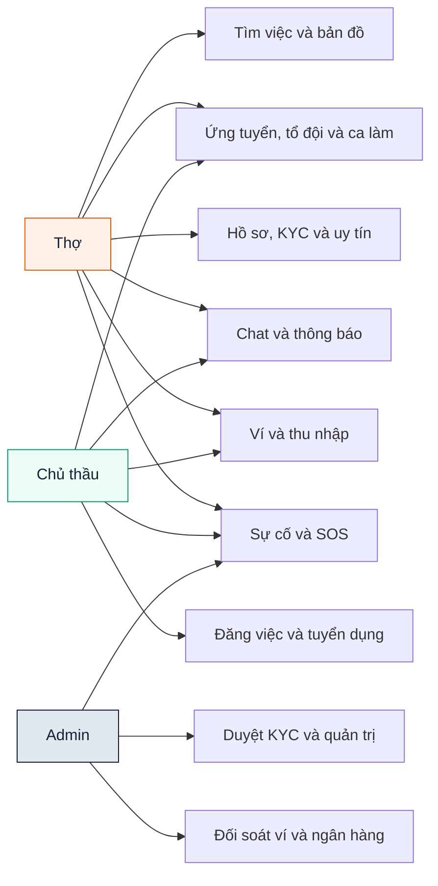

*Hình 3.1. Tác nhân và nhóm chức năng tổng quát*

<!-- diagram:use-case-tho -->
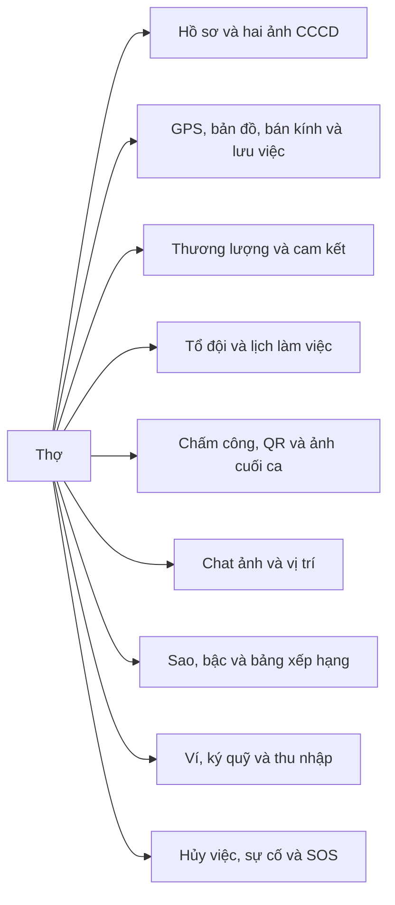

*Sơ đồ chức năng của Thợ*

<!-- diagram:use-case-chu-thau -->
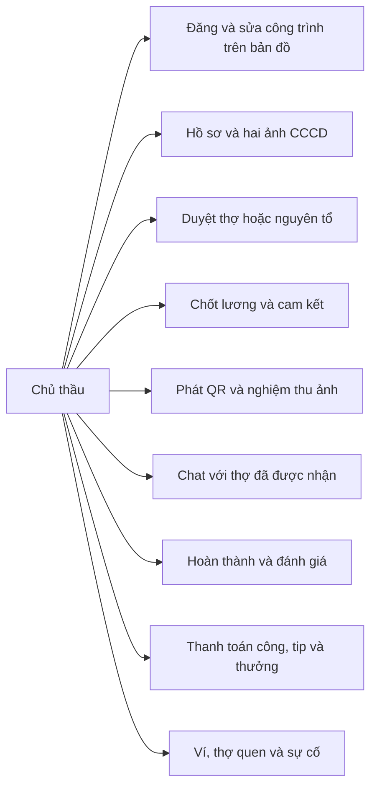

*Sơ đồ chức năng của Chủ thầu*

<!-- diagram:use-case-admin -->
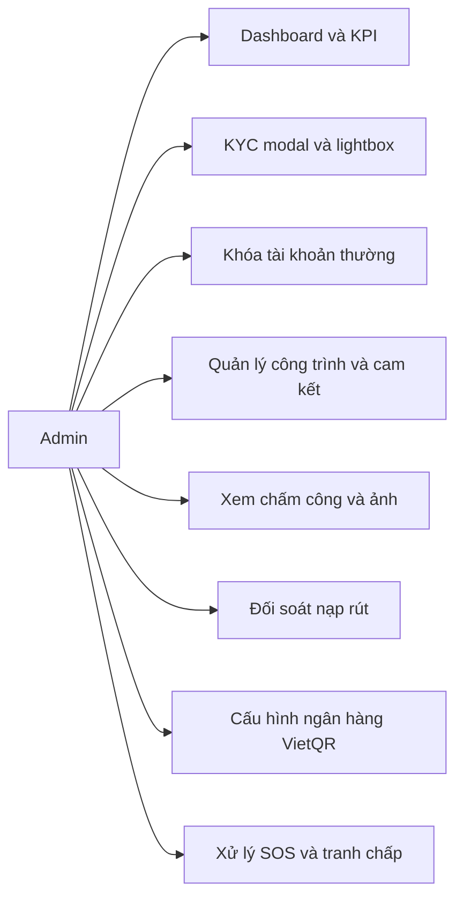

*Sơ đồ chức năng của Admin*

## 3.3. Mô hình dữ liệu và ERD

Database có 30 bảng nghiệp vụ. Flyway tạo thêm flyway_schema_history để theo dõi migration, không phải entity nghiệp vụ. Sơ đồ tổng quan giữ toàn bộ bảng và khóa ngoại. Các sơ đồ theo phân hệ trình bày cột khóa/chính yếu để dễ đọc; từ điển ở mục 3.4 liệt kê đầy đủ cột, kiểu và ràng buộc. Ký hiệu FK rỗng thể hiện quan hệ có thể không tồn tại sau xóa theo SET NULL.

<!-- diagram:erd -->
```mermaid
erDiagram
 attendance_records {
  bigint id PK
 }
 attendance_shift_codes {
  bigint job_id PK
 }
 chat_read_states {
  bigint id PK
 }
 crew_batches {
  bigint id PK
 }
 crew_members {
  bigint id PK
 }
 crews {
  bigint id PK
 }
 device_tokens {
  bigint id PK
 }
 incident_audit {
  bigint id PK
 }
 incidents {
  bigint id PK
 }
 job_applications {
  bigint id PK
 }
 job_payments {
  bigint id PK
 }
 jobs {
  bigint id PK
 }
 kyc_images {
  uuid id PK
 }
 message_attachments {
  bigint message_id PK
 }
 messages {
  bigint id PK
 }
 notifications {
  bigint id PK
 }
 portfolio_photos {
  uuid id PK
 }
 receiving_bank_audit {
  bigint id PK
 }
 receiving_bank_settings {
  bigint id PK
 }
 reputation_events {
  bigint id PK
 }
 saved_jobs {
  bigint id PK
 }
 saved_workers {
  bigint id PK
 }
 user_project_images {
  bigint user_id PK
  integer sort_order PK
 }
 user_skills {
  bigint user_id PK
  integer sort_order PK
 }
 users {
  bigint id PK
 }
 wallet_accounts {
  bigint user_id PK
 }
 wallet_entries {
  bigint id PK
 }
 wallet_requests {
  bigint id PK
 }
 work_logs {
  bigint id PK
 }
 worker_calendar_blocks {
  bigint id PK
 }
 job_applications ||--o{ attendance_records : "application_id"
 jobs ||--o| attendance_shift_codes : "job_id"
 jobs ||--o{ chat_read_states : "job_id"
 users ||--o{ chat_read_states : "peer_id"
 users ||--o{ chat_read_states : "user_id"
 crews ||--o{ crew_batches : "crew_id"
 jobs ||--o{ crew_batches : "job_id"
 crews ||--o{ crew_members : "crew_id"
 users ||--o{ crew_members : "worker_id"
 users ||--o{ crews : "leader_id"
 users ||--o{ device_tokens : "user_id"
 users |o--o{ incident_audit : "actor_id"
 incidents ||--o{ incident_audit : "incident_id"
 jobs |o--o{ incidents : "job_id"
 users |o--o{ incidents : "reporter_id"
 crew_batches |o--o{ job_applications : "crew_batch_id"
 jobs ||--o{ job_applications : "job_id"
 users ||--o{ job_applications : "worker_id"
 job_applications |o--o| job_payments : "application_id"
 users ||--o{ job_payments : "contractor_id"
 jobs |o--o{ job_payments : "job_id"
 users ||--o{ job_payments : "worker_id"
 users ||--o{ jobs : "contractor_id"
 users ||--o{ kyc_images : "user_id"
 messages ||--o| message_attachments : "message_id"
 jobs ||--o{ messages : "job_id"
 users ||--o{ messages : "recipient_id"
 users ||--o{ messages : "sender_id"
 jobs |o--o{ notifications : "job_id"
 users ||--o{ notifications : "recipient_id"
 users ||--o{ portfolio_photos : "owner_id"
 users |o--o{ receiving_bank_audit : "actor_id"
 job_applications |o--o{ reputation_events : "application_id"
 jobs |o--o{ reputation_events : "job_id"
 users ||--o{ reputation_events : "user_id"
 jobs ||--o{ saved_jobs : "job_id"
 users ||--o{ saved_jobs : "owner_id"
 users ||--o{ saved_workers : "owner_id"
 users ||--o{ saved_workers : "worker_id"
 users ||--o{ user_project_images : "user_id"
 users ||--o{ user_skills : "user_id"
 users ||--o| wallet_accounts : "user_id"
 job_payments |o--o{ wallet_entries : "payment_id"
 wallet_requests |o--o{ wallet_entries : "request_id"
 users ||--o{ wallet_entries : "user_id"
 users |o--o{ wallet_requests : "processed_by"
 users ||--o{ wallet_requests : "user_id"
 attendance_records ||--o| work_logs : "attendance_id"
 users ||--o{ worker_calendar_blocks : "worker_id"
```

*ERD tổng quan 30 bảng. Ảnh PNG gốc trong docs/diagrams/erd.png có thể phóng to khi tra cứu.*

<!-- diagram:erd-ho-so -->
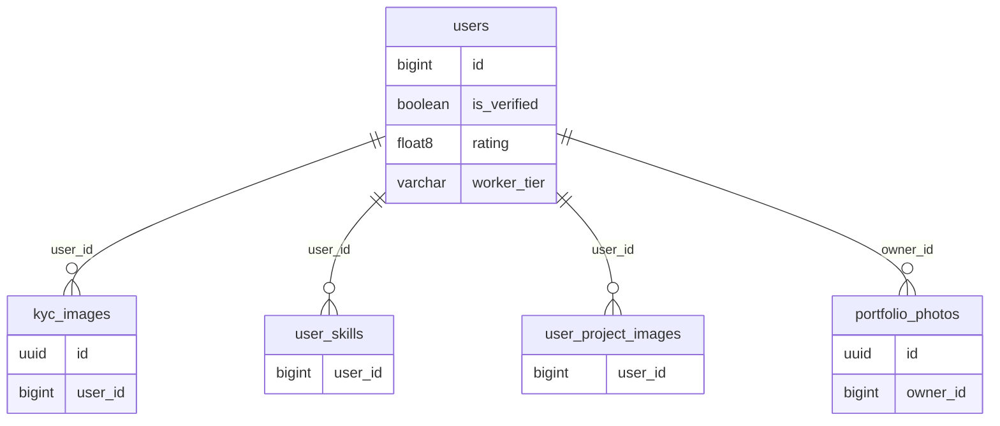

*ERD phân hệ ho so*

<!-- diagram:erd-tuyen-dung -->
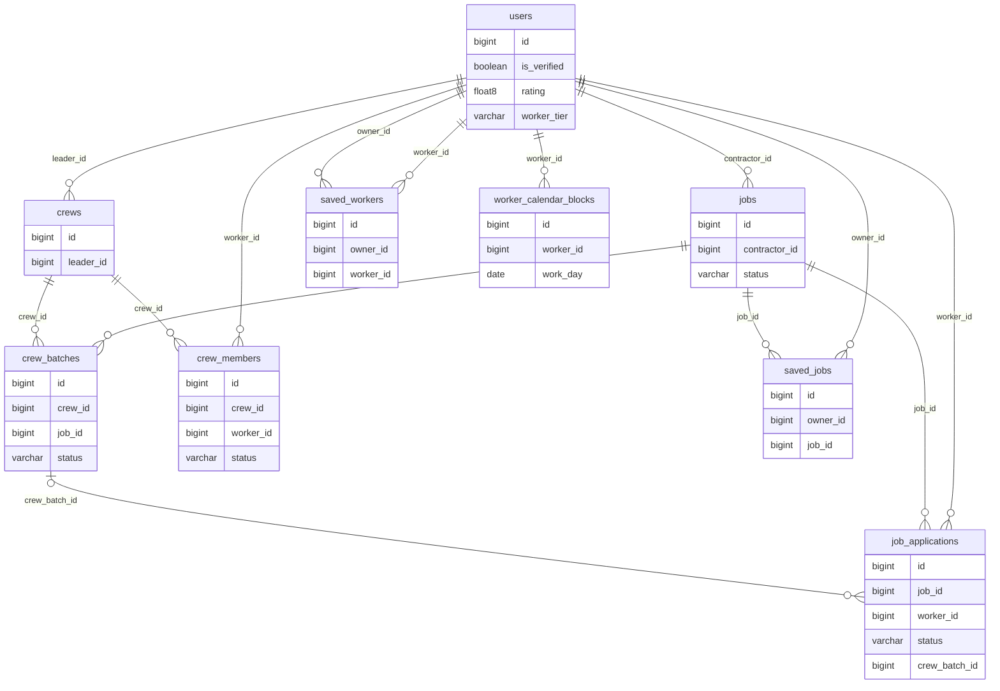

*ERD phân hệ tuyen dung*

<!-- diagram:erd-tai-chinh -->
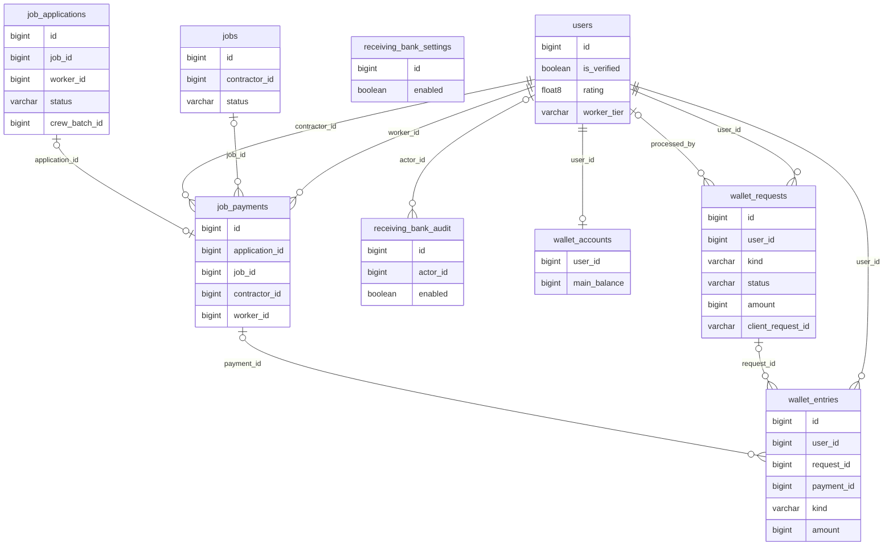

*ERD phân hệ tai chinh*

<!-- diagram:erd-van-hanh -->
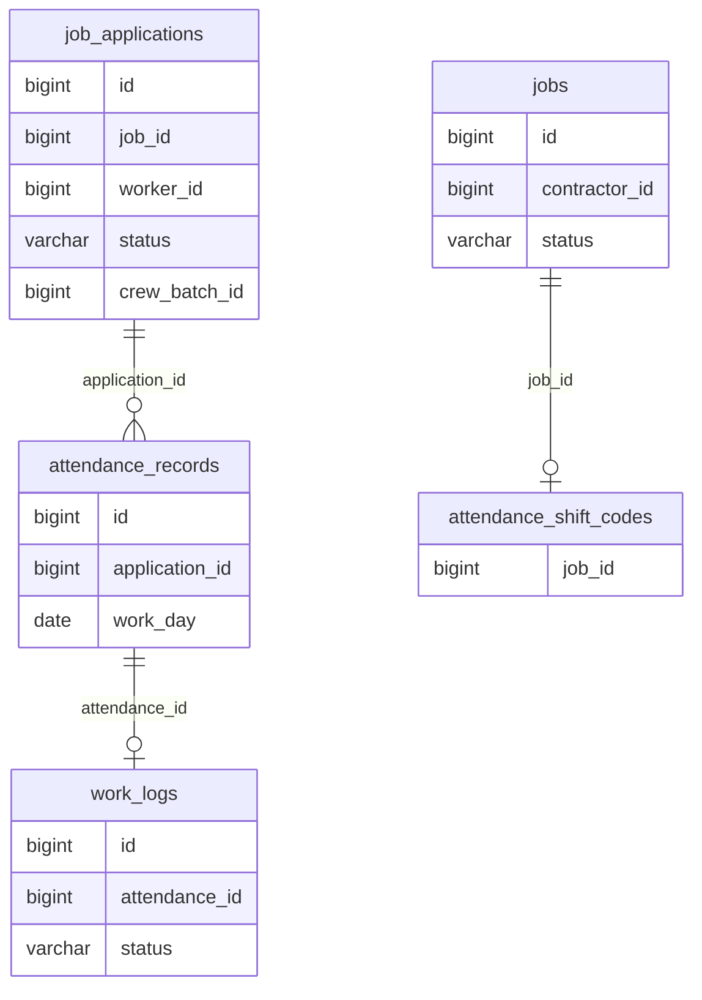

*ERD phân hệ van hanh*

<!-- diagram:erd-thong-bao -->
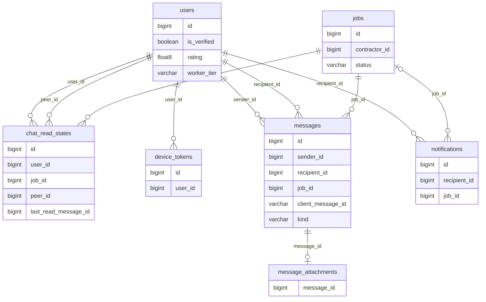

*ERD phân hệ thong bao*

<!-- diagram:erd-uy-tin -->
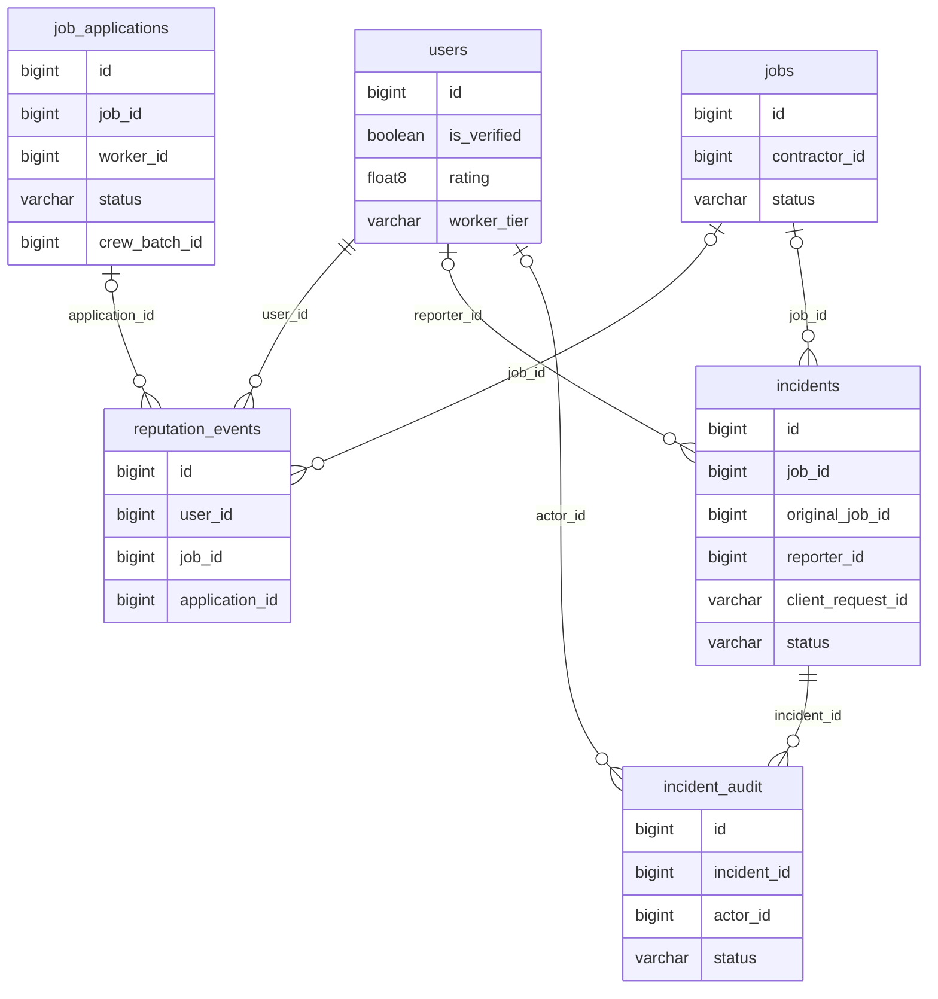

*ERD phân hệ uy tin*

## 3.4. Từ điển dữ liệu đầy đủ

Kiểu dữ liệu dưới đây là kiểu PostgreSQL thực tế. PK: khóa chính; FK: khóa ngoại; NULL/NOT NULL: cho phép/bắt buộc có giá trị. Unique, CHECK và hành vi xóa được ghi nguyên văn từ catalog; default được nêu ở cột quy tắc. TIMESTAMP là thời gian không kèm múi giờ, TIMESTAMPTZ là thời điểm có ngữ nghĩa UTC; ngày công/thu nhập luôn được quy đổi bằng Asia/Ho_Chi_Minh ở tầng nghiệp vụ.

### 3.4.1. Bảng attendance_records

Một ca/ngày theo đơn, check-in/out và chứng cứ GPS/QR.

| Cột | Kiểu PostgreSQL | Khóa và quy tắc | Ý nghĩa |
| --- | --- | --- | --- |
| id | bigint | NOT NULL; PK; default tự tăng (sequence) | Khóa định danh bản ghi. |
| application_id | bigint | NOT NULL; FK; UNIQUE nhóm | Đơn ứng tuyển liên quan. |
| work_day | date | NOT NULL; UNIQUE nhóm | Ngày công theo giờ Việt Nam. |
| checked_in_at | timestamp with time zone | NOT NULL | Thời điểm check-in/out được server ghi nhận. |
| checked_out_at | timestamp with time zone | NULL | Thời điểm check-in/out được server ghi nhận. |
| checkin_method | character varying(10) | NOT NULL | Chứng cứ lúc vào ca: GPS hoặc QR. |
| checkout_method | character varying(10) | NULL | Chứng cứ lúc ra ca: GPS hoặc QR. |
| checkin_latitude | double precision | NULL | Chứng cứ lúc vào ca: vĩ độ. |
| checkin_longitude | double precision | NULL | Chứng cứ lúc vào ca: kinh độ. |
| checkin_accuracy | double precision | NULL | Chứng cứ lúc vào ca: độ chính xác GPS, mét. |
| checkout_latitude | double precision | NULL | Chứng cứ lúc ra ca: vĩ độ. |
| checkout_longitude | double precision | NULL | Chứng cứ lúc ra ca: kinh độ. |
| checkout_accuracy | double precision | NULL | Chứng cứ lúc ra ca: độ chính xác GPS, mét. |

Ràng buộc tham chiếu và kiểm tra:

- `CHECK (((checked_out_at IS NULL) OR (checked_out_at >= checked_in_at)))`
- `CHECK (((checkin_method)::text = ANY ((ARRAY['GPS'::character varying, 'QR'::character varying])::text[])))`
- `CHECK (((checkout_method)::text = ANY ((ARRAY['GPS'::character varying, 'QR'::character varying])::text[])))`
- `FOREIGN KEY (application_id) REFERENCES job_applications(id) ON DELETE CASCADE`
- `UNIQUE (application_id, work_day)`

### 3.4.2. Bảng attendance_shift_codes

Hash mã ca làm đang còn hiệu lực cho một công trình.

| Cột | Kiểu PostgreSQL | Khóa và quy tắc | Ý nghĩa |
| --- | --- | --- | --- |
| job_id | bigint | NOT NULL; FK; PK | Công trình liên quan. |
| token_hash | character varying(64) | NOT NULL | Hash định danh token thiết bị/ca làm. |
| expires_at | timestamp with time zone | NOT NULL | Hết hạn QR ca làm. |

Ràng buộc tham chiếu và kiểm tra:

- `FOREIGN KEY (job_id) REFERENCES jobs(id) ON DELETE CASCADE`

### 3.4.3. Bảng chat_read_states

Con trỏ tin đã đọc tăng đơn điệu theo người/công trình/đối tác.

| Cột | Kiểu PostgreSQL | Khóa và quy tắc | Ý nghĩa |
| --- | --- | --- | --- |
| id | bigint | NOT NULL; PK; default tự tăng (sequence) | Khóa định danh bản ghi. |
| user_id | bigint | NOT NULL; FK; UNIQUE nhóm | Tài khoản sở hữu hoặc nhận dữ liệu. |
| job_id | bigint | NOT NULL; FK; UNIQUE nhóm | Công trình liên quan. |
| peer_id | bigint | NOT NULL; FK; UNIQUE nhóm | Đối tác trong cuộc hội thoại. |
| last_read_message_id | bigint | NOT NULL; default 0 | Con trỏ message đã đọc gần nhất, không giảm. |

Ràng buộc tham chiếu và kiểm tra:

- `CHECK ((user_id <> peer_id))`
- `CHECK ((last_read_message_id >= 0))`
- `FOREIGN KEY (job_id) REFERENCES jobs(id) ON DELETE CASCADE`
- `FOREIGN KEY (peer_id) REFERENCES users(id) ON DELETE CASCADE`
- `FOREIGN KEY (user_id) REFERENCES users(id) ON DELETE CASCADE`
- `UNIQUE (user_id, job_id, peer_id)`

### 3.4.4. Bảng crew_batches

Một đợt ứng tuyển nguyên tổ vào công trình.

| Cột | Kiểu PostgreSQL | Khóa và quy tắc | Ý nghĩa |
| --- | --- | --- | --- |
| id | bigint | NOT NULL; PK; default tự tăng (sequence) | Khóa định danh bản ghi. |
| crew_id | bigint | NOT NULL; FK; UNIQUE nhóm | Tổ đội liên quan. |
| job_id | bigint | NOT NULL; FK; UNIQUE nhóm | Công trình liên quan. |
| status | character varying(20) | NOT NULL; default 'PENDING' | Trạng thái nghiệp vụ theo CHECK ở dưới bảng. |
| created_at | timestamp with time zone | NOT NULL; default CURRENT_TIMESTAMP | Thời điểm tạo. |

Ràng buộc tham chiếu và kiểm tra:

- `CHECK (((status)::text = ANY ((ARRAY['PENDING'::character varying, 'ACCEPTED'::character varying, 'REJECTED'::character varying])::text[])))`
- `FOREIGN KEY (crew_id) REFERENCES crews(id)`
- `FOREIGN KEY (job_id) REFERENCES jobs(id) ON DELETE CASCADE`
- `UNIQUE (crew_id, job_id)`

### 3.4.5. Bảng crew_members

Lời mời và trạng thái xác nhận của các tài khoản thợ thực.

| Cột | Kiểu PostgreSQL | Khóa và quy tắc | Ý nghĩa |
| --- | --- | --- | --- |
| id | bigint | NOT NULL; PK; default tự tăng (sequence) | Khóa định danh bản ghi. |
| crew_id | bigint | NOT NULL; FK; UNIQUE nhóm | Tổ đội liên quan. |
| worker_id | bigint | NOT NULL; FK; UNIQUE nhóm | Tài khoản thợ liên quan. |
| status | character varying(20) | NOT NULL; default 'INVITED' | Trạng thái nghiệp vụ theo CHECK ở dưới bảng. |
| confirmed_at | timestamp with time zone | NULL | Thời điểm xác nhận tham gia. |

Ràng buộc tham chiếu và kiểm tra:

- `CHECK (((status)::text = ANY ((ARRAY['INVITED'::character varying, 'CONFIRMED'::character varying, 'DECLINED'::character varying])::text[])))`
- `FOREIGN KEY (crew_id) REFERENCES crews(id) ON DELETE CASCADE`
- `FOREIGN KEY (worker_id) REFERENCES users(id) ON DELETE CASCADE`
- `UNIQUE (crew_id, worker_id)`

### 3.4.6. Bảng crews

Tổ đội do một thợ làm tổ trưởng.

| Cột | Kiểu PostgreSQL | Khóa và quy tắc | Ý nghĩa |
| --- | --- | --- | --- |
| id | bigint | NOT NULL; PK; default tự tăng (sequence) | Khóa định danh bản ghi. |
| leader_id | bigint | NOT NULL; FK | Thợ làm tổ trưởng. |
| name | character varying(100) | NOT NULL | Tên hiển thị. |
| created_at | timestamp with time zone | NOT NULL; default CURRENT_TIMESTAMP | Thời điểm tạo. |

Ràng buộc tham chiếu và kiểm tra:

- `FOREIGN KEY (leader_id) REFERENCES users(id)`

### 3.4.7. Bảng device_tokens

FCM token thiết bị, hash để định danh và last-seen.

| Cột | Kiểu PostgreSQL | Khóa và quy tắc | Ý nghĩa |
| --- | --- | --- | --- |
| id | bigint | NOT NULL; PK; default tự tăng (sequence) | Khóa định danh bản ghi. |
| user_id | bigint | NOT NULL; FK | Tài khoản sở hữu hoặc nhận dữ liệu. |
| token_hash | character varying(64) | NOT NULL; UNIQUE | Hash định danh token thiết bị/ca làm. |
| token | character varying(4096) | NOT NULL | FCM token, không phải JWT. |
| last_seen_at | timestamp with time zone | NOT NULL; default CURRENT_TIMESTAMP | Thời điểm thiết bị cập nhật token. |

Ràng buộc tham chiếu và kiểm tra:

- `FOREIGN KEY (user_id) REFERENCES users(id) ON DELETE CASCADE`
- `UNIQUE (token_hash)`

### 3.4.8. Bảng incident_audit

Lịch sử trạng thái xử lý sự cố và ghi chú của Admin.

| Cột | Kiểu PostgreSQL | Khóa và quy tắc | Ý nghĩa |
| --- | --- | --- | --- |
| id | bigint | NOT NULL; PK; default tự tăng (sequence) | Khóa định danh bản ghi. |
| incident_id | bigint | NOT NULL; FK | Báo cáo sự cố liên quan. |
| actor_id | bigint | NULL; FK | Người thao tác. |
| status | character varying(30) | NOT NULL | Trạng thái nghiệp vụ theo CHECK ở dưới bảng. |
| note | character varying(1000) | NOT NULL | Ghi chú nghiệp vụ. |
| created_at | timestamp with time zone | NOT NULL | Thời điểm tạo. |

Ràng buộc tham chiếu và kiểm tra:

- `FOREIGN KEY (actor_id) REFERENCES users(id) ON DELETE SET NULL`
- `FOREIGN KEY (incident_id) REFERENCES incidents(id) ON DELETE CASCADE`

### 3.4.9. Bảng incidents

Báo cáo riêng tư với snapshot công trình/người báo và độ ưu tiên.

| Cột | Kiểu PostgreSQL | Khóa và quy tắc | Ý nghĩa |
| --- | --- | --- | --- |
| id | bigint | NOT NULL; PK; default tự tăng (sequence) | Khóa định danh bản ghi. |
| job_id | bigint | NULL; FK | Công trình liên quan. |
| original_job_id | bigint | NOT NULL | ID gốc được giữ ngay cả khi công trình bị xóa. |
| job_title | character varying(200) | NOT NULL | Snapshot tên công trình. |
| job_address | character varying(255) | NOT NULL | Snapshot địa chỉ. |
| job_latitude | double precision | NOT NULL | Snapshot vĩ độ công trình. |
| job_longitude | double precision | NOT NULL | Snapshot kinh độ công trình. |
| reporter_id | bigint | NULL; FK; UNIQUE nhóm | Tài khoản người báo, có thể SET NULL khi xóa. |
| reporter_name | character varying(100) | NOT NULL | Snapshot tên người báo. |
| reporter_phone | character varying(15) | NOT NULL | Snapshot số liên lạc người báo. |
| client_request_id | character varying(80) | NOT NULL; UNIQUE nhóm | Khóa idempotency từ client. |
| type | character varying(30) | NOT NULL | Loại sự kiện hoặc báo cáo. |
| status | character varying(30) | NOT NULL; default 'NEW' | Trạng thái nghiệp vụ theo CHECK ở dưới bảng. |
| description | character varying(2000) | NOT NULL | Nội dung mô tả. |
| reported_latitude | double precision | NULL | Vĩ độ do người báo tự nguyện gửi. |
| reported_longitude | double precision | NULL | Kinh độ do người báo tự nguyện gửi. |
| admin_note | character varying(1000) | NOT NULL; default '' | Phản hồi/kết quả xử lý từ Admin. |
| created_at | timestamp with time zone | NOT NULL | Thời điểm tạo. |
| updated_at | timestamp with time zone | NULL | Thời điểm cập nhật. |
| version | bigint | NOT NULL; default 0 | Phiên bản optimistic locking. |

Ràng buộc tham chiếu và kiểm tra:

- `CHECK ((((reported_latitude IS NULL) AND (reported_longitude IS NULL)) OR ((reported_latitude IS NOT NULL) AND (reported_longitude IS NOT NULL) AND ((reported_latitude >= ('-90'::integer)::double precision) AND (reported_latitude <= (90)::double precision)) AND ((reported_longitude >= ('-180'::integer)::double precision) AND (reported_longitude <= (180)::double precision)))))`
- `CHECK (((status)::text = ANY ((ARRAY['NEW'::character varying, 'IN_REVIEW'::character varying, 'RESOLVED'::character varying])::text[])))`
- `CHECK (((type)::text = ANY ((ARRAY['SOS'::character varying, 'SAFETY'::character varying, 'PAYMENT_DISPUTE'::character varying, 'OTHER'::character varying])::text[])))`
- `FOREIGN KEY (job_id) REFERENCES jobs(id) ON DELETE SET NULL`
- `FOREIGN KEY (reporter_id) REFERENCES users(id) ON DELETE SET NULL`
- `UNIQUE (reporter_id, client_request_id)`

### 3.4.10. Bảng job_applications

Đơn ứng tuyển cá nhân, thương lượng, đồng thuận, cam kết chốt, sao và hủy việc.

| Cột | Kiểu PostgreSQL | Khóa và quy tắc | Ý nghĩa |
| --- | --- | --- | --- |
| id | bigint | NOT NULL; PK; default tự tăng (sequence) | Khóa định danh bản ghi. |
| job_id | bigint | NOT NULL; FK; UNIQUE nhóm | Công trình liên quan. |
| worker_id | bigint | NOT NULL; FK; UNIQUE nhóm | Tài khoản thợ liên quan. |
| status | character varying(30) | NOT NULL; default 'PENDING' | Trạng thái nghiệp vụ theo CHECK ở dưới bảng. |
| cancellation_reason | character varying(500) | NULL | Lý do hủy việc. |
| cancelled_at | timestamp with time zone | NULL | Thời điểm hủy. |
| cancellation_penalty | integer | NOT NULL; default 0 | Điểm phạt khi hủy. |
| worker_rating | integer | NULL | Điểm sao 1–5, chỉ đơn ACCEPTED; chốt khi COMPLETED. |
| reviewed_at | timestamp with time zone | NULL | Thời điểm đánh giá hoặc nghiệm thu. |
| applied_at | timestamp without time zone | NOT NULL; default CURRENT_TIMESTAMP | Thời điểm ứng tuyển. |
| proposed_daily_rate | bigint | NULL | Lương thợ đề xuất, VND/ngày. |
| wage_note | character varying(500) | NULL | Ghi chú thương lượng. |
| agreed_daily_rate | bigint | NULL | Lương được hai bên chốt. |
| consent_version | integer | NULL | Phiên bản điều khoản thợ đã đồng ý. |
| accepted_terms_at | timestamp with time zone | NULL | Thời điểm thợ xác nhận. |
| contract_snapshot | text | NULL | Văn bản cam kết bất biến sau duyệt. |
| contract_hash | character varying(64) | NULL | SHA256 của snapshot cam kết. |
| contractor_confirmed_at | timestamp with time zone | NULL | Thời điểm chủ thầu xác nhận. |
| crew_batch_id | bigint | NULL; FK | Đợt ứng tuyển tổ đội, nếu có. |

Ràng buộc tham chiếu và kiểm tra:

- `CHECK ((((proposed_daily_rate IS NULL) OR ((proposed_daily_rate >= 1) AND (proposed_daily_rate <= 1000000000))) AND ((agreed_daily_rate IS NULL) OR ((agreed_daily_rate >= 1) AND (agreed_daily_rate <= 1000000000)))))`
- `CHECK (((worker_rating IS NULL) OR (((worker_rating >= 1) AND (worker_rating <= 5)) AND ((status)::text = 'ACCEPTED'::text))))`
- `CHECK (((status)::text = ANY ((ARRAY['PENDING'::character varying, 'ACCEPTED'::character varying, 'REJECTED'::character varying, 'CANCELLED'::character varying])::text[])))`
- `FOREIGN KEY (crew_batch_id) REFERENCES crew_batches(id) ON DELETE SET NULL`
- `FOREIGN KEY (job_id) REFERENCES jobs(id) ON DELETE CASCADE`
- `FOREIGN KEY (worker_id) REFERENCES users(id)`
- `UNIQUE (job_id, worker_id)`

### 3.4.11. Bảng job_payments

Thanh toán công trình một lần cho mỗi đơn, công/tip/thưởng đã chốt.

| Cột | Kiểu PostgreSQL | Khóa và quy tắc | Ý nghĩa |
| --- | --- | --- | --- |
| id | bigint | NOT NULL; PK; default tự tăng (sequence) | Khóa định danh bản ghi. |
| application_id | bigint | NULL; FK; UNIQUE | Đơn ứng tuyển liên quan. |
| job_id | bigint | NULL; FK | Công trình liên quan. |
| contractor_id | bigint | NOT NULL; FK | Chủ thầu liên quan. |
| worker_id | bigint | NOT NULL; FK | Tài khoản thợ liên quan. |
| job_title | character varying(200) | NOT NULL | Snapshot tên công trình. |
| work_days | integer | NOT NULL | Ngày công được thanh toán. |
| daily_rate | bigint | NOT NULL | Lương ngày công đã chốt. |
| base | bigint | NOT NULL | Tiền công bằng ngày công nhân đơn giá. |
| tip | bigint | NOT NULL | Tiền tip đã xác nhận. |
| bonus | bigint | NOT NULL | Thưởng đã xác nhận. |
| total | bigint | NOT NULL | Tổng công, tip và thưởng. |
| created_at | timestamp with time zone | NOT NULL; default CURRENT_TIMESTAMP | Thời điểm tạo. |

Ràng buộc tham chiếu và kiểm tra:

- `CHECK (((work_days >= 1) AND (work_days <= 366)))`
- `CHECK ((bonus >= 0))`
- `CHECK (((base = (work_days * daily_rate)) AND (total = ((base + tip) + bonus))))`
- `CHECK ((daily_rate > 0))`
- `CHECK ((tip >= 0))`
- `FOREIGN KEY (application_id) REFERENCES job_applications(id) ON DELETE SET NULL`
- `FOREIGN KEY (contractor_id) REFERENCES users(id) ON DELETE CASCADE`
- `FOREIGN KEY (job_id) REFERENCES jobs(id) ON DELETE SET NULL`
- `FOREIGN KEY (worker_id) REFERENCES users(id) ON DELETE CASCADE`
- `UNIQUE (application_id)`

### 3.4.12. Bảng jobs

Công trình, chủ thầu, mức lương, tọa độ, lịch và yêu cầu chấm công.

| Cột | Kiểu PostgreSQL | Khóa và quy tắc | Ý nghĩa |
| --- | --- | --- | --- |
| id | bigint | NOT NULL; PK; default tự tăng (sequence) | Khóa định danh bản ghi. |
| contractor_id | bigint | NOT NULL; FK | Chủ thầu liên quan. |
| title | character varying(200) | NOT NULL | Tiêu đề hiển thị. |
| description | text | NULL | Nội dung mô tả. |
| job_type | character varying(50) | NOT NULL | Thợ chính hoặc Phụ hồ. |
| salary_per_day | double precision | NOT NULL | Lương tuyển dụng gốc, VND/ngày. |
| address | character varying(255) | NOT NULL | Địa chỉ công trình. |
| latitude | double precision | NOT NULL | Vĩ độ theo WGS84. |
| longitude | double precision | NOT NULL | Kinh độ theo WGS84. |
| required_workers | integer | NOT NULL | Số thợ cần tuyển. |
| status | character varying(30) | NOT NULL; default 'OPEN' | Trạng thái nghiệp vụ theo CHECK ở dưới bảng. |
| created_at | timestamp without time zone | NOT NULL; default CURRENT_TIMESTAMP | Thời điểm tạo. |
| starts_on | date | NULL | Ngày bắt đầu lịch công trình. |
| ends_on | date | NULL | Ngày kết thúc, bao gồm ngày này. |
| terms_version | integer | NOT NULL; default 1 | Phiên bản điều khoản công trình. |
| attendance_required | boolean | NOT NULL; default false | Yêu cầu ngày công phải qua chấm công/nghiệm thu trước khi trả. |

Ràng buộc tham chiếu và kiểm tra:

- `CHECK ((((starts_on IS NULL) AND (ends_on IS NULL)) OR ((starts_on IS NOT NULL) AND (ends_on IS NOT NULL) AND (ends_on >= starts_on) AND ((ends_on - starts_on) <= 365))))`
- `CHECK (((job_type)::text = ANY ((ARRAY['Thợ chính'::character varying, 'Phụ hồ'::character varying])::text[])))`
- `CHECK (((latitude >= ('-90'::integer)::double precision) AND (latitude <= (90)::double precision)))`
- `CHECK (((longitude >= ('-180'::integer)::double precision) AND (longitude <= (180)::double precision)))`
- `CHECK ((required_workers > 0))`
- `CHECK ((salary_per_day > (0)::double precision))`
- `CHECK (((status)::text = ANY ((ARRAY['OPEN'::character varying, 'IN_PROGRESS'::character varying, 'COMPLETED'::character varying, 'CANCELLED'::character varying])::text[])))`
- `FOREIGN KEY (contractor_id) REFERENCES users(id)`

### 3.4.13. Bảng kyc_images

Ảnh CCCD riêng tư đã được chuẩn hóa, truy cập có kiểm tra quyền.

| Cột | Kiểu PostgreSQL | Khóa và quy tắc | Ý nghĩa |
| --- | --- | --- | --- |
| id | uuid | NOT NULL; PK | Khóa định danh bản ghi. |
| user_id | bigint | NOT NULL; FK | Tài khoản sở hữu hoặc nhận dữ liệu. |
| content | bytea | NOT NULL | Nội dung tin nhắn hoặc byte ảnh tùy bảng. |

Ràng buộc tham chiếu và kiểm tra:

- `FOREIGN KEY (user_id) REFERENCES users(id) ON DELETE CASCADE`

### 3.4.14. Bảng message_attachments

Nội dung ảnh tin nhắn, cùng giao dịch với message và xóa cascade.

| Cột | Kiểu PostgreSQL | Khóa và quy tắc | Ý nghĩa |
| --- | --- | --- | --- |
| message_id | bigint | NOT NULL; FK; PK | Tin nhắn sở hữu ảnh. |
| content | bytea | NOT NULL | Nội dung tin nhắn hoặc byte ảnh tùy bảng. |

Ràng buộc tham chiếu và kiểm tra:

- `CHECK ((octet_length(content) <= 2097152))`
- `FOREIGN KEY (message_id) REFERENCES messages(id) ON DELETE CASCADE`

### 3.4.15. Bảng messages

Tin chữ/ảnh/GPS giữa hai người gắn với công trình.

| Cột | Kiểu PostgreSQL | Khóa và quy tắc | Ý nghĩa |
| --- | --- | --- | --- |
| id | bigint | NOT NULL; PK; default tự tăng (sequence) | Khóa định danh bản ghi. |
| sender_id | bigint | NOT NULL; FK; UNIQUE nhóm | Người gửi. |
| recipient_id | bigint | NOT NULL; FK | Người nhận. |
| job_id | bigint | NOT NULL; FK | Công trình liên quan. |
| content | character varying(2000) | NOT NULL | Nội dung tin nhắn hoặc byte ảnh tùy bảng. |
| client_message_id | character varying(64) | NOT NULL; UNIQUE nhóm | Khóa idempotency tin nhắn theo người gửi. |
| created_at | timestamp with time zone | NOT NULL; default CURRENT_TIMESTAMP | Thời điểm tạo. |
| kind | character varying(16) | NOT NULL; default 'TEXT' | Loại giao dịch hoặc loại tin nhắn tùy bảng. |
| latitude | double precision | NULL | Vĩ độ theo WGS84. |
| longitude | double precision | NULL | Kinh độ theo WGS84. |
| image_hash | character varying(64) | NULL | SHA256 ảnh tin nhắn chuẩn hóa. |

Ràng buộc tham chiếu và kiểm tra:

- `CHECK (((((kind)::text = 'TEXT'::text) AND (latitude IS NULL) AND (longitude IS NULL) AND (image_hash IS NULL)) OR (((kind)::text = 'IMAGE'::text) AND (latitude IS NULL) AND (longitude IS NULL) AND (image_hash IS NOT NULL) AND (length((image_hash)::text) = 64)) OR (((kind)::text = 'LOCATION'::text) AND (latitude IS NOT NULL) AND (longitude IS NOT NULL) AND ((latitude >= ('-90'::integer)::double precision) AND (latitude <= (90)::double precision)) AND ((longitude >= ('-180'::integer)::double precision) AND (longitude <= (180)::double precision)) AND (image_hash IS NULL))))`
- `CHECK ((sender_id <> recipient_id))`
- `CHECK ((length(TRIM(BOTH FROM content)) > 0))`
- `FOREIGN KEY (job_id) REFERENCES jobs(id) ON DELETE CASCADE`
- `FOREIGN KEY (recipient_id) REFERENCES users(id)`
- `FOREIGN KEY (sender_id) REFERENCES users(id)`
- `UNIQUE (sender_id, client_message_id)`

### 3.4.16. Bảng notifications

Lịch sử thông báo và outbox thử gửi FCM.

| Cột | Kiểu PostgreSQL | Khóa và quy tắc | Ý nghĩa |
| --- | --- | --- | --- |
| id | bigint | NOT NULL; PK; default tự tăng (sequence) | Khóa định danh bản ghi. |
| recipient_id | bigint | NOT NULL; FK | Người nhận. |
| job_id | bigint | NULL; FK | Công trình liên quan. |
| event_key | character varying(200) | NOT NULL; UNIQUE | Khóa sự kiện duy nhất chống thông báo lặp. |
| type | character varying(40) | NOT NULL | Loại sự kiện hoặc báo cáo. |
| title | character varying(120) | NOT NULL | Tiêu đề hiển thị. |
| body | character varying(500) | NOT NULL | Thuộc tính body của notifications. |
| created_at | timestamp with time zone | NOT NULL; default CURRENT_TIMESTAMP | Thời điểm tạo. |
| read_at | timestamp with time zone | NULL | Thời điểm thông báo được đọc. |
| push_status | character varying(20) | NOT NULL; default 'DISABLED' | Trạng thái outbox FCM. |
| push_attempts | integer | NOT NULL; default 0 | Số lần thử gửi push. |
| next_attempt_at | timestamp with time zone | NOT NULL; default CURRENT_TIMESTAMP | Thời điểm đủ điều kiện thử lại. |

Ràng buộc tham chiếu và kiểm tra:

- `FOREIGN KEY (job_id) REFERENCES jobs(id) ON DELETE SET NULL`
- `FOREIGN KEY (recipient_id) REFERENCES users(id) ON DELETE CASCADE`
- `UNIQUE (event_key)`

### 3.4.17. Bảng portfolio_photos

Ảnh tay nghề upload riêng tư, tối đa 12 ảnh mỗi chủ hồ sơ.

| Cột | Kiểu PostgreSQL | Khóa và quy tắc | Ý nghĩa |
| --- | --- | --- | --- |
| id | uuid | NOT NULL; PK | Khóa định danh bản ghi. |
| owner_id | bigint | NOT NULL; FK | Chủ sở hữu dữ liệu. |
| caption | character varying(160) | NOT NULL; default '' | Chú thích ảnh. |
| content | bytea | NOT NULL | Nội dung tin nhắn hoặc byte ảnh tùy bảng. |
| created_at | timestamp with time zone | NOT NULL; default CURRENT_TIMESTAMP | Thời điểm tạo. |

Ràng buộc tham chiếu và kiểm tra:

- `CHECK ((octet_length(content) <= 2097152))`
- `FOREIGN KEY (owner_id) REFERENCES users(id) ON DELETE CASCADE`

### 3.4.18. Bảng receiving_bank_audit

Lịch sử cấu hình nhận tiền và người thực hiện.

| Cột | Kiểu PostgreSQL | Khóa và quy tắc | Ý nghĩa |
| --- | --- | --- | --- |
| id | bigint | NOT NULL; PK; default tự tăng (sequence) | Khóa định danh bản ghi. |
| actor_id | bigint | NULL; FK | Người thao tác. |
| enabled | boolean | NOT NULL | Bật/tắt tạo yêu cầu QR mới. |
| bank_bin | character varying(6) | NULL | BIN ngân hàng nhận tiền. |
| bank_name | character varying(100) | NULL | Tên ngân hàng tại thời điểm lưu. |
| account_no | character varying(19) | NULL | Số tài khoản nhận tiền. |
| account_name | character varying(100) | NULL | Tên chủ tài khoản. |
| revision | bigint | NOT NULL | Phiên bản cấu hình được audit. |
| changed_at | timestamp with time zone | NOT NULL | Thời điểm thay cấu hình. |

Ràng buộc tham chiếu và kiểm tra:

- `FOREIGN KEY (actor_id) REFERENCES users(id) ON DELETE SET NULL`

### 3.4.19. Bảng receiving_bank_settings

Cấu hình ngân hàng nhận tiền duy nhất, mặc định không bật QR.

| Cột | Kiểu PostgreSQL | Khóa và quy tắc | Ý nghĩa |
| --- | --- | --- | --- |
| id | bigint | NOT NULL; PK | Khóa định danh bản ghi. |
| enabled | boolean | NOT NULL; default false | Bật/tắt tạo yêu cầu QR mới. |
| bank_bin | character varying(6) | NULL | BIN ngân hàng nhận tiền. |
| bank_name | character varying(100) | NULL | Tên ngân hàng tại thời điểm lưu. |
| account_no | character varying(19) | NULL | Số tài khoản nhận tiền. |
| account_name | character varying(100) | NULL | Tên chủ tài khoản. |
| version | bigint | NOT NULL; default 0 | Phiên bản optimistic locking. |

Ràng buộc tham chiếu và kiểm tra:

- `CHECK (((NOT enabled) OR ((bank_bin IS NOT NULL) AND (bank_name IS NOT NULL) AND (account_no IS NOT NULL) AND (account_name IS NOT NULL))))`
- `CHECK ((id = 1))`

### 3.4.20. Bảng reputation_events

Sự kiện hoàn thành/hủy việc và điểm uy tín sau thay đổi.

| Cột | Kiểu PostgreSQL | Khóa và quy tắc | Ý nghĩa |
| --- | --- | --- | --- |
| id | bigint | NOT NULL; PK; default tự tăng (sequence) | Khóa định danh bản ghi. |
| user_id | bigint | NOT NULL; FK | Tài khoản sở hữu hoặc nhận dữ liệu. |
| job_id | bigint | NULL; FK | Công trình liên quan. |
| application_id | bigint | NULL; FK; UNIQUE nhóm | Đơn ứng tuyển liên quan. |
| job_title | character varying(200) | NOT NULL | Snapshot tên công trình. |
| type | character varying(30) | NOT NULL; UNIQUE nhóm | Loại sự kiện hoặc báo cáo. |
| delta | integer | NOT NULL | Thay đổi điểm uy tín. |
| score_after | integer | NOT NULL | Điểm uy tín sau sự kiện. |
| created_at | timestamp with time zone | NOT NULL; default CURRENT_TIMESTAMP | Thời điểm tạo. |

Ràng buộc tham chiếu và kiểm tra:

- `FOREIGN KEY (application_id) REFERENCES job_applications(id) ON DELETE SET NULL`
- `FOREIGN KEY (job_id) REFERENCES jobs(id) ON DELETE SET NULL`
- `FOREIGN KEY (user_id) REFERENCES users(id) ON DELETE CASCADE`
- `UNIQUE (application_id, type)`

### 3.4.21. Bảng saved_jobs

Công trình yêu thích riêng của thợ.

| Cột | Kiểu PostgreSQL | Khóa và quy tắc | Ý nghĩa |
| --- | --- | --- | --- |
| id | bigint | NOT NULL; PK; default tự tăng (sequence) | Khóa định danh bản ghi. |
| owner_id | bigint | NOT NULL; FK; UNIQUE nhóm | Chủ sở hữu dữ liệu. |
| job_id | bigint | NOT NULL; FK; UNIQUE nhóm | Công trình liên quan. |
| created_at | timestamp with time zone | NOT NULL; default CURRENT_TIMESTAMP | Thời điểm tạo. |

Ràng buộc tham chiếu và kiểm tra:

- `FOREIGN KEY (job_id) REFERENCES jobs(id) ON DELETE CASCADE`
- `FOREIGN KEY (owner_id) REFERENCES users(id) ON DELETE CASCADE`
- `UNIQUE (owner_id, job_id)`

### 3.4.22. Bảng saved_workers

Thợ quen riêng của chủ thầu.

| Cột | Kiểu PostgreSQL | Khóa và quy tắc | Ý nghĩa |
| --- | --- | --- | --- |
| id | bigint | NOT NULL; PK; default tự tăng (sequence) | Khóa định danh bản ghi. |
| owner_id | bigint | NOT NULL; FK; UNIQUE nhóm | Chủ sở hữu dữ liệu. |
| worker_id | bigint | NOT NULL; FK; UNIQUE nhóm | Tài khoản thợ liên quan. |
| created_at | timestamp with time zone | NOT NULL; default CURRENT_TIMESTAMP | Thời điểm tạo. |

Ràng buộc tham chiếu và kiểm tra:

- `CHECK ((owner_id <> worker_id))`
- `FOREIGN KEY (owner_id) REFERENCES users(id) ON DELETE CASCADE`
- `FOREIGN KEY (worker_id) REFERENCES users(id) ON DELETE CASCADE`
- `UNIQUE (owner_id, worker_id)`

### 3.4.23. Bảng user_project_images

URL ảnh dự án legacy có thứ tự, giữ tương thích dữ liệu cũ.

| Cột | Kiểu PostgreSQL | Khóa và quy tắc | Ý nghĩa |
| --- | --- | --- | --- |
| user_id | bigint | NOT NULL; FK; PK nhóm | Tài khoản sở hữu hoặc nhận dữ liệu. |
| sort_order | integer | NOT NULL; PK nhóm | Thứ tự trong collection. |
| image_url | character varying(500) | NOT NULL | URL ảnh dự án legacy. |

Ràng buộc tham chiếu và kiểm tra:

- `FOREIGN KEY (user_id) REFERENCES users(id) ON DELETE CASCADE`

### 3.4.24. Bảng user_skills

Danh sách kỹ năng có thứ tự của tài khoản.

| Cột | Kiểu PostgreSQL | Khóa và quy tắc | Ý nghĩa |
| --- | --- | --- | --- |
| user_id | bigint | NOT NULL; FK; PK nhóm | Tài khoản sở hữu hoặc nhận dữ liệu. |
| sort_order | integer | NOT NULL; PK nhóm | Thứ tự trong collection. |
| skill | character varying(50) | NOT NULL | Tên kỹ năng. |

Ràng buộc tham chiếu và kiểm tra:

- `FOREIGN KEY (user_id) REFERENCES users(id) ON DELETE CASCADE`

### 3.4.25. Bảng users

Tài khoản, vai trò, trạng thái, hồ sơ, KYC và thông số uy tín.

| Cột | Kiểu PostgreSQL | Khóa và quy tắc | Ý nghĩa |
| --- | --- | --- | --- |
| id | bigint | NOT NULL; PK; default tự tăng (sequence) | Khóa định danh bản ghi. |
| is_available | boolean | NOT NULL; default true | Cờ thợ sẵn sàng nhận việc. |
| phone_number | character varying(15) | NOT NULL; UNIQUE | Số điện thoại dùng đăng nhập, duy nhất. |
| password | character varying(255) | NOT NULL | Mật khẩu băm BCrypt, không trả cho client. |
| full_name | character varying(100) | NOT NULL | Họ tên hiển thị. |
| date_of_birth | date | NULL | Ngày sinh. |
| experience_years | integer | NOT NULL; default 0 | Số năm kinh nghiệm. |
| experience_summary | character varying(2000) | NULL | Mô tả kinh nghiệm. |
| role | character varying(30) | NOT NULL | ROLE_WORKER, ROLE_CONTRACTOR hoặc ROLE_ADMIN. |
| is_verified | boolean | NOT NULL; default false | KYC được Admin duyệt, yêu cầu đủ hai ảnh. |
| cccd_image | character varying(500) | NULL | Liên kết ảnh CCCD legacy. |
| cccd_front_image | character varying(500) | NULL | Tham chiếu ảnh CCCD mặt trước. |
| cccd_back_image | character varying(500) | NULL | Tham chiếu ảnh CCCD mặt sau. |
| rating | double precision | NOT NULL; default 5.0 | Trung bình sao từ công trình COMPLETED; mặc định 5.0 nếu chưa có sao. |
| reputation_score | integer | NOT NULL; default 100 | Điểm uy tín từ 0 đến 100. |
| completed_jobs | integer | NOT NULL; default 0 | Số công trình hoàn thành được ghi nhận. |
| cancelled_jobs | integer | NOT NULL; default 0 | Số lần hủy việc đã nhận. |
| worker_tier | character varying(12) | NOT NULL; default 'SILVER' | Bậc SILVER, GOLD hoặc DIAMOND. |
| is_active | boolean | NOT NULL; default true | Cờ hoạt động; false chặn cả JWT cũ. |
| created_at | timestamp without time zone | NOT NULL; default CURRENT_TIMESTAMP | Thời điểm tạo. |

Ràng buộc tham chiếu và kiểm tra:

- `CHECK (((NOT is_verified) OR ((((COALESCE(cccd_front_image, ''::character varying))::text ~~ 'https://_%'::text) OR ((COALESCE(cccd_front_image, ''::character varying))::text ~~ '/admin/kyc/images/%'::text)) AND (((COALESCE(cccd_back_image, ''::character varying))::text ~~ 'https://_%'::text) OR ((COALESCE(cccd_back_image, ''::character varying))::text ~~ '/admin/kyc/images/%'::text)))))`
- `CHECK (((rating >= (0)::double precision) AND (rating <= (5)::double precision)))`
- `CHECK (((reputation_score >= 0) AND (reputation_score <= 100)))`
- `CHECK (((role)::text = ANY ((ARRAY['ROLE_WORKER'::character varying, 'ROLE_CONTRACTOR'::character varying, 'ROLE_ADMIN'::character varying])::text[])))`
- `UNIQUE (phone_number)`

### 3.4.26. Bảng wallet_accounts

Số dư chính, ký quỹ và tiền giữ chỗ rút của từng tài khoản.

| Cột | Kiểu PostgreSQL | Khóa và quy tắc | Ý nghĩa |
| --- | --- | --- | --- |
| user_id | bigint | NOT NULL; FK; PK | Tài khoản sở hữu hoặc nhận dữ liệu. |
| main_balance | bigint | NOT NULL; default 0 | Số dư khả dụng. |
| escrow_balance | bigint | NOT NULL; default 0 | Tiền ký quỹ. |
| held_balance | bigint | NOT NULL; default 0 | Tiền đang giữ chỗ rút. |

Ràng buộc tham chiếu và kiểm tra:

- `CHECK (((main_balance >= 0) AND (escrow_balance >= 0) AND (held_balance >= 0) AND (((main_balance + escrow_balance) + held_balance) <= '1000000000000'::bigint)))`
- `FOREIGN KEY (user_id) REFERENCES users(id) ON DELETE CASCADE`

### 3.4.27. Bảng wallet_entries

Sổ giao dịch với delta từng ngăn tiền, số dư sau và khóa tham chiếu chống lặp.

| Cột | Kiểu PostgreSQL | Khóa và quy tắc | Ý nghĩa |
| --- | --- | --- | --- |
| id | bigint | NOT NULL; PK; default tự tăng (sequence) | Khóa định danh bản ghi. |
| user_id | bigint | NOT NULL; FK | Tài khoản sở hữu hoặc nhận dữ liệu. |
| request_id | bigint | NULL; FK | Yêu cầu nạp/rút liên quan. |
| payment_id | bigint | NULL; FK | Thanh toán công trình liên quan. |
| kind | character varying(30) | NOT NULL | Loại giao dịch hoặc loại tin nhắn tùy bảng. |
| amount | bigint | NOT NULL | Số tiền nguyên VND. |
| main_delta | bigint | NOT NULL | Mức thay đổi của ngăn tiền main, có dấu. |
| escrow_delta | bigint | NOT NULL | Mức thay đổi của ngăn tiền escrow, có dấu. |
| held_delta | bigint | NOT NULL | Mức thay đổi của ngăn tiền held, có dấu. |
| main_after | bigint | NOT NULL | Số dư ngăn main sau giao dịch. |
| escrow_after | bigint | NOT NULL | Số dư ngăn escrow sau giao dịch. |
| held_after | bigint | NOT NULL | Số dư ngăn held sau giao dịch. |
| reference | character varying(150) | NOT NULL; UNIQUE | Khóa tham chiếu chống ghi sổ trùng. |
| description | character varying(250) | NOT NULL | Nội dung mô tả. |
| created_at | timestamp with time zone | NOT NULL; default CURRENT_TIMESTAMP | Thời điểm tạo. |

Ràng buộc tham chiếu và kiểm tra:

- `CHECK ((amount > 0))`
- `CHECK ((escrow_after >= 0))`
- `CHECK ((held_after >= 0))`
- `CHECK ((main_after >= 0))`
- `FOREIGN KEY (payment_id) REFERENCES job_payments(id) ON DELETE SET NULL`
- `FOREIGN KEY (request_id) REFERENCES wallet_requests(id) ON DELETE SET NULL`
- `FOREIGN KEY (user_id) REFERENCES users(id) ON DELETE CASCADE`
- `UNIQUE (reference)`

### 3.4.28. Bảng wallet_requests

Yêu cầu nạp/rút, trạng thái Admin và snapshot VietQR.

| Cột | Kiểu PostgreSQL | Khóa và quy tắc | Ý nghĩa |
| --- | --- | --- | --- |
| id | bigint | NOT NULL; PK; default tự tăng (sequence) | Khóa định danh bản ghi. |
| user_id | bigint | NOT NULL; FK; UNIQUE nhóm | Tài khoản sở hữu hoặc nhận dữ liệu. |
| kind | character varying(15) | NOT NULL | Loại giao dịch hoặc loại tin nhắn tùy bảng. |
| status | character varying(15) | NOT NULL; default 'PENDING' | Trạng thái nghiệp vụ theo CHECK ở dưới bảng. |
| amount | bigint | NOT NULL | Số tiền nguyên VND. |
| client_request_id | character varying(80) | NOT NULL; UNIQUE nhóm | Khóa idempotency từ client. |
| transfer_reference | character varying(200) | NULL | Nội dung chuyển khoản. |
| bank_name | character varying(100) | NULL | Tên ngân hàng tại thời điểm lưu. |
| bank_account | character varying(34) | NULL | Số tài khoản của yêu cầu. |
| account_name | character varying(100) | NULL | Tên chủ tài khoản. |
| external_reference | character varying(100) | NULL; UNIQUE | Mã đối soát thực tế duy nhất do Admin ghi. |
| note | character varying(300) | NULL | Ghi chú nghiệp vụ. |
| processed_by | bigint | NULL; FK | Admin xử lý yêu cầu. |
| created_at | timestamp with time zone | NOT NULL; default CURRENT_TIMESTAMP | Thời điểm tạo. |
| processed_at | timestamp with time zone | NULL | Thời điểm Admin chốt yêu cầu. |
| receiving_bank_bin | character varying(6) | NULL | Snapshot BIN khi tạo yêu cầu. |
| deposit_reference | character varying(25) | NULL | Nội dung đối soát VietQR duy nhất. |
| qr_payload | text | NULL | Chuỗi TLV QRIBFTTA có CRC16. |

Ràng buộc tham chiếu và kiểm tra:

- `CHECK (((amount >= 1000) AND (amount <= 100000000)))`
- `CHECK (((kind)::text = ANY ((ARRAY['TOP_UP'::character varying, 'WITHDRAW'::character varying])::text[])))`
- `CHECK (((status)::text = ANY ((ARRAY['PENDING'::character varying, 'APPROVED'::character varying, 'REJECTED'::character varying])::text[])))`
- `FOREIGN KEY (processed_by) REFERENCES users(id) ON DELETE SET NULL`
- `FOREIGN KEY (user_id) REFERENCES users(id) ON DELETE CASCADE`
- `UNIQUE (external_reference)`
- `UNIQUE (user_id, client_request_id)`

### 3.4.29. Bảng work_logs

Ảnh báo cáo cuối ca, phản hồi nghiệm thu và version chống ghi đè.

| Cột | Kiểu PostgreSQL | Khóa và quy tắc | Ý nghĩa |
| --- | --- | --- | --- |
| id | bigint | NOT NULL; PK; default tự tăng (sequence) | Khóa định danh bản ghi. |
| attendance_id | bigint | NOT NULL; FK; UNIQUE | Thuộc tính attendance_id của work_logs. |
| caption | character varying(1000) | NOT NULL; default '' | Chú thích ảnh. |
| photo | bytea | NOT NULL | Byte ảnh công việc chuẩn hóa JPEG. |
| status | character varying(30) | NOT NULL; default 'PENDING' | Trạng thái nghiệp vụ theo CHECK ở dưới bảng. |
| feedback | character varying(500) | NOT NULL; default '' | Phản hồi nghiệm thu. |
| created_at | timestamp with time zone | NOT NULL; default CURRENT_TIMESTAMP | Thời điểm tạo. |
| reviewed_at | timestamp with time zone | NULL | Thời điểm đánh giá hoặc nghiệm thu. |
| version | bigint | NOT NULL; default 0 | Phiên bản optimistic locking. |

Ràng buộc tham chiếu và kiểm tra:

- `CHECK ((octet_length(photo) <= 2097152))`
- `CHECK (((status)::text = ANY ((ARRAY['PENDING'::character varying, 'APPROVED'::character varying, 'CHANGES_REQUESTED'::character varying])::text[])))`
- `FOREIGN KEY (attendance_id) REFERENCES attendance_records(id) ON DELETE CASCADE`
- `UNIQUE (attendance_id)`

### 3.4.30. Bảng worker_calendar_blocks

Ngày bận do thợ tự khai, khóa duy nhất theo thợ/ngày.

| Cột | Kiểu PostgreSQL | Khóa và quy tắc | Ý nghĩa |
| --- | --- | --- | --- |
| id | bigint | NOT NULL; PK; default tự tăng (sequence) | Khóa định danh bản ghi. |
| worker_id | bigint | NOT NULL; FK; UNIQUE nhóm | Tài khoản thợ liên quan. |
| work_day | date | NOT NULL; UNIQUE nhóm | Ngày công theo giờ Việt Nam. |
| note | character varying(200) | NOT NULL; default '' | Ghi chú nghiệp vụ. |

Ràng buộc tham chiếu và kiểm tra:

- `FOREIGN KEY (worker_id) REFERENCES users(id) ON DELETE CASCADE`
- `UNIQUE (worker_id, work_day)`

## 3.5. Danh mục endpoint theo Controller

Danh mục có 111 cặp method/path: 90 dưới /api/ và 21 route khác, gồm giao diện Admin, tài nguyên ảnh riêng tư, trang gốc và readiness /health. Phân quyền tiếp tục được service kiểm tra quyền sở hữu, trạng thái ACCEPTED và trạng thái tài khoản; biết URL không cấp quyền đọc dữ liệu. Các mutation Admin sử dụng phiên/form cần CSRF. Annotation dưới đây được đối chiếu từ Controller.java; hash tệp nguồn nằm trong PROJECT_INVENTORY.json.

### AdminController

| HTTP | Đường dẫn | Handler và quyền truy cập |
| --- | --- | --- |
| GET | / | index; công khai |
| GET | /admin/login | login; công khai |
| GET | /admin/dashboard | dashboard; Admin, phiên/CSRF |
| POST | /admin/users/{id}/verify | verify; Admin, phiên/CSRF |
| POST | /admin/users/{id}/toggle-active | toggle; Admin, phiên/CSRF |
| POST | /admin/jobs/{id}/delete | delete; Admin, phiên/CSRF |

### AttendanceAdminController

| HTTP | Đường dẫn | Handler và quyền truy cập |
| --- | --- | --- |
| GET | /admin/jobs/{id}/attendance | list; Admin, phiên/CSRF |
| GET | /admin/work-logs/{id}/photo | photo; Admin, phiên/CSRF |

### CommitmentAdminController

| HTTP | Đường dẫn | Handler và quyền truy cập |
| --- | --- | --- |
| GET | /admin/jobs/{id}/commitments | list; Admin, phiên/CSRF |

### IncidentAdminController

| HTTP | Đường dẫn | Handler và quyền truy cập |
| --- | --- | --- |
| GET | /admin/incidents | queue; Admin, phiên/CSRF |
| GET | /admin/incidents/{id} | detail; Admin, phiên/CSRF |
| GET | /admin/incidents/counts | counts; Admin, phiên/CSRF |
| POST | /admin/incidents/{id} | update; Admin, phiên/CSRF |

### PortfolioAdminController

| HTTP | Đường dẫn | Handler và quyền truy cập |
| --- | --- | --- |
| GET | /admin/users/{id}/portfolio | portfolio; Admin, phiên/CSRF |
| GET | /admin/portfolio/photos/{id} | photo; Admin, phiên/CSRF |

### AttendanceController

| HTTP | Đường dẫn | Handler và quyền truy cập |
| --- | --- | --- |
| GET | /api/applications/{id}/attendance | history; JWT, kiểm tra vai trò/chủ sở hữu tại service |
| GET | /api/jobs/{id}/attendance | byJob; JWT, kiểm tra vai trò/chủ sở hữu tại service |
| POST | /api/jobs/{id}/attendance/shift-code | code; JWT, kiểm tra vai trò/chủ sở hữu tại service |
| POST | /api/applications/{id}/attendance/check-in | checkIn; JWT, kiểm tra vai trò/chủ sở hữu tại service |
| POST | /api/applications/{id}/attendance/check-out | checkOut; JWT, kiểm tra vai trò/chủ sở hữu tại service |
| POST | /api/applications/{id}/work-logs | upload; JWT, kiểm tra vai trò/chủ sở hữu tại service |
| PUT | /api/work-logs/{id}/review | review; JWT, kiểm tra vai trò/chủ sở hữu tại service |
| GET | /api/work-logs/{id}/photo | photo; JWT, kiểm tra vai trò/chủ sở hữu tại service |

### ChatInboxController

| HTTP | Đường dẫn | Handler và quyền truy cập |
| --- | --- | --- |
| GET | /api/messages/inbox | inbox; JWT, kiểm tra vai trò/chủ sở hữu tại service |
| GET | /api/messages/unread | unread; JWT, kiểm tra vai trò/chủ sở hữu tại service |
| PUT | /api/jobs/{jobId}/messages/read | read; JWT, kiểm tra vai trò/chủ sở hữu tại service |

### ApplicationController

| HTTP | Đường dẫn | Handler và quyền truy cập |
| --- | --- | --- |
| PUT | /api/applications/{id}/cancel | cancel; JWT, kiểm tra vai trò/chủ sở hữu tại service |
| POST | /api/applications/apply | apply; JWT, kiểm tra vai trò/chủ sở hữu tại service |
| GET | /api/applications/job/{jobId} | byJob; JWT, kiểm tra vai trò/chủ sở hữu tại service |
| GET | /api/applications/worker/{workerId} | byWorker; JWT, kiểm tra vai trò/chủ sở hữu tại service |
| PUT | /api/applications/{id}/status | updateStatus; JWT, kiểm tra vai trò/chủ sở hữu tại service |

### AuthController

| HTTP | Đường dẫn | Handler và quyền truy cập |
| --- | --- | --- |
| POST | /api/auth/register | register; công khai |
| POST | /api/auth/login | login; công khai |

### DeploymentHealthController

| HTTP | Đường dẫn | Handler và quyền truy cập |
| --- | --- | --- |
| GET | /health | health; công khai |
| GET | /api/auth/health | health; công khai |

### JobController

| HTTP | Đường dẫn | Handler và quyền truy cập |
| --- | --- | --- |
| POST | /api/jobs | create; JWT, kiểm tra vai trò/chủ sở hữu tại service |
| GET | /api/jobs/{id} | detail; JWT, kiểm tra vai trò/chủ sở hữu tại service |
| PUT | /api/jobs/{id} | update; JWT, kiểm tra vai trò/chủ sở hữu tại service |
| GET | /api/jobs/nearby | nearby; JWT, kiểm tra vai trò/chủ sở hữu tại service |
| PUT | /api/jobs/{id}/complete | complete; JWT, kiểm tra vai trò/chủ sở hữu tại service |
| GET | /api/jobs/contractor/{contractorId} | byContractor; JWT, kiểm tra vai trò/chủ sở hữu tại service |

### MessageController

| HTTP | Đường dẫn | Handler và quyền truy cập |
| --- | --- | --- |
| POST | /api/jobs/{jobId}/messages/photo | photo; JWT, kiểm tra vai trò/chủ sở hữu tại service |
| POST | /api/jobs/{jobId}/messages/location | location; JWT, kiểm tra vai trò/chủ sở hữu tại service |
| GET | /api/jobs/{jobId}/messages/{messageId}/photo | photo; JWT, kiểm tra vai trò/chủ sở hữu tại service |
| POST | /api/jobs/{jobId}/messages | send; JWT, kiểm tra vai trò/chủ sở hữu tại service |
| GET | /api/jobs/{jobId}/messages | history; JWT, kiểm tra vai trò/chủ sở hữu tại service |

### NotificationController

| HTTP | Đường dẫn | Handler và quyền truy cập |
| --- | --- | --- |
| GET | /api/notifications | history; JWT, kiểm tra vai trò/chủ sở hữu tại service |
| PUT | /api/notifications/{id}/read | read; JWT, kiểm tra vai trò/chủ sở hữu tại service |
| PUT | /api/notifications/read-all | readAll; JWT, kiểm tra vai trò/chủ sở hữu tại service |
| PUT | /api/notifications/devices | register; JWT, kiểm tra vai trò/chủ sở hữu tại service |
| POST | /api/notifications/devices/unregister | unregister; JWT, kiểm tra vai trò/chủ sở hữu tại service |

### UserProfileController

| HTTP | Đường dẫn | Handler và quyền truy cập |
| --- | --- | --- |
| GET | /api/users/me/availability | availability; JWT, kiểm tra vai trò/chủ sở hữu tại service |
| PUT | /api/users/me/availability | availability; JWT, kiểm tra vai trò/chủ sở hữu tại service |
| GET | /api/users/me/reputation | reputation; JWT, kiểm tra vai trò/chủ sở hữu tại service |
| GET | /api/users/me | profile; JWT, kiểm tra vai trò/chủ sở hữu tại service |
| PUT | /api/users/me | update; JWT, kiểm tra vai trò/chủ sở hữu tại service |
| PUT | /api/users/me/cccd | updateCccd; JWT, kiểm tra vai trò/chủ sở hữu tại service |

### WorkerController

| HTTP | Đường dẫn | Handler và quyền truy cập |
| --- | --- | --- |
| GET | /api/workers/leaderboard | leaderboard; JWT, kiểm tra vai trò/chủ sở hữu tại service |
| GET | /api/workers/{id}/reviews | reviews; JWT, kiểm tra vai trò/chủ sở hữu tại service |
| GET | /api/workers/{id}/profile | profile; JWT, kiểm tra vai trò/chủ sở hữu tại service |

### CrewController

| HTTP | Đường dẫn | Handler và quyền truy cập |
| --- | --- | --- |
| GET | /api/crews | mine; JWT, kiểm tra vai trò/chủ sở hữu tại service |
| POST | /api/crews | create; JWT, kiểm tra vai trò/chủ sở hữu tại service |
| POST | /api/crews/{id}/invitations | invite; JWT, kiểm tra vai trò/chủ sở hữu tại service |
| PUT | /api/crews/{id}/membership | membership; JWT, kiểm tra vai trò/chủ sở hữu tại service |
| POST | /api/crews/{id}/applications | apply; JWT, kiểm tra vai trò/chủ sở hữu tại service |
| PUT | /api/crew-applications/{id}/status | decide; JWT, kiểm tra vai trò/chủ sở hữu tại service |
| DELETE | /api/crew-applications/{id}/participation | withdraw; JWT, kiểm tra vai trò/chủ sở hữu tại service |
| GET | /api/jobs/{id}/crew-applications | byJob; JWT, kiểm tra vai trò/chủ sở hữu tại service |

### FavoriteController

| HTTP | Đường dẫn | Handler và quyền truy cập |
| --- | --- | --- |
| GET | /api/users/me/saved/jobs | jobs; JWT, kiểm tra vai trò/chủ sở hữu tại service |
| PUT | /api/users/me/saved/jobs/{id} | saveJob; JWT, kiểm tra vai trò/chủ sở hữu tại service |
| DELETE | /api/users/me/saved/jobs/{id} | removeJob; JWT, kiểm tra vai trò/chủ sở hữu tại service |
| GET | /api/users/me/saved/workers | workers; JWT, kiểm tra vai trò/chủ sở hữu tại service |
| PUT | /api/users/me/saved/workers/{id} | saveWorker; JWT, kiểm tra vai trò/chủ sở hữu tại service |
| DELETE | /api/users/me/saved/workers/{id} | removeWorker; JWT, kiểm tra vai trò/chủ sở hữu tại service |

### IncidentController

| HTTP | Đường dẫn | Handler và quyền truy cập |
| --- | --- | --- |
| POST | /api/jobs/{id}/incidents | create; JWT, kiểm tra vai trò/chủ sở hữu tại service |
| GET | /api/incidents/{id} | get; JWT, kiểm tra vai trò/chủ sở hữu tại service |
| GET | /api/incidents/me | mine; JWT, kiểm tra vai trò/chủ sở hữu tại service |
| GET | /api/admin/incidents | queue; JWT Admin |
| PUT | /api/admin/incidents/{id} | update; JWT Admin |

### KycController

| HTTP | Đường dẫn | Handler và quyền truy cập |
| --- | --- | --- |
| POST | /api/users/me/cccd/photos | upload; JWT, kiểm tra vai trò/chủ sở hữu tại service |
| GET | /api/users/me/cccd/images/{id} | own; JWT, kiểm tra vai trò/chủ sở hữu tại service |
| GET | /admin/kyc/images/{id} | admin; Admin, phiên/CSRF |

### PortfolioController

| HTTP | Đường dẫn | Handler và quyền truy cập |
| --- | --- | --- |
| GET | /api/users/{id}/portfolio | list; JWT, kiểm tra vai trò/chủ sở hữu tại service |
| POST | /api/users/me/portfolio | upload; JWT, kiểm tra vai trò/chủ sở hữu tại service |
| GET | /api/portfolio/photos/{id} | read; JWT, kiểm tra vai trò/chủ sở hữu tại service |
| DELETE | /api/users/me/portfolio/{id} | delete; JWT, kiểm tra vai trò/chủ sở hữu tại service |

### CalendarController

| HTTP | Đường dẫn | Handler và quyền truy cập |
| --- | --- | --- |
| GET | /api/users/me/calendar | list; JWT, kiểm tra vai trò/chủ sở hữu tại service |
| POST | /api/users/me/calendar | block; JWT, kiểm tra vai trò/chủ sở hữu tại service |
| DELETE | /api/users/me/calendar/{id} | remove; JWT, kiểm tra vai trò/chủ sở hữu tại service |

### CommitmentController

| HTTP | Đường dẫn | Handler và quyền truy cập |
| --- | --- | --- |
| GET | /api/jobs/{id}/terms | terms; JWT, kiểm tra vai trò/chủ sở hữu tại service |
| GET | /api/applications/{id}/commitment | read; JWT, kiểm tra vai trò/chủ sở hữu tại service |
| PUT | /api/applications/{id}/commitment | confirm; JWT, kiểm tra vai trò/chủ sở hữu tại service |

### BankSettingsAdminController

| HTTP | Đường dẫn | Handler và quyền truy cập |
| --- | --- | --- |
| GET | /admin/wallet/bank-settings | page; Admin, phiên/CSRF |
| POST | /admin/wallet/bank-settings | save; Admin, phiên/CSRF |

### DepositController

| HTTP | Đường dẫn | Handler và quyền truy cập |
| --- | --- | --- |
| POST | /api/wallet/deposits | create; JWT, kiểm tra vai trò/chủ sở hữu tại service |
| GET | /api/wallet/deposits/{id} | get; JWT, kiểm tra vai trò/chủ sở hữu tại service |
| GET | /api/admin/wallet/bank-settings | settings; JWT Admin |
| PUT | /api/admin/wallet/bank-settings | save; JWT Admin |

### WalletAdminApiController

| HTTP | Đường dẫn | Handler và quyền truy cập |
| --- | --- | --- |
| GET | /api/admin/wallet/requests | pending; JWT Admin |
| POST | /api/admin/wallet/requests/{id}/review | review; JWT Admin |

### WalletAdminController

| HTTP | Đường dẫn | Handler và quyền truy cập |
| --- | --- | --- |
| GET | /admin/wallet | page; Admin, phiên/CSRF |
| POST | /admin/wallet/requests/{id}/review | review; Admin, phiên/CSRF |

### WalletController

| HTTP | Đường dẫn | Handler và quyền truy cập |
| --- | --- | --- |
| GET | /api/wallet | balance; JWT, kiểm tra vai trò/chủ sở hữu tại service |
| GET | /api/wallet/transactions | history; JWT, kiểm tra vai trò/chủ sở hữu tại service |
| GET | /api/wallet/requests | requests; JWT, kiểm tra vai trò/chủ sở hữu tại service |
| POST | /api/wallet/requests | create; JWT, kiểm tra vai trò/chủ sở hữu tại service |
| POST | /api/wallet/escrow | escrow; JWT, kiểm tra vai trò/chủ sở hữu tại service |
| GET | /api/wallet/earnings | earnings; JWT, kiểm tra vai trò/chủ sở hữu tại service |
| POST | /api/wallet/job-payments | pay; JWT, kiểm tra vai trò/chủ sở hữu tại service |
| GET | /api/wallet/jobs/{id}/payments | payments; JWT, kiểm tra vai trò/chủ sở hữu tại service |

### WeatherController

| HTTP | Đường dẫn | Handler và quyền truy cập |
| --- | --- | --- |
| GET | /api/weather | weather; JWT, kiểm tra vai trò/chủ sở hữu tại service |

Các endpoint do Spring Security xử lý ngoài Controller: POST /admin/login và POST /admin/logout. WebSocket /ws/chat nâng cấp HTTP sau xác thực, kiểm tra lại quyền hội thoại; không tính như REST endpoint. Ảnh CCCD/portfolio/chat/nhật ký có ACL riêng và Cache-Control: no-store; không nhúng JWT vào URL ảnh.

## 3.6. Kiến trúc module và giao dịch

Backend là modular monolith: controller nhận DTO và Jakarta Validation, service kiểm tra actor/quyền và transaction, repository truy cập PostgreSQL. Các package scheduling, crew, attendance, wallet, media, incident, chat và weather tạo các ranh giới nghiệp vụ. Flutter tách model/service/screen/widget/theme; ApiService tập trung xác thực, lỗi, multipart và URL. Thymeleaf render Admin, JavaScript quản lý bộ lọc và modal nhưng quyền cuối cùng nằm trên server.

Duyệt đơn khóa công trình và các worker theo thứ tự ID, ngăn vượt số lượng và nhận trùng lịch. Duyệt tổ đội xử lý nguyên nhóm trong một transaction. Chốt sao khóa các worker trước khi tính trung bình. Thanh toán khóa ví, ghi payment/ledger/số dư cùng transaction và tham chiếu duy nhất. Retry idempotent không tự đổi số tiền, ảnh hoặc nội dung; payload khác với cùng khóa bị từ chối 409. QR ca làm chỉ lưu hash và hết hạn sau 5 phút. Snapshot ngân hàng/cam kết không đổi khi thông tin nguồn thay đổi về sau.

# Chương 4. Triển khai và kiểm thử

## 4.1. Kiến trúc triển khai thực tế

<!-- diagram:kien-truc -->
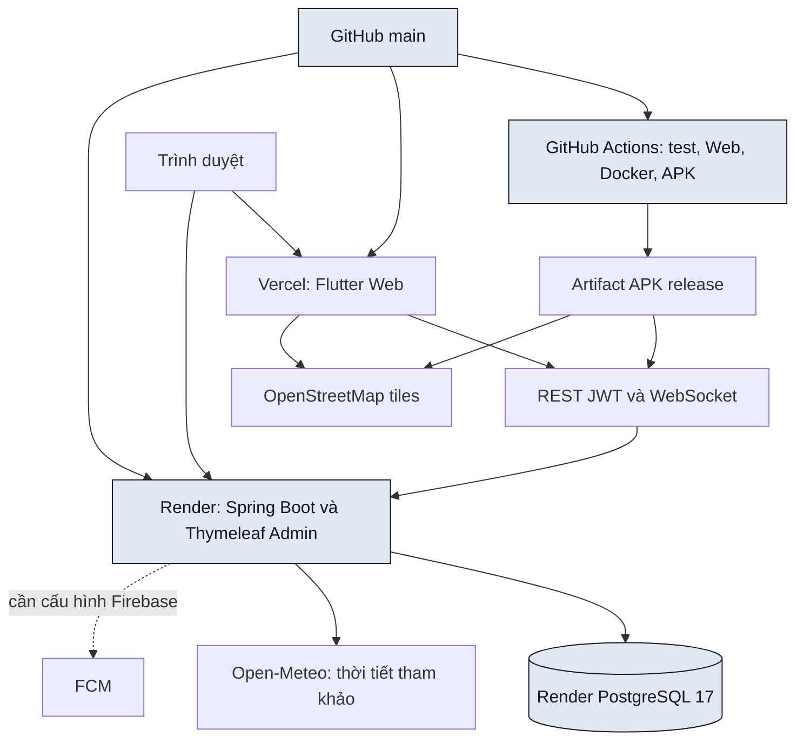

*Kiến trúc triển khai Vercel, Render và APK. Các tích hợp ngoài được ghi đúng trạng thái cấu hình.*

Web production: https://thoxay.vercel.app. Backend/Admin: https://thoxay-api.onrender.com. APK release mặc định dùng HTTPS Backend, không hard-code địa chỉ LAN. Vercel build script tự chuẩn bị Flutter theo version ghim. Render Docker multi-stage chạy kiểm thử trước khi đóng gói, ứng dụng dùng user không phải root, datasource/khóa JWT nhận qua môi trường hoặc secret files. Không đưa mật khẩu, token, service account hay ảnh người dùng thật vào Git.

Flyway dùng baseline 11 khi nhận database legacy đã có bảng và chạy V12–V21 theo thứ tự. Database mới chạy V1 rồi các migration tiếp theo. V1 được giữ bất biến; clean bị vô hiệu hóa. Production tắt SQL init và JPA dùng validate. Script migrations/ phục vụ đối chiếu/chạy thủ công an toàn lặp; không chạy lại seed như migration. Các chỉ mục mới hỗ trợ lịch, hàng chờ, unread và tổng hợp thu nhập.

Render Free có thể cần thời gian khởi động lại. Client kiểm tra GET readiness trước thao tác nghiệp vụ, chia sẻ cùng một lượt chờ và hủy request chờ khi dispose. Chỉ health được retry có giới hạn; các POST/PUT/DELETE không tự gửi lặp. Alias /api/auth/health có CORS cho Web. Không diễn giải cold start thành tỷ lệ sẵn sàng đã được kiểm định.

## 4.2. Các luồng nghiệp vụ chính

### 4.2.1. KYC hai mặt

Người dùng chụp/chọn hai ảnh bằng image_picker, xem trước/phóng to và gửi multipart. Server giải mã, giới hạn kích thước/pixel, chuẩn hóa JPEG và bỏ metadata; hồ sơ quay về chưa xác thực. Admin chỉ tải ảnh khi mở modal, xem hai mặt, phóng to đối chiếu và xác nhận kèm snapshot URL đã xem. Ảnh thay đổi sau khi mở dashboard sẽ làm lượt duyệt cũ không hợp lệ. Kiểm tra ảnh tự động không thay thế xác minh danh tính bằng con người.

### 4.2.2. Ví và ký quỹ 200.000đ

Ví chia main/escrow/held. Nạp tạo yêu cầu PENDING; QR chụp snapshot người nhận/số tiền/nội dung, Admin đối soát giao dịch thực tế mới cộng sổ. Rút giữ tiền ở held trước, Admin duyệt hoặc trả lại khi từ chối. Chuyển ký quỹ chỉ chuyển giữa các ngăn tiền, không tạo thu nhập. Dưới 200.000đ hiển thị cảnh báo, chưa chặn nhận việc. VietQR demo dùng BIN 000000 riêng trên database demo, không chuyển tiền thật.

### 4.2.3. Đánh giá và bậc thợ

Chủ thầu của công trình IN_PROGRESS gửi sao 1–5 cho đúng toàn bộ thợ ACCEPTED, server lưu và hoàn thành cùng giao dịch. Điểm trung bình chỉ tính đánh giá từ COMPLETED, chưa được đánh giá mặc định 5.0. GOLD cần uy tín ≥80, sao ≥4.0 và ≥5 công trình. DIAMOND cần uy tín ≥95, sao ≥4.7, ≥20 công trình và KYC. Các trường hợp khác là SILVER. Bảng xếp hạng sắp bậc rồi uy tín, sao, số công trình và ID ổn định.

### 4.2.4. Hủy việc và phạt 15 điểm

Thợ hủy đơn ACCEPTED phải cung cấp lý do. Server ghi CANCELLED, sự kiện uy tín, trừ 15 điểm trong giới hạn 0–100, tính lại bậc và cập nhật công suất/trạng thái công trình trong transaction. Gửi lại không trừ hai lần. Chưa có cơ chế tự trừ tiền ký quỹ khi hủy.

### 4.2.5. Tuyển dụng có lịch, lương và cam kết

Chủ thầu đặt cặp ngày bắt đầu/kết thúc; thợ chọn lương đề xuất và đồng thuận đúng termsVersion. Chủ thầu quyết định giá đề xuất hoặc giá gốc. Server chặn lịch giao nhau và ngày bận trước khi nhận, lưu agreedDailyRate, bản cam kết và SHA256 bất biến. Đơn legacy được giữ tương thích, không tự tạo bằng chứng đồng thuận lịch sử.

### 4.2.6. Chấm công và nghiệm thu

Thợ trong đơn ACCEPTED check-in/out bằng GPS trong 200m, độ chính xác tối đa 100m hoặc bằng mã QR ca làm hạn 5 phút. Mỗi đơn/ngày có một bản ghi. Checkout trong cùng ngày Việt Nam; ca qua đêm chưa được hỗ trợ. Thợ gửi ảnh cuối ca, chủ thầu duyệt hoặc yêu cầu bổ sung với version. Công trình mới yêu cầu đủ ca đã checkout và ảnh APPROVED trước khi thanh toán ngày công đúng số ca.

### 4.2.7. Chat và thông báo

Tin nhắn chỉ mở cho cặp thợ/chủ thầu của đơn ACCEPTED. REST lưu tin, WebSocket phát sự kiện sau commit, client khử trùng theo ID. Ảnh/GPS dùng xác nhận trước khi gửi; ảnh riêng tư cùng transaction với message. Read cursor tăng đơn điệu, chỉ cập nhật khi người dùng thực sự ở cuối chat đang hiện. Thông báo lưu trong DB; FCM cần cấu hình Firebase và token thiết bị hợp lệ.

### 4.2.8. SOS và thời tiết

Người dùng gửi SOS hoặc sự cố với mô tả và vị trí tự nguyện. Server lưu snapshot công trình/người báo, Admin nhận hàng chờ ưu tiên và ghi nhận xử lý/audit, người báo đọc phản hồi riêng. SOS không gọi lực lượng cứu hộ tự động. Widget thời tiết chỉ tham khảo từ Open-Meteo, có cache/stale/timeout và không khóa việc khi provider lỗi.

## 4.3. Ma trận 18 hạng mục nâng cao

Đề bài nhóm một số khả năng chung trong cùng mục. Bảng dưới tách thành 18 hạng mục nghiệm thu để đối chiếu, không coi chúng là 18 microservice.

| STT | Tính năng | Hành vi đã thực thi | Điểm đối chiếu |
| --- | --- | --- | --- |
| 1 | Bản đồ công trình | Ghim có lương, chọn ghim mở tóm tắt. | jobs, JobController, JobsMap |
| 2 | Bán kính Haversine | Lọc 2/5/10/20km và sắp xếp khoảng cách/lương. | JobRepository, WorkerHome |
| 3 | Chọn tọa độ đăng/sửa | Map Pin Picker lưu latitude/longitude. | JobController, LocationPicker |
| 4 | Chỉ đường | Mở điều hướng ngoài từ tọa độ công trình. | job_links, job_utilities |
| 5 | Chấm công GPS/QR | Bán kính 200m, QR hạn 5 phút, check-in/out. | AttendanceController, attendance_records |
| 6 | Nhật ký ảnh cuối ca | Upload ảnh, duyệt/bổ sung, điều kiện thanh toán. | work_logs, AttendanceScreen |
| 7 | Tổ đội thực | Mời/xác nhận, ứng tuyển và duyệt nguyên nhóm. | CrewController, crews, crew_members, crew_batches |
| 8 | VietQR | TLV/CRC, snapshot ngân hàng, Admin bật. | DepositController, receiving_bank_settings |
| 9 | Thương lượng lương | Proposed/agreed rate, lựa chọn giá gốc. | ApplicationController, CommitmentService |
| 10 | Lịch chống trùng | Ngày bận và kiểm tra lịch khi duyệt. | CalendarController, worker_calendar_blocks |
| 11 | Cam kết điện tử | Phiên bản đồng thuận, snapshot và SHA256. | CommitmentController, job_applications |
| 12 | SOS/sự cố | Ưu tiên, riêng tư, version và audit. | IncidentController, incidents |
| 13 | Portfolio tay nghề | Ảnh upload, caption, xem hồ sơ có quyền. | PortfolioController, portfolio_photos |
| 14 | Thời tiết | Open-Meteo, cache, dữ liệu cũ có nhãn. | WeatherController, WeatherCard |
| 15 | Lưu công trình | Danh sách yêu thích riêng của thợ. | FavoriteController, saved_jobs |
| 16 | Lưu thợ quen | Danh sách riêng của chủ thầu. | FavoriteController, saved_workers |
| 17 | Chat ảnh và GPS | Multipart/LOCATION, preview, ACL ảnh. | MessageController, message_attachments |
| 18 | Chia sẻ công trình | QR/link Web và mở sau đăng nhập. | SharedJobScreen, job_links |

## 4.4. Kết quả kiểm thử và build

| Lớp kiểm chứng | Kết quả chốt | Phạm vi và giới hạn |
| --- | --- | --- |
| Backend Maven verify | 125 test pass, 0 lỗi, 0 bỏ qua | H2/MockMvc, PostgreSQL migration riêng, cạnh tranh duyệt đơn, ACL, ví, ảnh và giờ Việt Nam. JVM test mặc định UTC. |
| Flutter | 110 test pass, analyze sạch | Mốc 108 được tăng bằng test khung Tổ đội 320/1440 và test QR demo không mời chuyển tiền thật. |
| JavaScript Node | 12 test pass | Schema/build config, bộ lọc Admin, KYC/lightbox và sự cố. |
| Python demo | 6 test pass | Chặn host/database/sự hiện diện dữ liệu thật, yêu cầu migration, chạy lặp không ghi đè. |
| JAR / Web release | Build thành công | Maven Spring Boot repackage và Flutter build web --release. |
| APK / CI | Workflow tự build khi push main | Chỉ tuyên bố run thành công sau khi đối chiếu trạng thái Actions; không có Android SDK local. |
| Chrome demo thật | 390/1440px, hai vai trò, Admin | Dùng API localhost và dữ liệu tổng hợp, đã kiểm tra ví/Top 3/chat/công trình và bốn template Admin. |
| Đối soát demo | Số dư/ledger/sao khớp | QR CRC, idempotency, earnings theo ngày, inbox dùng API thật. |

Lỗi lịch thu nhập khác nhau giữa Windows và CI UTC đã được tái hiện, thu nhỏ đến truy vấn ngày và sửa bằng TO_CHAR theo múi giờ Việt Nam trước khi parse LocalDate. Backend kiểm thử dưới UTC và đối chiếu thêm PostgreSQL thực tế, tránh việc H2 CAST DATE vô tình phụ thuộc timezone JVM. Không suy ra hiệu năng hoặc tỷ lệ bao phủ từ việc test pass.

Lệnh kiểm chứng có thể chạy lại:

```powershell
$env:THOXAY_PG_TEST_URL="jdbc:postgresql://127.0.0.1:55433/thoxay_upgrade_qa"
.\mvnw.cmd -B "-Dthoxay.build.directory=.local/advanced-target" verify
cd mobile_app
flutter analyze
flutter test
flutter build web --release --no-wasm-dry-run
cd ..
node --test scripts/deployment.test.mjs scripts/tests/*.test.cjs
```

## 4.5. Dữ liệu và quy trình bảo vệ

Demo chạy riêng trên thoxay_defense_demo, Backend loopback:18083 và Web loopback:3008, không dùng dữ liệu thật trên Render. Seed tạo 8 tài khoản có tiền tố DEMO, 8 việc OPEN, 39 việc COMPLETED với payment và sao thực sự được lưu trong database demo, 1 việc đang làm cùng chat/ảnh ca/nhóm/SOS. Số dư được đối soát từ ledger; ngày công quá khứ rải theo ngày để biểu đồ có ý nghĩa. Mật khẩu ngẫu nhiên chỉ lưu trong .local/demo/access.md, không được đưa vào báo cáo hoặc slide. Xem DEMO.md và KICH_BAN_DEMO_VA_HOI_DAP.md để chạy lại.

# Chương 5. Kết luận và hướng phát triển

## 5.1. Kết quả đạt được

Đồ án đã thực hiện một quy trình kết nối lao động có phân quyền, dữ liệu địa lý, lịch đồng thuận, bằng chứng ca làm và sổ tài chính có đối soát. Giao diện dùng role palette nhất quán, khung responsive, skeleton, empty states, tương phản Outdoor và hỗ trợ giảm chuyển động. Những ràng buộc quan trọng được thực thi trên server và database, thay vì chỉ ẩn nút ở giao diện. Migration, test, Docker và CI giúp tái lập, kiểm chứng và triển khai cùng mã nguồn cho Web/APK/Admin.

## 5.2. Hạn chế

Đây là sản phẩm đồ án, chưa được nghiệm thu khai thác thương mại hoặc kiểm thử tải quy mô lớn. KYC là kiểm tra ảnh và duyệt thủ công, không chứng minh danh tính bằng cơ sở dữ liệu dân cư. Ví không tự chuyển tiền ngân hàng, chưa là dịch vụ trung gian thanh toán. VietQR demo không có ngân hàng nhận thật. FCM cần tài khoản Firebase riêng. Cam kết là chứng cứ đồng thuận trong ứng dụng, chưa có chữ ký số của nhà cung cấp chứng thực. Check-in GPS có thể chịu sai số/giả vị trí, QR có thể bị chia sẻ; chưa coi đây là chống gian lận tuyệt đối. Ca qua đêm, thiết bị camera thực, QR ngân hàng thực, đánh giá pháp lý và kiểm thử khả năng tiếp cận với người dùng thực cần giai đoạn nghiệm thu tiếp theo.

## 5.3. Hướng phát triển

Bước tiếp theo ưu tiên quan trắc lỗi/hiệu năng và backup phục hồi database, kiểm thử thiết bị Android đa cấu hình, hoàn thiện xử lý ca qua đêm và quy trình điều chỉnh công có audit. Khi có hợp đồng dịch vụ phù hợp, có thể tích hợp eKYC, thông báo FCM production và đối soát ngân hàng tự động bằng webhook có chữ ký/idempotency. Khi lưu lượng tăng, cần đánh giá PostGIS/chỉ mục địa lý, object storage ảnh riêng tư có URL ngắn hạn và phát sự kiện nhiều instance qua broker. Mọi mở rộng phải giữ phân quyền, bảo vệ dữ liệu cá nhân và các bất biến ledger.

## 5.4. Đóng góp kỹ thuật của đồ án

Điểm thực hiện có thể bảo vệ bằng mã gồm khóa giao dịch theo thứ tự để chống nhận vượt/trùng lịch; chốt cam kết theo version và hash; xử lý ảnh riêng tư và bỏ metadata; sổ ví có ba ngăn cùng khóa idempotency; snapshot dữ liệu quan trọng trước thay đổi/xóa; và kiểm thử calendar/timezone dưới cả môi trường local và CI. Chưa thực hiện nghiên cứu so sánh định lượng, do đó không gán tỷ lệ cải thiện hiệu quả tuyển dụng hoặc năng suất lao động.

# Tài liệu và mã nguồn đối chiếu

- pom.xml, .flutter-version, mobile_app/pubspec.yaml và pubspec.lock: công nghệ/phiên bản.
- schema.sql, src/main/java, src/main/resources/db/migration: mô hình và nghiệp vụ.
- docs/PROJECT_INVENTORY.json: 30 bảng, toàn bộ cột/ràng buộc và ánh xạ controller.
- docs/ADVANCED_UPGRADE.md, DATABASE_MIGRATIONS.md, UI_UX_DESIGN_SYSTEM.md: đặc tả đã thực thi.
- docs/DEMO.md, FIREBASE.md, WALLET.md, KYC_CAMERA.md: cấu hình và giới hạn.
- .github/workflows, Dockerfile, render.yaml, vercel.json, scripts/build-vercel.mjs: CI và triển khai.
- src/test/java, mobile_app/test, scripts/tests: ca kiểm thử.
- docs/diagrams: ảnh sơ đồ render từ mọi khối Mermaid trong báo cáo.
- docs/KICH_BAN_DEMO_VA_HOI_DAP.md: trình diễn và câu hỏi bảo vệ.

Các tệp .local chứa log, ảnh QA và thông tin truy cập demo không được commit. Không trích dữ liệu cá nhân, khóa hoặc mật khẩu thật vào tài liệu bảo vệ.
