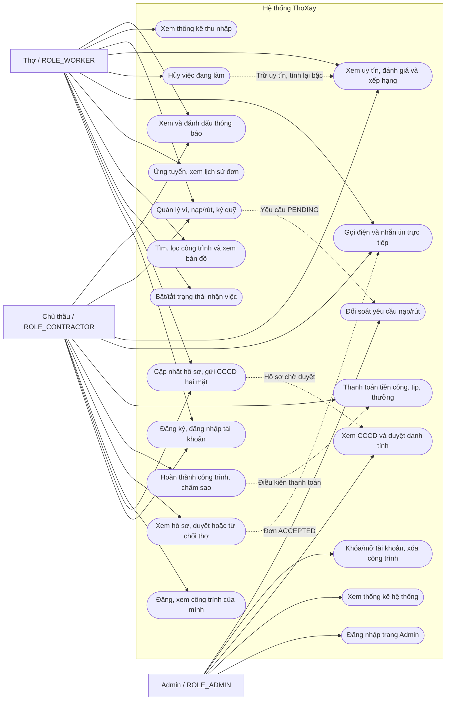
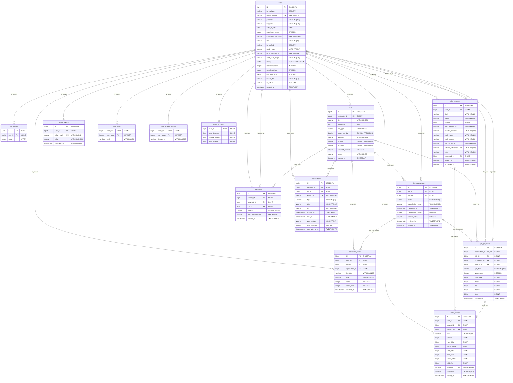
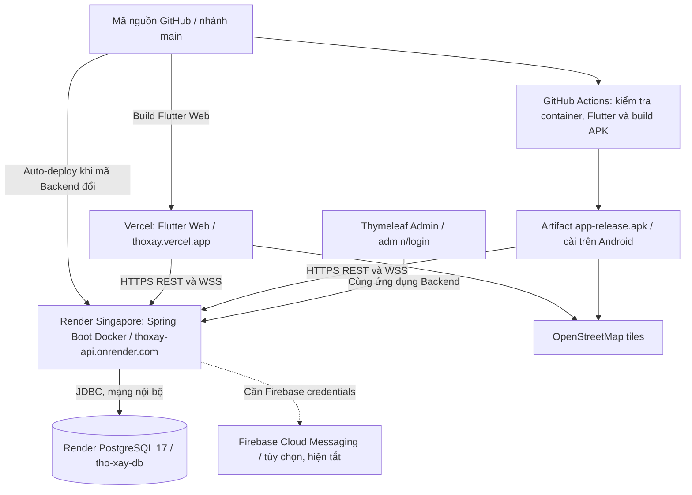

# BÁO CÁO ĐỒ ÁN TỐT NGHIỆP

## Đề tài: Ứng dụng di động kết nối lao động phổ thông và chủ thầu — ThoXay

**Ngày chốt số liệu:** 28/10/2026, múi giờ Việt Nam.

**Mã nguồn khảo sát:** nhánh `main`, commit `9caeabf853e3c00a4d529629cdfc513d94250e68`.

**Phương pháp:** đối chiếu mã Java/Dart, DDL, migration, DTO, controller, service, cấu hình build/deploy, mã kiểm thử và kết quả kiểm thử đã có. Các số liệu dưới đây là số lượng thành phần phần mềm, không phải số người dùng hoặc giao dịch thực tế.

## Tóm tắt

ThoXay hỗ trợ kết nối người thợ với chủ công trình xây dựng thông qua vị trí địa lý, loại việc và mức lương theo ngày. Hệ thống cung cấp quy trình đăng tuyển, ứng tuyển, duyệt thợ, liên lạc, hoàn thành công trình, đánh giá và thanh toán nội bộ. Quản trị viên quản lý tài khoản, duyệt hồ sơ CCCD hai mặt và đối soát yêu cầu nạp/rút tiền.

Backend được tổ chức dưới dạng ứng dụng Spring Boot nhiều mô-đun nghiệp vụ trong cùng một tiến trình, lưu dữ liệu bằng PostgreSQL. Flutter dùng chung mã nguồn cho giao diện thợ/chủ thầu trên Android và Web; giao diện Admin dùng Thymeleaf. REST API sử dụng JWT, còn trang Admin sử dụng phiên đăng nhập. Tin nhắn được lưu trong database và cập nhật qua WebSocket. Bản Web được triển khai trên Vercel; Backend/Admin và PostgreSQL chạy trên Render; GitHub Actions tạo APK release.

Kết quả khảo sát ghi nhận **93 tệp Java sản xuất, 47 tệp Dart trong `lib`, 14 tệp màn hình Flutter, 12 entity JPA, 14 bảng dữ liệu với 131 cột, 13 controller và 49 ánh xạ HTTP khai báo tại controller**. Bộ kiểm thử chính có **64 test Backend và 47 test Flutter**, tổng cộng **111 test**. Hệ thống đã có bản triển khai và APK, nhưng chưa có cơ sở để khẳng định hiệu năng phục vụ số lượng người dùng lớn hoặc hiệu quả kinh tế qua khảo sát thực địa.

**Từ khóa:** lao động phổ thông; xây dựng; Flutter; Spring Boot; PostgreSQL; KYC; WebSocket; ví nội bộ.

## Danh mục thuật ngữ

| Thuật ngữ | Ý nghĩa trong đồ án |
| --- | --- |
| Thợ | Người dùng `ROLE_WORKER`, tìm và ứng tuyển công trình |
| Chủ thầu | Người dùng `ROLE_CONTRACTOR`, đăng tuyển và quản lý công trình |
| Admin | Người dùng `ROLE_ADMIN`, quản trị và đối soát |
| Công trình / Job | Một tin tuyển dụng có tọa độ, đơn giá/ngày và số thợ cần tuyển |
| Đơn ứng tuyển | Liên kết giữa một thợ với một công trình; mỗi cặp chỉ có một đơn |
| KYC / CCCD | Hồ sơ ảnh căn cước hai mặt, được Admin duyệt danh tính |
| JWT | Token xác thực REST API có chữ ký và thời hạn |
| Idempotent | Gửi lại cùng yêu cầu hợp lệ không tạo thêm tác động nghiệp vụ |
| Số dư chính | Số tiền nội bộ có thể dùng để chi trả hoặc tạo yêu cầu rút |
| Ký quỹ | Số dư dự phòng tự chuyển từ số dư chính; chưa gắn với từng công trình |
| Giữ chỗ | Số tiền đã dành riêng cho yêu cầu rút đang chờ xử lý |
| Uy tín | Điểm từ 0–100, khác với điểm đánh giá 1–5 sao |

## Mục lục

1. [Chương 1 — Tổng quan đề tài](#chuong-1)
2. [Chương 2 — Công nghệ sử dụng](#chuong-2)
3. [Chương 3 — Phân tích và thiết kế hệ thống](#chuong-3)
4. [Chương 4 — Triển khai và kiểm thử](#chuong-4)
5. [Chương 5 — Kết luận và hướng phát triển](#chuong-5)
6. [Tài liệu và mã nguồn đối chiếu](#tai-lieu)

<a id="chuong-1"></a>

# Chương 1. Tổng quan đề tài

## 1.1. Lý do chọn đề tài

Nhu cầu tuyển thợ xây dựng thường gắn với địa điểm thi công, thời gian và số lượng lao động cụ thể. Khi thông tin được trao đổi phân tán qua điện thoại hoặc người quen, người thợ khó so sánh cơ hội việc làm quanh vị trí của mình; chủ thầu khó tổng hợp ứng viên và theo dõi kết quả tuyển dụng. Việc thiếu lịch sử làm việc và cơ chế ghi nhận đánh giá cũng làm giảm khả năng tham khảo thông tin trước khi hợp tác.

Đề tài xây dựng một ứng dụng tập trung hóa các thao tác trên: thể hiện địa điểm bằng bản đồ, công khai mức lương theo ngày, quản lý trạng thái ứng tuyển và lưu lịch sử trao đổi. Hồ sơ CCCD, đánh giá sao, điểm uy tín và quy trình đối soát ví bổ sung các căn cứ quản lý trong phạm vi ứng dụng. Đây là động cơ và bài toán thiết kế của đồ án; mã nguồn không chứa khảo sát thị trường để định lượng mức độ phổ biến hoặc tỷ lệ cải thiện so với cách tuyển dụng truyền thống.

## 1.2. Mục tiêu

- Xây dựng Backend có xác thực, phân quyền và kiểm tra quyền sở hữu dữ liệu cho ba vai trò.
- Hỗ trợ thợ tìm công trình theo GPS, bán kính, loại việc và mức lương; hỗ trợ chủ thầu đăng tuyển và duyệt ứng viên.
- Khép kín quy trình hợp tác bằng liên lạc sau khi được nhận, hoàn thành công trình và đánh giá thợ.
- Quản lý hồ sơ mở rộng, CCCD hai mặt, điểm uy tín, bậc thợ và lịch sử thông báo.
- Cung cấp sổ ví VND nội bộ, ký quỹ, yêu cầu nạp/rút chờ Admin và thống kê thu nhập đã thanh toán.
- Tạo được bản Web và APK có thể sử dụng Backend online; duy trì kiểm thử và checkpoint GitHub.

## 1.3. Phạm vi

Đối tượng công việc hiện được giới hạn ở **Thợ chính** và **Phụ hồ**. Một tài khoản giữ một vai trò trong ba vai trò của hệ thống. Hai vai trò thợ và chủ thầu được đăng ký công khai; Admin được cấp quyền bằng quy trình quản trị, không qua form đăng ký công khai.

Sản phẩm đã có giao diện Android/Flutter Web và Web Admin, Backend REST/WebSocket, PostgreSQL, Dockerfile, migration và các workflow CI. Những thư mục nền tảng Flutter khác không đồng nghĩa với việc đã phát hành hoặc nghiệm thu iOS/desktop. Phạm vi báo cáo sử dụng bằng chứng build Android và Web hiện có.

Các giới hạn nghiệp vụ cần phân biệt:

- Kiểm tra ảnh CCCD tự động chỉ kiểm tra tệp, kích thước và chuẩn hóa ảnh; **Admin duyệt danh tính**, chưa có OCR/eKYC hoặc đối soát dân cư.
- Ví là **sổ số dư nội bộ**; nạp/rút đối soát thủ công, chưa có cổng thanh toán hoặc API ngân hàng tự chuyển tiền.
- Ký quỹ dưới 200.000đ phát cảnh báo; chưa chặn nhận việc, chưa thu phạt tiền và chưa khóa ký quỹ theo từng công trình.
- GPS dùng làm tâm truy vấn tìm việc; chưa có theo dõi vị trí thợ liên tục hoặc điều phối cuốc việc tự động.
- Push FCM có mã tích hợp nhưng cần Firebase riêng; cấu hình triển khai hiện ghi nhận FCM tắt. Lịch sử thông báo vẫn được lưu và đọc qua API.

## 1.4. Ba nhóm người sử dụng

| Nhóm | Nhu cầu chính | Giao diện sử dụng |
| --- | --- | --- |
| Thợ | Tìm việc phù hợp vị trí, ứng tuyển, trao đổi, theo dõi hồ sơ, uy tín và thu nhập | Flutter Android/Web, tông cam `#EA580C` |
| Chủ thầu | Đăng công trình, tuyển thợ, theo dõi ứng viên, chốt đánh giá và thanh toán | Flutter Android/Web, tông xanh lục bảo `#059669` |
| Admin | Duyệt CCCD, quản lý hoạt động tài khoản/công trình, đối soát nạp/rút | Thymeleaf/Bootstrap, nền Navy `#0F172A`, sidebar `#1E293B`, nhấn `#3B82F6` |

## 1.5. Phương pháp thực hiện và đánh giá

Hệ thống phân chia trách nhiệm theo controller → service → repository → PostgreSQL. DTO kiểm soát dữ liệu vào/ra; transaction và khóa ghi bảo vệ các nghiệp vụ duyệt, chốt sao, hủy và chuyển số dư. Kiểm thử Backend xác nhận HTTP, quyền truy cập, dữ liệu và một số tình huống cạnh tranh; kiểm thử Flutter xác nhận xử lý API, trạng thái và tương tác widget. Kết quả được đánh giá bằng những ca kiểm thử, bản build và cấu hình triển khai có thể đối chiếu, không suy diễn thành số liệu khảo sát người dùng.

<a id="chuong-2"></a>

# Chương 2. Công nghệ sử dụng

## 2.1. Backend và cơ sở dữ liệu

Phiên bản khai báo trực tiếp được đọc từ `pom.xml`; phiên bản dependency được Spring Boot quản lý được đối chiếu với các thư viện trong bản JAR đã build. Vì vậy bảng phân biệt rõ cấu hình ngôn ngữ, dependency đã resolve và phiên bản nền tảng không được ghim.

| Công nghệ | Phiên bản/cấu hình kiểm chứng | Vai trò và nguồn |
| --- | --- | --- |
| Java | Target **17**; CI dùng Temurin **17**; image `eclipse-temurin:17-jdk-jammy` và `17-jre-jammy` | Ngôn ngữ Backend; `pom.xml`, `Dockerfile`, workflow APK. Tag image không ghim số patch/digest |
| Maven | **3.9.16**; Maven Wrapper **3.3.4** | Quản lý dependency, test và đóng gói JAR; `.mvn/wrapper/maven-wrapper.properties` |
| Spring Boot | **3.5.16**; ứng dụng Backend **1.0.0** | Khởi tạo ứng dụng, cấu hình, REST/MVC/WebSocket; parent và artifact trong `pom.xml` |
| Spring Framework MVC | **6.2.19**, dependency đã resolve | HTTP controller, multipart và WebSocket; JAR `spring-webmvc` |
| Spring Security | **6.5.11**, dependency đã resolve | REST stateless JWT, form login Admin, CSRF, BCrypt, phân quyền; `SecurityConfig` |
| JWT / JJWT | **0.12.6** cho `jjwt-api`, `jjwt-impl`, `jjwt-jackson` | Ký/kiểm tra JWT bằng khóa HMAC; `JwtUtil`. Không khai báo cứng một thuật toán HS cụ thể trong code |
| Spring Data JPA / Hibernate | Starter JPA thuộc Boot **3.5.16**; Hibernate **6.6.53.Final** đã resolve | Ánh xạ entity, truy vấn và khóa `PESSIMISTIC_WRITE` |
| PostgreSQL | Cloud cấu hình major **17** | Lưu 14 bảng và ảnh CCCD `BYTEA`; `render.yaml`. Không ghim bản patch server trong repository |
| PostgreSQL JDBC | **42.7.11**, dependency đã resolve | Kết nối Java–PostgreSQL; thư viện runtime trong JAR |
| Thymeleaf | **3.1.5.RELEASE**, gồm `thymeleaf-spring6` | Render Admin tại server; ba template dashboard, login và wallet |
| Bootstrap | **5.3.8**, CSS/JS lưu trong `static/vendor/bootstrap` | Layout, bảng, badge và modal CCCD; đọc version từ header file |
| Firebase Admin Java | **9.11.0** | Gateway gửi push có điều kiện cấu hình; `pom.xml`, package `notification` |

Các starter Spring Security/JPA/Thymeleaf không có version độc lập được ghi đè trong `pom.xml`; Spring Boot parent quản lý chúng. Các số resolve nêu trên phản ánh bản build đã kiểm chứng, không phải số phiên bản tự suy ra từ tên starter. Cơ sở dữ liệu local mặc định tên `tho_xay_db`; production nhận thông số kết nối từ môi trường/secret file, không dùng mật khẩu local làm cấu hình cloud.

## 2.2. Flutter và các thư viện client

Flutter được ghim **3.47.8** trong `.flutter-version` và workflow APK. SDK local tương ứng sử dụng **Dart 3.13.7**; `pubspec.yaml` cho phép Dart `>=3.13.0 <4.0.0`, Flutter `>=3.47.0`. Phiên bản ứng dụng là **0.1.0+1**. Các số dưới đây là bản đã resolve trong `pubspec.lock`, không phải chỉ cận dưới có dấu `^`.

| Thư viện | Phiên bản resolve | Vai trò |
| --- | --- | --- |
| `http` | 1.6.0 | REST JSON, multipart CCCD, gắn Bearer JWT |
| `shared_preferences` | 2.5.6 | Lưu/khôi phục phiên đăng nhập và dấu phục hồi camera |
| `geolocator` | 14.1.2 | Quyền và tọa độ GPS khi tìm/đăng công trình |
| `flutter_map` | 8.3.2 | Bản đồ OpenStreetMap, ghim và chọn tọa độ |
| `latlong2` | 0.9.1 | Biểu diễn tọa độ cho bản đồ |
| `image_picker` | 1.2.4 | Chụp hai mặt CCCD; chọn tệp khi nền tảng không có camera phù hợp |
| `url_launcher` | 6.3.3 | Mở `tel:` và đường dẫn attribution OpenStreetMap |
| `web_socket_channel` | 3.0.3 | Kênh nhận tin nhắn thời gian thực |
| `firebase_core` | 5.1.0 | Khởi tạo Firebase trên Android/iOS khi có cấu hình |
| `firebase_messaging` | 17.0.1 | Quyền thông báo, đăng ký thiết bị và nhận push |

Giao diện dùng Material 3, locale tiếng Việt và theme theo vai trò. Shimmer được tự xây bằng `AnimationController`/`ShaderMask` trong `loading_jobs.dart`; **không có dependency `shimmer`** trong `pubspec.yaml`. Bản đồ giữ attribution OpenStreetMap và `userAgentPackageName` riêng; test dùng tile provider giả thay vì tải tile thật.

## 2.3. Build, CI/CD và nền tảng triển khai

| Thành phần | Phiên bản/cấu hình thực tế | Chức năng |
| --- | --- | --- |
| Docker | Không ghim Docker Engine; multi-stage Temurin Java 17 trên Ubuntu Jammy | Build bằng Maven `verify`, chạy JRE với user 10001, group bổ sung 1000 và giới hạn heap theo RAM |
| GitHub Actions | Không có số version chung được ghim cho dịch vụ; runner `ubuntu-latest` | Hai workflow: `Build Flutter APK` và `Check cloud deployment` |
| Actions dùng trong repo | `checkout@v7`, `setup-java@v6`, `upload-artifact@v7`, `setup-node@v6`, `subosito/flutter-action@v2` | Checkout, Java 17, Node 24, Flutter 3.47.8, lưu artifact APK 30 ngày; các action ghim theo tag major |
| Node.js | **24** trong workflow; project Vercel dùng **24.x** theo hồ sơ triển khai | Chạy build script Flutter Web, kiểm tra schema/cấu hình và phục vụ Web local |
| Render | SaaS, không có phiên bản sản phẩm được ghim trong repo; **Docker Web Service Free**, Singapore, một instance | Chạy Spring Boot/Admin và Managed Postgres major 17 |
| Vercel | SaaS, không có phiên bản sản phẩm được ghim trong repo; framework `null`/Other | Build và phục vụ Flutter Web từ `mobile_app/build/web` |

Không đồng nhất phiên bản CLI cài riêng trên máy với phiên bản ứng dụng hoặc phiên bản dịch vụ Render/Vercel. `render.yaml` là Blueprint tham khảo; dịch vụ đang chạy được tạo trực tiếp bằng CLI và quản lý môi trường/Secret Files trong Render, theo [hồ sơ triển khai](DEPLOY_VERCEL.md).

<a id="chuong-3"></a>

# Chương 3. Phân tích và thiết kế hệ thống

## 3.1. Kiến trúc phần mềm và phân chia trách nhiệm

Backend là một ứng dụng triển khai chung, chưa tách microservice. Nhóm `controller` xử lý REST thông thường; `admin` xử lý dashboard; `kyc` xử lý ảnh; `wallet` xử lý số dư/thanh toán; `notification` xử lý push; `chat` xử lý WebSocket. Service kiểm tra quyền và điều kiện nghiệp vụ trước khi repository đọc/ghi PostgreSQL. DTO ngăn việc trả trực tiếp toàn bộ entity chứa mật khẩu, ảnh riêng tư hoặc thông tin ngân hàng không phù hợp.

Flutter tổ chức thành `screens`, `widgets`, `models`, `services`, `theme`. `ApiService` tập trung URL, HTTP, phiên và lỗi; `ChatController` quản lý lịch sử, gửi lại và kết nối chat; các màn hình sử dụng chung widget hồ sơ, ví, bản đồ, card công trình, trạng thái chờ và trạng thái trống.

## 3.2. Danh sách chức năng theo đối tượng

### 3.2.1. Thợ

| Nhóm | Chức năng thực tế |
| --- | --- |
| Tài khoản | Đăng ký bằng họ tên, số điện thoại, mật khẩu; đăng nhập/đăng xuất và khôi phục phiên |
| Hồ sơ | Cập nhật họ tên, ngày sinh, số năm/mô tả kinh nghiệm, tối đa 20 kỹ năng và 10 URL HTTPS ảnh dự án |
| CCCD | Chụp/chọn đủ mặt trước và sau, xem lại và gửi multipart; theo dõi trạng thái xác thực |
| Nhận việc | Bật/tắt Online; đăng ký mới được service đặt Offline, dù default DDL `is_available` là TRUE |
| Tìm việc | GPS hoặc tọa độ nhập; bán kính mặc định 10 km, API nhận 0,1–200 km; lọc Thợ chính/Phụ hồ; sắp theo khoảng cách hoặc lương giảm dần; xem ghim bản đồ |
| Ứng tuyển | Gửi đơn, xem lịch sử/trạng thái; không tạo đơn trùng cho cùng công trình |
| Liên lạc | Xem số điện thoại, gọi `tel:` và chat với chủ thầu khi đơn `ACCEPTED` |
| Hủy việc | Hủy đơn `ACCEPTED` thuộc công trình `IN_PROGRESS`, ghi lý do và nhận mức phạt uy tín |
| Uy tín | Xem sao, bậc, số công trình đã hoàn thành, lịch sử uy tín, đánh giá và bảng xếp hạng |
| Thông báo | Xem lịch sử, số chưa đọc, đánh dấu một/tất cả đã đọc; bật push khi có Firebase |
| Tài chính | Số dư, yêu cầu nạp/rút, ký quỹ, lịch sử biến động; thu nhập Ngày/Tuần/Tháng tách tiền công, tip và thưởng |

### 3.2.2. Chủ thầu

| Nhóm | Chức năng thực tế |
| --- | --- |
| Tài khoản/hồ sơ | Đăng ký vai trò Chủ thầu, đăng nhập, sửa hồ sơ mở rộng và gửi CCCD hai mặt |
| Công trình | Đăng tiêu đề, mô tả, loại việc, lương/ngày, địa chỉ, tọa độ, số thợ; lấy GPS, nhập hoặc chọn ghim trên bản đồ |
| Tuyển dụng | Xem công trình của mình, danh sách ứng viên và hồ sơ thợ; chấp nhận/từ chối đơn `PENDING` |
| Hợp tác | Liên lạc điện thoại/chat với thợ đã nhận; được thông báo khi có ứng viên hoặc thợ hủy |
| Hoàn thành | Chốt `COMPLETED` và gửi sao 1–5 cho đúng toàn bộ thợ còn `ACCEPTED` |
| Thanh toán | Trả tiền từ số dư chính cho từng thợ sau hoàn thành và đánh giá; xác nhận số ngày công, tip, thưởng; xem khoản đã trả |
| Ví/thông báo | Nạp/rút chờ Admin, chuyển ký quỹ, lịch sử ví và thông báo; xem bảng xếp hạng/hồ sơ thợ |

Không có controller công khai cho sửa/xóa công trình của chủ thầu, hủy công trình tùy ý hoặc đổi vai trò tài khoản. Báo cáo không xem các thao tác này là chức năng đã hoàn thành.

### 3.2.3. Admin

| Nhóm | Chức năng thực tế |
| --- | --- |
| Đăng nhập | Form riêng `/admin/login`, sử dụng session và CSRF cho thao tác ghi |
| Thống kê | Tổng tài khoản, tài khoản hoạt động, hồ sơ đủ ảnh chờ duyệt, công trình OPEN và tỷ lệ đã xác thực |
| Tài khoản | Xem danh sách, khóa/mở khóa thợ hoặc chủ thầu; ẩn và chặn thao tác khóa mọi Admin |
| CCCD | Xem hai ảnh trong modal; nút xác thực chỉ sẵn sàng khi đã tải đủ; xác nhận đúng hai URL đang xem |
| Công trình | Xem/xóa công trình; xóa đơn và tin liên quan, tính lại sao/số công trình hoàn thành; giữ lịch sử tài chính đã chốt |
| Ví | Xem hàng chờ nạp/rút, duyệt sau đối soát thực tế hoặc từ chối có lý do; lưu mã giao dịch và người xử lý |

Tỷ lệ KYC trên dashboard là `round(số tài khoản is_verified=true × 100 / tổng tài khoản)`, bằng 0 khi chưa có tài khoản. Mẫu số là toàn bộ tài khoản trong dashboard, không phải chỉ số hồ sơ đã nộp, nên đây không phải tỷ lệ vượt kiểm tra eKYC.

## 3.3. Sơ đồ Use Case tổng quát

Sơ đồ dùng Mermaid `flowchart`, biểu diễn ba actor và các ca sử dụng bằng nút bo tròn. Đường nét đứt diễn tả điều kiện/liên hệ nghiệp vụ; đây là biểu diễn Use Case để đọc trên Markdown, không khai báo một loại sơ đồ Mermaid `useCaseDiagram`.



## 3.4. Mô hình trạng thái và quy tắc dữ liệu

| Đối tượng | Trạng thái và chuyển tiếp thực tế |
| --- | --- |
| Công trình | Mới tạo `OPEN`; đủ số đơn ACCEPTED chuyển `IN_PROGRESS`; chủ thầu chốt sao chuyển `COMPLETED`. Enum còn có `CANCELLED`, nhưng chưa có API hủy công trình riêng |
| Đơn ứng tuyển | `PENDING` → `ACCEPTED` hoặc `REJECTED`; `ACCEPTED` → `CANCELLED` khi đủ điều kiện hủy. Hoàn thành công trình không đổi đơn ACCEPTED thành trạng thái COMPLETED |
| Hồ sơ KYC | `is_verified=false` khi tạo, thay ảnh hoặc đổi họ tên/ngày sinh; chỉ Admin duyệt hồ sơ đủ hai mặt mới chuyển true |
| Yêu cầu ví | `PENDING` → `APPROVED` hoặc `REJECTED`; kết quả đã chốt không đổi sang quyết định khác |

`JobRepository.findNearby` thực tế tìm cả `OPEN` **và `IN_PROGRESS` còn vị trí trống**, chỉ lấy chủ thầu đang hoạt động. Đây là hành vi đã nâng cấp để tuyển người thay thế sau khi hủy, khác mô tả cũ chỉ tìm OPEN. Công thức Haversine dùng bán kính Trái Đất 6.371 km trên tọa độ double; hiện không dùng PostGIS.

Service khóa công trình khi duyệt, hoàn thành, hủy hoặc thanh toán. Khi cần khóa nhiều thợ/ví, thứ tự ID tăng dần giúp hạn chế tranh chấp và tránh cập nhật sai số dư/điểm trung bình. Quyền sở hữu vẫn được kiểm tra tại service, không chỉ dựa vào việc ẩn nút trên Flutter/Admin.

## 3.5. Sơ đồ ERD toàn bộ cơ sở dữ liệu

Có **14 bảng vật lý**, trong đó `user_skills` và `user_project_images` là `@ElementCollection` của `User`, không có entity Java riêng. ERD mô tả FK thật trong DDL, gồm cả những FK có thể NULL để giữ lịch sử. Ký hiệu `PK`, `FK`, `UK` trong Mermaid dùng cho khóa cột; UNIQUE ghép được trình bày ở đặc tả từng bảng, không hiểu thành UNIQUE riêng từng thành phần.



Hai ảnh CCCD được liên kết ở `users.cccd_front_image`/`cccd_back_image` bằng đường dẫn riêng chứa UUID của `kyc_images`. Hai cột này là **VARCHAR, không phải FK SQL**. Khi dùng client cũ, chúng còn có thể chứa URL HTTPS. Bảng `kyc_images` có FK `user_id`; giới hạn hai ảnh hiện tại được thực hiện trong service thay thế hồ sơ, không phải ràng buộc số dòng trong database.

## 3.6. Đặc tả toàn bộ bảng dữ liệu

Nguồn chuẩn kiểu SQL và ràng buộc là [schema.sql](../schema.sql), đối chiếu với entity JPA. `BIGSERIAL` là định danh tự tăng trên nền BIGINT; PK luôn NOT NULL. `TIMESTAMP` được dùng với thời gian local của các entity gốc; `TIMESTAMPTZ` được dùng với `Instant` của các mô-đun mới. Trong bảng, `—` ở cột mặc định nghĩa là DDL không khai báo default; service/entity có thể vẫn gán giá trị khi tạo.

### 3.6.1. Bảng `users` — User

| Tên cột | Kiểu PostgreSQL | Khóa | Cho NULL | Mặc định DDL | Mô tả |
| --- | --- | --- | --- | --- | --- |
| `id` | `BIGSERIAL` | PK | Không | Tự tăng | Định danh tài khoản |
| `is_available` | `BOOLEAN` | — | Không | `TRUE` | Cờ sẵn sàng nhận việc; đăng ký qua service đặt false |
| `phone_number` | `VARCHAR(15)` | UK | Không | — | Số điện thoại dùng đăng nhập, duy nhất |
| `password` | `VARCHAR(255)` | — | Không | — | Chuỗi băm BCrypt; không trả qua DTO |
| `full_name` | `VARCHAR(100)` | — | Không | — | Họ tên hiển thị |
| `date_of_birth` | `DATE` | — | Có | — | Ngày sinh, không đưa vào hồ sơ thợ công khai |
| `experience_years` | `INTEGER` | — | Không | `0` | Số năm kinh nghiệm |
| `experience_summary` | `VARCHAR(2000)` | — | Có | — | Mô tả kinh nghiệm |
| `role` | `VARCHAR(30)` | — | Không | — | ROLE_WORKER, ROLE_CONTRACTOR hoặc ROLE_ADMIN |
| `is_verified` | `BOOLEAN` | — | Không | `FALSE` | Kết quả duyệt danh tính; luôn chưa xác thực khi đăng ký |
| `cccd_image` | `VARCHAR(500)` | — | Có | — | Đường dẫn ảnh CCCD legacy được giữ để tương thích |
| `cccd_front_image` | `VARCHAR(500)` | — | Có | — | URL HTTPS hoặc đường dẫn ảnh mặt trước riêng tư |
| `cccd_back_image` | `VARCHAR(500)` | — | Có | — | URL HTTPS hoặc đường dẫn ảnh mặt sau riêng tư |
| `rating` | `DOUBLE PRECISION` | — | Không | `5.0` | Sao trung bình từ công trình đã hoàn thành |
| `reputation_score` | `INTEGER` | — | Không | `100` | Điểm uy tín 0–100 |
| `completed_jobs` | `INTEGER` | — | Không | `0` | Số đơn có đánh giá thuộc công trình hoàn thành |
| `cancelled_jobs` | `INTEGER` | — | Không | `0` | Số lần hủy việc được ghi nhận |
| `worker_tier` | `VARCHAR(12)` | — | Không | `'SILVER'` | Bậc SILVER, GOLD hoặc DIAMOND do service/entity tính |
| `is_active` | `BOOLEAN` | — | Không | `TRUE` | Cho phép hoạt động; false chặn đăng nhập/JWT cũ |
| `created_at` | `TIMESTAMP` | — | Không | `CURRENT_TIMESTAMP` | Thời điểm tạo tài khoản |

`phone_number` UNIQUE; role có CHECK ba vai trò; rating trong [0,5], uy tín trong [0,100]. CHECK hai mặt CCCD chặn verified=true khi thiếu đường dẫn hợp lệ. Bậc do enum/service tính; DDL không đặt CHECK riêng cho `worker_tier`. Giá trị rating mặc định 5,0 không chứng minh đã có đánh giá.

### 3.6.2. Bảng `kyc_images` — KycImage

| Tên cột | Kiểu PostgreSQL | Khóa | Cho NULL | Mặc định DDL | Mô tả |
| --- | --- | --- | --- | --- | --- |
| `id` | `UUID` | PK | Không | — | UUID định danh ảnh, sinh ở Java |
| `user_id` | `BIGINT` | FK → `users.id` | Không | — | Chủ hồ sơ CCCD |
| `content` | `BYTEA` | — | Không | — | Nội dung JPEG đã chuẩn hóa, chỉ đọc qua endpoint có kiểm tra quyền |

Upload mới kiểm tra đủ hai mặt, xóa ảnh cũ rồi lưu hai ảnh trong cùng transaction. Không có cột mặt trước/mặt sau ở bảng ảnh; vai trò mặt ảnh được xác định bằng hai đường dẫn trên users.

**Khi xóa bản ghi cha:** `user_id` → `users.id`: ON DELETE CASCADE.

### 3.6.3. Bảng `jobs` — Job

| Tên cột | Kiểu PostgreSQL | Khóa | Cho NULL | Mặc định DDL | Mô tả |
| --- | --- | --- | --- | --- | --- |
| `id` | `BIGSERIAL` | PK | Không | Tự tăng | Định danh công trình/tin tuyển |
| `contractor_id` | `BIGINT` | FK → `users.id` | Không | — | Chủ thầu sở hữu công trình |
| `title` | `VARCHAR(200)` | — | Không | — | Tiêu đề tuyển dụng |
| `description` | `TEXT` | — | Có | — | Mô tả chi tiết công việc |
| `job_type` | `VARCHAR(50)` | — | Không | — | Thợ chính hoặc Phụ hồ |
| `salary_per_day` | `DOUBLE PRECISION` | — | Không | — | Đơn giá theo ngày; phải lớn hơn 0 |
| `address` | `VARCHAR(255)` | — | Không | — | Địa chỉ thi công |
| `latitude` | `DOUBLE PRECISION` | — | Không | — | Vĩ độ −90 đến 90 |
| `longitude` | `DOUBLE PRECISION` | — | Không | — | Kinh độ −180 đến 180 |
| `required_workers` | `INTEGER` | — | Không | — | Số lượng thợ cần, lớn hơn 0 |
| `status` | `VARCHAR(30)` | — | Không | `'OPEN'` | OPEN, IN_PROGRESS, COMPLETED hoặc CANCELLED |
| `created_at` | `TIMESTAMP` | — | Không | `CURRENT_TIMESTAMP` | Thời điểm đăng công trình |

CHECK loại việc, lương >0, tọa độ hợp lệ, số thợ >0 và bốn trạng thái. Khóa job được dùng khi duyệt/hoàn thành/hủy/thanh toán.

**Khi xóa bản ghi cha:** `contractor_id` → `users.id`: NO ACTION mặc định.

### 3.6.4. Bảng `job_applications` — JobApplication

| Tên cột | Kiểu PostgreSQL | Khóa | Cho NULL | Mặc định DDL | Mô tả |
| --- | --- | --- | --- | --- | --- |
| `id` | `BIGSERIAL` | PK | Không | Tự tăng | Định danh đơn |
| `job_id` | `BIGINT` | FK → `jobs.id`; UK ghép 1 | Không | — | Công trình ứng tuyển |
| `worker_id` | `BIGINT` | FK → `users.id`; UK ghép 1 | Không | — | Người thợ gửi đơn |
| `status` | `VARCHAR(30)` | — | Không | `'PENDING'` | PENDING, ACCEPTED, REJECTED hoặc CANCELLED |
| `cancellation_reason` | `VARCHAR(500)` | — | Có | — | Lý do hủy, do thợ cung cấp |
| `cancelled_at` | `TIMESTAMPTZ` | — | Có | — | Thời điểm hủy việc |
| `cancellation_penalty` | `INTEGER` | — | Không | `0` | Số điểm uy tín thực tế đã trừ |
| `worker_rating` | `INTEGER` | — | Có | — | Sao 1–5 riêng công trình; chỉ có trên đơn ACCEPTED |
| `reviewed_at` | `TIMESTAMPTZ` | — | Có | — | Thời điểm chốt đánh giá |
| `applied_at` | `TIMESTAMP` | — | Không | `CURRENT_TIMESTAMP` | Thời điểm ứng tuyển |

UNIQUE (`job_id`, `worker_id`). `worker_rating` NULL hoặc 1–5 với status ACCEPTED. Sao, thời điểm đánh giá và trạng thái công trình được chốt cùng transaction.

**Khi xóa bản ghi cha:** `job_id` → `jobs.id`: ON DELETE CASCADE; `worker_id` → `users.id`: NO ACTION mặc định.

### 3.6.5. Bảng `messages` — Message

| Tên cột | Kiểu PostgreSQL | Khóa | Cho NULL | Mặc định DDL | Mô tả |
| --- | --- | --- | --- | --- | --- |
| `id` | `BIGSERIAL` | PK | Không | Tự tăng | Định danh/cursor tin nhắn |
| `sender_id` | `BIGINT` | FK → `users.id`; UK ghép 1 | Không | — | Người gửi, do server xác định |
| `recipient_id` | `BIGINT` | FK → `users.id` | Không | — | Người nhận trong cặp hội thoại hợp lệ |
| `job_id` | `BIGINT` | FK → `jobs.id` | Không | — | Công trình làm ngữ cảnh hội thoại |
| `content` | `VARCHAR(2000)` | — | Không | — | Nội dung không rỗng, tối đa 2.000 ký tự |
| `client_message_id` | `VARCHAR(64)` | UK ghép 1 | Không | — | Mã phía client để gửi lại không tạo tin trùng |
| `created_at` | `TIMESTAMPTZ` | — | Không | `CURRENT_TIMESTAMP` | Thời điểm tạo tin theo Instant |

UNIQUE (`sender_id`, `client_message_id`); CHECK người gửi khác người nhận và nội dung sau trim không rỗng. Nội dung gửi lại khác nội dung đã lưu cùng mã bị service từ chối.

**Khi xóa bản ghi cha:** `sender_id` → `users.id`: NO ACTION mặc định; `recipient_id` → `users.id`: NO ACTION mặc định; `job_id` → `jobs.id`: ON DELETE CASCADE.

### 3.6.6. Bảng `notifications` — AppNotification

| Tên cột | Kiểu PostgreSQL | Khóa | Cho NULL | Mặc định DDL | Mô tả |
| --- | --- | --- | --- | --- | --- |
| `id` | `BIGSERIAL` | PK | Không | Tự tăng | Định danh/cursor thông báo |
| `recipient_id` | `BIGINT` | FK → `users.id` | Không | — | Tài khoản nhận thông báo |
| `job_id` | `BIGINT` | FK → `jobs.id` | Có | — | Công trình liên quan, có thể không có |
| `event_key` | `VARCHAR(200)` | UK | Không | — | Khóa sự kiện chống tạo thông báo trùng |
| `type` | `VARCHAR(40)` | — | Không | — | Loại sự kiện nghiệp vụ |
| `title` | `VARCHAR(120)` | — | Không | — | Tiêu đề hiển thị |
| `body` | `VARCHAR(500)` | — | Không | — | Nội dung tóm tắt |
| `created_at` | `TIMESTAMPTZ` | — | Không | `CURRENT_TIMESTAMP` | Thời điểm tạo thông báo |
| `read_at` | `TIMESTAMPTZ` | — | Có | — | Thời điểm đã đọc, NULL nếu chưa đọc |
| `push_status` | `VARCHAR(20)` | — | Không | `'DISABLED'` | DISABLED, PENDING, ACCEPTED, FAILED hoặc SKIPPED theo bộ gửi |
| `push_attempts` | `INTEGER` | — | Không | `0` | Số lần thử gửi push |
| `next_attempt_at` | `TIMESTAMPTZ` | — | Không | `CURRENT_TIMESTAMP` | Mốc sớm nhất của lần gửi tiếp theo |

`event_key` UNIQUE. Bảng đồng thời lưu lịch sử và trạng thái outbox push; `push_status` hiện là chuỗi do service quản lý, không có CHECK enum riêng trong DDL.

**Khi xóa bản ghi cha:** `recipient_id` → `users.id`: ON DELETE CASCADE; `job_id` → `jobs.id`: ON DELETE SET NULL.

### 3.6.7. Bảng `device_tokens` — DeviceToken

| Tên cột | Kiểu PostgreSQL | Khóa | Cho NULL | Mặc định DDL | Mô tả |
| --- | --- | --- | --- | --- | --- |
| `id` | `BIGSERIAL` | PK | Không | Tự tăng | Định danh đăng ký thiết bị |
| `user_id` | `BIGINT` | FK → `users.id` | Không | — | Tài khoản đang sở hữu đăng ký |
| `token_hash` | `VARCHAR(64)` | UK | Không | — | SHA-256 của token, dùng tìm/khử trùng |
| `token` | `VARCHAR(4096)` | — | Không | — | Giá trị đăng ký thiết bị để gửi push; không công bố |
| `last_seen_at` | `TIMESTAMPTZ` | — | Không | `CURRENT_TIMESTAMP` | Thời điểm đăng ký/đồng bộ gần nhất |

`token_hash` UNIQUE; token có thể được gán lại cho tài khoản đang đăng nhập thiết bị. Thông tin này không phải dữ liệu hồ sơ công khai.

**Khi xóa bản ghi cha:** `user_id` → `users.id`: ON DELETE CASCADE.

### 3.6.8. Bảng `user_skills` — User.skills (@ElementCollection)

| Tên cột | Kiểu PostgreSQL | Khóa | Cho NULL | Mặc định DDL | Mô tả |
| --- | --- | --- | --- | --- | --- |
| `user_id` | `BIGINT` | PK; FK → `users.id` | Không | — | Tài khoản sở hữu danh sách |
| `sort_order` | `INTEGER` | PK | Không | — | Thứ tự phần tử trong List kỹ năng |
| `skill` | `VARCHAR(50)` | — | Không | — | Nội dung một kỹ năng, tối đa 50 ký tự |

PK ghép (`user_id`, `sort_order`). DTO giới hạn tối đa 20 kỹ năng; entity dùng List có thứ tự và service loại các mục trùng.

**Khi xóa bản ghi cha:** `user_id` → `users.id`: ON DELETE CASCADE.

### 3.6.9. Bảng `user_project_images` — User.projectImages (@ElementCollection)

| Tên cột | Kiểu PostgreSQL | Khóa | Cho NULL | Mặc định DDL | Mô tả |
| --- | --- | --- | --- | --- | --- |
| `user_id` | `BIGINT` | PK; FK → `users.id` | Không | — | Tài khoản sở hữu danh sách ảnh |
| `sort_order` | `INTEGER` | PK | Không | — | Thứ tự phần tử trong List ảnh dự án |
| `image_url` | `VARCHAR(500)` | — | Không | — | URL HTTPS ảnh dự án; chưa lưu file ảnh dự án trong bảng này |

PK ghép (`user_id`, `sort_order`). DTO giới hạn tối đa 10 URL HTTPS; service loại các URL trùng.

**Khi xóa bản ghi cha:** `user_id` → `users.id`: ON DELETE CASCADE.

### 3.6.10. Bảng `reputation_events` — ReputationEvent

| Tên cột | Kiểu PostgreSQL | Khóa | Cho NULL | Mặc định DDL | Mô tả |
| --- | --- | --- | --- | --- | --- |
| `id` | `BIGSERIAL` | PK | Không | Tự tăng | Định danh/cursor lịch sử uy tín |
| `user_id` | `BIGINT` | FK → `users.id` | Không | — | Người thợ chịu tác động |
| `job_id` | `BIGINT` | FK → `jobs.id` | Có | — | Công trình liên quan, NULL nếu đã bị xóa |
| `application_id` | `BIGINT` | FK → `job_applications.id`; UK ghép 1 | Có | — | Đơn liên quan, NULL nếu đã bị xóa |
| `job_title` | `VARCHAR(200)` | — | Không | — | Tên công trình chụp lại để giữ lịch sử |
| `type` | `VARCHAR(30)` | UK ghép 1 | Không | — | COMPLETED hoặc CANCELLED do service hiện tạo |
| `delta` | `INTEGER` | — | Không | — | Mức tăng/giảm thực tế sau áp dụng sàn/trần |
| `score_after` | `INTEGER` | — | Không | — | Uy tín sau sự kiện |
| `created_at` | `TIMESTAMPTZ` | — | Không | `CURRENT_TIMESTAMP` | Thời điểm phát sinh sự kiện |

UNIQUE (`application_id`, `type`) khi application còn tồn tại. `job_title`, `delta`, `score_after` giữ ý nghĩa lịch sử khi FK bị đặt NULL; sự kiện phạt không bị tự hoàn điểm khi xóa job.

**Khi xóa bản ghi cha:** `user_id` → `users.id`: ON DELETE CASCADE; `job_id` → `jobs.id`: ON DELETE SET NULL; `application_id` → `job_applications.id`: ON DELETE SET NULL.

### 3.6.11. Bảng `wallet_accounts` — WalletAccount

| Tên cột | Kiểu PostgreSQL | Khóa | Cho NULL | Mặc định DDL | Mô tả |
| --- | --- | --- | --- | --- | --- |
| `user_id` | `BIGINT` | PK; FK → `users.id` | Không | — | Tài khoản sở hữu; vừa PK vừa FK, tối đa một ví/tài khoản |
| `main_balance` | `BIGINT` | — | Không | `0` | Số dư chính khả dụng, số nguyên VND |
| `escrow_balance` | `BIGINT` | — | Không | `0` | Số dư ký quỹ dự phòng, số nguyên VND |
| `held_balance` | `BIGINT` | — | Không | `0` | Số tiền giữ cho yêu cầu rút đang chờ |

Ba số dư không âm và tổng không vượt 1.000.000.000.000 VND. Ví tạo lười, nên một user có thể chưa có dòng ví. Hạn mức/ngưỡng ký quỹ tối thiểu không phải cùng một khái niệm.

**Khi xóa bản ghi cha:** `user_id` → `users.id`: ON DELETE CASCADE.

### 3.6.12. Bảng `wallet_requests` — WalletRequest

| Tên cột | Kiểu PostgreSQL | Khóa | Cho NULL | Mặc định DDL | Mô tả |
| --- | --- | --- | --- | --- | --- |
| `id` | `BIGSERIAL` | PK | Không | Tự tăng | Định danh yêu cầu nạp/rút |
| `user_id` | `BIGINT` | FK → `users.id`; UK ghép 1 | Không | — | Người tạo yêu cầu |
| `kind` | `VARCHAR(15)` | — | Không | — | TOP_UP hoặc WITHDRAW |
| `status` | `VARCHAR(15)` | — | Không | `'PENDING'` | PENDING, APPROVED hoặc REJECTED |
| `amount` | `BIGINT` | — | Không | — | Số tiền yêu cầu, 1.000–100.000.000 VND |
| `client_request_id` | `VARCHAR(80)` | UK ghép 1 | Không | — | Mã yêu cầu do client tạo để gửi lại an toàn |
| `transfer_reference` | `VARCHAR(200)` | — | Có | — | Mã/nội dung chuyển khoản làm căn cứ đối soát nạp |
| `bank_name` | `VARCHAR(100)` | — | Có | — | Ngân hàng nhận tiền rút |
| `bank_account` | `VARCHAR(34)` | — | Có | — | Số tài khoản ngân hàng nhận tiền rút |
| `account_name` | `VARCHAR(100)` | — | Có | — | Tên chủ tài khoản nhận tiền rút |
| `external_reference` | `VARCHAR(100)` | UK | Có | — | Mã giao dịch thực tế, duy nhất khi Admin duyệt |
| `note` | `VARCHAR(300)` | — | Có | — | Ghi chú/lý do xử lý |
| `processed_by` | `BIGINT` | FK → `users.id` | Có | — | Admin xử lý yêu cầu |
| `created_at` | `TIMESTAMPTZ` | — | Không | `CURRENT_TIMESTAMP` | Thời điểm tạo yêu cầu |
| `processed_at` | `TIMESTAMPTZ` | — | Có | — | Thời điểm duyệt hoặc từ chối |

UNIQUE (`user_id`, `client_request_id`) và UNIQUE `external_reference`. CHECK kind, status và miền amount. Ngân hàng/mã giao dịch chỉ lộ cho chủ tài khoản và Admin theo API phù hợp.

**Khi xóa bản ghi cha:** `user_id` → `users.id`: ON DELETE CASCADE; `processed_by` → `users.id`: ON DELETE SET NULL.

### 3.6.13. Bảng `job_payments` — JobPayment

| Tên cột | Kiểu PostgreSQL | Khóa | Cho NULL | Mặc định DDL | Mô tả |
| --- | --- | --- | --- | --- | --- |
| `id` | `BIGSERIAL` | PK | Không | Tự tăng | Định danh khoản thanh toán |
| `application_id` | `BIGINT` | FK → `job_applications.id`; UK | Có | — | Đơn được chi trả; UNIQUE, giữ NULL khi đơn bị xóa |
| `job_id` | `BIGINT` | FK → `jobs.id` | Có | — | Công trình được chi trả; giữ NULL khi job bị xóa |
| `contractor_id` | `BIGINT` | FK → `users.id` | Không | — | Chủ thầu chi trả |
| `worker_id` | `BIGINT` | FK → `users.id` | Không | — | Người thợ nhận tiền |
| `job_title` | `VARCHAR(200)` | — | Không | — | Tên công trình chụp lại cho lịch sử |
| `work_days` | `INTEGER` | — | Không | — | Số ngày công do chủ thầu xác nhận, 1–365 |
| `daily_rate` | `BIGINT` | — | Không | — | Đơn giá/ngày làm tròn HALF_UP sang VND |
| `base` | `BIGINT` | — | Không | — | Tiền công, bằng ngày công nhân đơn giá |
| `tip` | `BIGINT` | — | Không | — | Tiền tip không âm |
| `bonus` | `BIGINT` | — | Không | — | Tiền thưởng không âm |
| `total` | `BIGINT` | — | Không | — | Tổng tiền công + tip + thưởng |
| `created_at` | `TIMESTAMPTZ` | — | Không | `CURRENT_TIMESTAMP` | Thời điểm chốt và chuyển số dư |

`application_id` UNIQUE: một đơn có tối đa một khoản chốt. CHECK ngày công 1–365, đơn giá >0, tip/bonus ≥0, `base=work_days*daily_rate` và `total=base+tip+bonus`. Snapshot tên/ngày công/tiền được giữ sau khi job bị xóa.

**Khi xóa bản ghi cha:** `application_id` → `job_applications.id`: ON DELETE SET NULL; `job_id` → `jobs.id`: ON DELETE SET NULL; `contractor_id` → `users.id`: ON DELETE CASCADE; `worker_id` → `users.id`: ON DELETE CASCADE.

### 3.6.14. Bảng `wallet_entries` — WalletEntry

| Tên cột | Kiểu PostgreSQL | Khóa | Cho NULL | Mặc định DDL | Mô tả |
| --- | --- | --- | --- | --- | --- |
| `id` | `BIGSERIAL` | PK | Không | Tự tăng | Định danh/cursor bút toán |
| `user_id` | `BIGINT` | FK → `users.id` | Không | — | Chủ ví được ghi biến động |
| `request_id` | `BIGINT` | FK → `wallet_requests.id` | Có | — | Yêu cầu nạp/rút liên quan nếu có |
| `payment_id` | `BIGINT` | FK → `job_payments.id` | Có | — | Khoản thanh toán công trình liên quan nếu có |
| `kind` | `VARCHAR(30)` | — | Không | — | Loại bút toán như TOP_UP, WITHDRAW_HOLD, WORK_EARNING, TIP |
| `amount` | `BIGINT` | — | Không | — | Số tiền dương của bút toán, VND |
| `main_delta` | `BIGINT` | — | Không | — | Biến động số dư chính, có thể âm |
| `escrow_delta` | `BIGINT` | — | Không | — | Biến động ký quỹ, có thể âm |
| `held_delta` | `BIGINT` | — | Không | — | Biến động tiền giữ chỗ, có thể âm |
| `main_after` | `BIGINT` | — | Không | — | Số dư chính sau bút toán, không âm |
| `escrow_after` | `BIGINT` | — | Không | — | Ký quỹ sau bút toán, không âm |
| `held_after` | `BIGINT` | — | Không | — | Tiền giữ chỗ sau bút toán, không âm |
| `reference` | `VARCHAR(150)` | UK | Không | — | Khóa tham chiếu duy nhất chống ghi trùng |
| `description` | `VARCHAR(250)` | — | Không | — | Nội dung giải thích biến động |
| `created_at` | `TIMESTAMPTZ` | — | Không | `CURRENT_TIMESTAMP` | Thời điểm ghi bút toán |

`reference` UNIQUE; amount >0 và ba số dư sau không âm. Mọi delta được tạo cùng cập nhật số dư trong transaction; DDL không tự tính số dư ví bằng trigger.

**Khi xóa bản ghi cha:** `user_id` → `users.id`: ON DELETE CASCADE; `request_id` → `wallet_requests.id`: ON DELETE SET NULL; `payment_id` → `job_payments.id`: ON DELETE SET NULL.

### 3.6.15. Chỉ mục và quản lý phiên bản schema

Ngoài chỉ mục do PK/UNIQUE tạo, DDL có 11 chỉ mục khai báo tường minh: ảnh theo người dùng; công trình theo trạng thái và chủ thầu; đơn theo thợ; hội thoại theo công trình/cặp người dùng/ID; thông báo theo người nhận và hàng đợi push; uy tín theo người dùng/ID; sổ ví theo người dùng/ID và ngày; yêu cầu ví theo trạng thái/ID.

| Migration | Nội dung |
| --- | --- |
| `002_worker_ratings.sql` | Điểm đánh giá thợ trên đơn ứng tuyển |
| `003_cccd_front_back.sql` | CCCD hai mặt; giữ ảnh legacy và bỏ xác thực khi chưa đủ mặt |
| `004_messages.sql` | Tin nhắn, idempotency và chỉ mục hội thoại |
| `005_notifications.sql` | Lịch sử thông báo và đăng ký thiết bị |
| `006_extended_profiles.sql` | Kinh nghiệm, kỹ năng và ảnh dự án |
| `007_reputation.sql` | Điểm uy tín, số công trình, bậc và lịch sử uy tín |
| `008_application_cancellation.sql` | Hủy đơn đang làm, lý do, thời điểm và mức phạt |
| `009_worker_availability.sql` | Trạng thái nhận việc của thợ |
| `010_wallet_earnings.sql` | Ví, yêu cầu, sổ biến động và thanh toán công trình |
| `011_kyc_photos.sql` | Ảnh CCCD nhị phân và đường dẫn riêng tư |

Các script được viết để chạy lại an toàn. Cloud mới dùng `src/main/resources/db/cloud-schema.sql`, được xuất từ DDL chuẩn và loại dữ liệu demo. `DB_INIT_MODE=always` là lựa chọn bootstrap đã dùng cho cloud mới; Hibernate production `validate`, không tự cập nhật cấu trúc. `CREATE TABLE IF NOT EXISTS` không thay thế migration nâng cấp bảng đang tồn tại. Repo chưa tích hợp Flyway/Liquibase.

## 3.7. Tổng hợp REST API theo Controller

Base URL online là `https://thoxay-api.onrender.com`; các đường dẫn dưới đây đã chứa `/api` khi cần. Trừ đăng ký/đăng nhập và `/health`, REST yêu cầu `Authorization: Bearer <JWT>`. Ký hiệu: **W** = Thợ; **C** = Chủ thầu; **A** = Admin; **U** = tài khoản đã xác thực, còn hoạt động. Điều kiện sở hữu/quan hệ công trình được kiểm tra thêm tại service.

### 3.7.1. AuthController

| Method | Endpoint | Dữ liệu/chức năng | Quyền |
| --- | --- | --- | --- |
| POST | `/api/auth/register` | `phoneNumber`, `password`, `fullName`, `role`, ảnh HTTPS tùy chọn cho client cũ; trả JWT và thông tin phiên | Công khai, chỉ role W/C |
| POST | `/api/auth/login` | Số điện thoại và mật khẩu; trả JWT, thời hạn và thông tin tài khoản | Công khai; tài khoản khóa trả 403 |

### 3.7.2. UserProfileController

| Method | Endpoint | Dữ liệu/chức năng | Quyền |
| --- | --- | --- | --- |
| GET | `/api/users/me` | Hồ sơ chính tài khoản đăng nhập | U |
| PUT | `/api/users/me` | Họ tên, ngày sinh, kinh nghiệm, kỹ năng, URL ảnh dự án | U, chỉ hồ sơ mình |
| PUT | `/api/users/me/cccd` | JSON `cccdFrontImage`, `cccdBackImage`, đủ hai URL HTTPS; API tương thích client cũ | U, chỉ hồ sơ mình |
| GET | `/api/users/me/availability` | Trạng thái nhận việc | W |
| PUT | `/api/users/me/availability` | JSON `available` boolean | W |
| GET | `/api/users/me/reputation` | Lịch sử uy tín, `beforeId`, `limit` mặc định 30, tối đa 100 | U, lịch sử mình |

### 3.7.3. KycController

| Method | Endpoint | Dữ liệu/chức năng | Quyền |
| --- | --- | --- | --- |
| POST | `/api/users/me/cccd/photos` | Multipart `front`, `back`; trả hồ sơ đang chờ duyệt | W/C |
| GET | `/api/users/me/cccd/images/{id}` | JPEG CCCD riêng tư theo UUID; no-store | Chủ ảnh hoặc A bằng JWT |
| GET | `/admin/kyc/images/{id}` | JPEG phục vụ modal Admin; đây là endpoint ảnh trong RestController, không phải trang HTML | A bằng phiên Admin |

### 3.7.4. JobController

| Method | Endpoint | Dữ liệu/chức năng | Quyền |
| --- | --- | --- | --- |
| POST | `/api/jobs` | Đăng công trình với lương, tọa độ và số lượng thợ | C |
| GET | `/api/jobs/nearby` | `lat`, `lng`, `radius=10`, `jobType`, `sort=DISTANCE` hoặc `SALARY_DESC` | W; Offline trả danh sách rỗng |
| GET | `/api/jobs/contractor/{contractorId}` | Công trình của chủ thầu chỉ định | C, ID chính mình |
| PUT | `/api/jobs/{id}/complete` | `ratings: [{workerId, stars}]` đủ toàn bộ thợ ACCEPTED | C sở hữu công trình |

### 3.7.5. ApplicationController

| Method | Endpoint | Dữ liệu/chức năng | Quyền |
| --- | --- | --- | --- |
| POST | `/api/applications/apply` | `jobId`; tạo đơn PENDING | W đang Online |
| GET | `/api/applications/job/{jobId}` | Danh sách ứng viên | C sở hữu công trình |
| GET | `/api/applications/worker/{workerId}` | Lịch sử đơn của thợ | W, ID chính mình |
| PUT | `/api/applications/{id}/status` | `status=ACCEPTED` hoặc `REJECTED` cho đơn PENDING | C sở hữu công trình |
| PUT | `/api/applications/{id}/cancel` | `reason`; hủy đơn đang làm, trả cả mức phạt thực tế | W sở hữu đơn |

### 3.7.6. MessageController

| Method | Endpoint | Dữ liệu/chức năng | Quyền |
| --- | --- | --- | --- |
| POST | `/api/jobs/{jobId}/messages` | `recipientId`, `content`, `clientMessageId`; tạo/lấy lại tin đã gửi | C chủ công trình ↔ W có đơn ACCEPTED |
| GET | `/api/jobs/{jobId}/messages` | `peerId`, `limit=50` tối đa 100; `beforeId` hoặc `afterId`, không dùng đồng thời | Cặp hội thoại hợp lệ trên |

### 3.7.7. NotificationController

| Method | Endpoint | Dữ liệu/chức năng | Quyền |
| --- | --- | --- | --- |
| GET | `/api/notifications` | Lịch sử của mình, `unreadCount`, `beforeId`, `limit=30`, tối đa 100 | U |
| PUT | `/api/notifications/{id}/read` | Đánh dấu một thông báo đã đọc | U sở hữu thông báo |
| PUT | `/api/notifications/read-all` | Đánh dấu tất cả thông báo của mình | U |
| PUT | `/api/notifications/devices` | JSON `token`, đăng ký thiết bị cho tài khoản hiện tại | U |
| POST | `/api/notifications/devices/unregister` | JSON `token`, hủy đăng ký thuộc tài khoản hiện tại | U |

### 3.7.8. WorkerController

| Method | Endpoint | Dữ liệu/chức năng | Quyền |
| --- | --- | --- | --- |
| GET | `/api/workers/leaderboard` | Xếp hạng, `limit=20`, tối đa 100 | U |
| GET | `/api/workers/{id}/reviews` | Sao công trình đã hoàn thành, `beforeId`, `limit=20`, tối đa 100 | U; thợ đích đang hoạt động |
| GET | `/api/workers/{id}/profile` | Hồ sơ công khai đã lược bỏ ngày sinh, điện thoại, ảnh CCCD | U; thợ đích đang hoạt động |

### 3.7.9. WalletController

| Method | Endpoint | Dữ liệu/chức năng | Quyền |
| --- | --- | --- | --- |
| GET | `/api/wallet` | Số dư chính, ký quỹ, giữ chỗ và ngưỡng cảnh báo | W/C |
| GET | `/api/wallet/transactions` | Sổ ví của mình, `beforeId`, `limit=30`, tối đa 100 | W/C |
| GET | `/api/wallet/requests` | Yêu cầu nạp/rút của mình, cùng cơ chế phân trang | W/C |
| POST | `/api/wallet/requests` | `kind`, `amount`, `clientRequestId`, chứng từ nạp/thông tin nhận rút | W/C |
| POST | `/api/wallet/escrow` | `direction=LOCK` hoặc `RELEASE`, `amount`, `clientRequestId` | W/C |
| GET | `/api/wallet/earnings` | `period=DAY/WEEK/MONTH`, mặc định MONTH; `date` ISO tùy chọn | W |
| POST | `/api/wallet/job-payments` | `applicationId`, `workDays`, `tip`, `bonus` | C sở hữu công trình đã hoàn thành |
| GET | `/api/wallet/jobs/{id}/payments` | Danh sách khoản đã trả của công trình | C sở hữu công trình |

### 3.7.10. WalletAdminApiController

| Method | Endpoint | Dữ liệu/chức năng | Quyền |
| --- | --- | --- | --- |
| GET | `/api/admin/wallet/requests` | Hàng chờ PENDING, `beforeId`, mỗi trang 30 | A bằng JWT |
| POST | `/api/admin/wallet/requests/{id}/review` | `decision`, `externalReference`, `confirmed`, `note` | A bằng JWT |

### 3.7.11. DeploymentHealthController

| Method | Endpoint | Dữ liệu/chức năng | Quyền |
| --- | --- | --- | --- |
| GET | `/health` | Kiểm tra `SELECT 1`; trả 200 `UP` hoặc 503 `DOWN`, không lộ cấu hình DB | Công khai |

### 3.7.12. Controller Web Admin và endpoint do Spring Security xử lý

Các endpoint sau là MVC/HTML/form, không gộp thành REST JSON. Tất cả thao tác quản trị yêu cầu vai trò A; POST form phải có CSRF hợp lệ.

| Controller/cơ chế | Method | Endpoint | Chức năng |
| --- | --- | --- | --- |
| AdminController | GET | `/` | Chuyển hướng tới dashboard |
| AdminController | GET | `/admin/login` | Render form đăng nhập, cho phép chưa đăng nhập |
| AdminController | GET | `/admin/dashboard` | Thống kê và bảng quản lý |
| AdminController | POST | `/admin/users/{id}/verify` | Xác thực với snapshot `cccdFrontImage`, `cccdBackImage` |
| AdminController | POST | `/admin/users/{id}/toggle-active` | Khóa/mở tài khoản không phải Admin |
| AdminController | POST | `/admin/jobs/{id}/delete` | Xóa công trình và xử lý dữ liệu liên quan |
| WalletAdminController | GET | `/admin/wallet` | Trang hàng chờ đối soát |
| WalletAdminController | POST | `/admin/wallet/requests/{id}/review` | Duyệt/từ chối yêu cầu qua form |
| Spring Security, không phải method controller | POST | `/admin/login` | Xử lý form đăng nhập bằng `phoneNumber` và `password` |
| Spring Security, không phải method controller | POST | `/admin/logout` | Kết thúc phiên Admin |

Tổng cộng có **39 ánh xạ `/api/**`**, **2 endpoint ngoài `/api` trong RestController** (`/health`, ảnh Admin) và **8 ánh xạ MVC**: **49 ánh xạ method + path trong 13 controller**. Hai POST login/logout do Spring Security xử lý không nằm trong số 49. WebSocket `/ws/chat` cũng được cấu hình riêng, không phải REST controller. Không thống kê các đường dẫn tài nguyên tĩnh hoặc framework như một chức năng API nghiệp vụ.

### 3.7.13. Quy ước lỗi và bảo mật API

| HTTP | Ý nghĩa điển hình |
| --- | --- |
| 400 | Dữ liệu thiếu/sai, đánh giá không đúng danh sách, ảnh không hợp lệ |
| 401 | Thiếu/sai/hết hạn JWT hoặc sai thông tin đăng nhập |
| 403 | Sai vai trò/quyền; tài khoản khóa có thêm `code=ACCOUNT_LOCKED` |
| 404 | Đối tượng không tồn tại hoặc không được phép biết sự tồn tại của ảnh riêng tư |
| 409 | Đơn trùng, đủ thợ, trạng thái không hợp lệ, snapshot thay đổi, thiếu số dư, nội dung gửi lại khác |
| 413 | Vượt kích thước ảnh hoặc multipart |

JWT có thời hạn cấu hình 86.400.000 ms, tương đương 24 giờ. Mỗi request có token được tải lại tài khoản/quyền hiện tại; khóa tài khoản chặn cả JWT cũ. REST không dùng session và tắt CSRF ở chuỗi API; Admin dùng form login/session và CSRF. Cookie production bật Secure, HttpOnly, SameSite=Lax. CORS REST và WebSocket lấy origin cấu hình cụ thể, không tự tin cậy mọi domain Vercel.

<a id="chuong-4"></a>

# Chương 4. Triển khai và kiểm thử

## 4.1. Kiến trúc triển khai thực tế



| Thành phần | Địa chỉ/trạng thái được ghi nhận |
| --- | --- |
| Giao diện Thợ/Chủ thầu | [https://thoxay.vercel.app](https://thoxay.vercel.app) |
| Backend | [https://thoxay-api.onrender.com](https://thoxay-api.onrender.com) |
| Admin | [https://thoxay-api.onrender.com/admin/login](https://thoxay-api.onrender.com/admin/login) |
| Health | [https://thoxay-api.onrender.com/health](https://thoxay-api.onrender.com/health), có kiểm tra database |
| APK | [Lần build của commit khảo sát](https://github.com/tranngocthiet2k6-ai/ThoXay/actions/runs/40720840405), artifact `tho-xay-release-apk` |

Web dùng `API_BASE_URL` HTTPS khi build; nguồn mặc định trong `ApiService` và workflow APK cùng trỏ về `https://thoxay-api.onrender.com`, không thêm `/api` vì endpoint đã có tiền tố. Client chat suy ra `wss` từ URL HTTPS và kết nối trực tiếp Backend, không đi qua một API Java trên Vercel.

Render chạy một instance vì bộ phát WebSocket quản lý các kết nối trong bộ nhớ. PostgreSQL lưu tin nhắn, thông báo, sổ ví và ảnh CCCD, nên dữ liệu này không phụ thuộc ổ đĩa tạm của container. Secret file được import qua Spring Config; JWT secret và thông tin database không lưu trong Git. Database chặn truy cập external theo hồ sơ triển khai; Backend dùng kết nối nội bộ cùng vùng/workspace.

Gói Render Free có cơ chế ngủ sau thời gian không có truy cập. Database Free hiện có mốc hết hạn **27/11/2026**, theo hồ sơ triển khai ngày chốt số liệu; cần kế hoạch xuất dữ liệu/chuyển hoặc nâng cấp trước mốc này. Các giới hạn gói dịch vụ không phải năng lực hiệu năng đã đo của ứng dụng.

## 4.2. Quy trình build và phát hành

1. Push lên `main` kích hoạt các workflow; APK còn có `workflow_dispatch` để chạy thủ công.
2. Job APK dùng Ubuntu, Java 17 và Flutter 3.47.8; chạy `flutter pub get`. Nếu có secret Firebase Android, job ghi cấu hình vào file không được commit.
3. Lệnh release: `flutter build apk --release --dart-define=API_BASE_URL=https://thoxay-api.onrender.com`.
4. `actions/upload-artifact` lưu `mobile_app/build/app/outputs/flutter-apk/app-release.apk`, giữ artifact 30 ngày.
5. Workflow cloud chạy `docker build`; Dockerfile gọi Maven `verify`. Job Web kiểm tra script/schema, tải Flutter chính thức có xác minh SHA-256, build Web, analyze và test Flutter.
6. Vercel liên kết repository, tự build Web từ `main`. Render áp dụng bộ lọc `src/**`, `Dockerfile`, `.dockerignore`, `pom.xml`, `mvnw`, `.mvn/**`; sửa Flutter/tài liệu không khởi động lại Backend.

APK hiện ký bằng debug key để demo theo `build.gradle.kts`; chưa phải quy trình phát hành Play Store với upload key riêng. Không đồng nhất APK release mode với một bản đã được ký và phát hành trên cửa hàng.

## 4.3. Luồng tìm việc, ứng tuyển và liên lạc

Thợ bật Online, lấy GPS hoặc nhập tọa độ, chọn bán kính/loại việc và xem danh sách hoặc ghim bản đồ. Backend tính Haversine, kiểm tra chủ thầu hoạt động và số vị trí trống. Offline trả danh sách gần rỗng và chặn ứng tuyển mới; lịch sử cùng các công việc đã nhận vẫn được giữ.

Khi gửi đơn, Backend khóa công trình và thợ, kiểm tra trùng, trạng thái và sức chứa. Chủ công trình duyệt PENDING sang ACCEPTED/REJECTED. Khi đủ số thợ, công trình chuyển IN_PROGRESS. Trong DTO đơn, số điện thoại hai bên chỉ được trả khi ACCEPTED; hồ sơ thợ công khai không mang theo CCCD/ngày sinh/điện thoại.

Gửi tin qua REST, nhận cập nhật qua `/ws/chat`. Frame đầu tiên đăng ký hội thoại kèm JWT trong nội dung, không đưa JWT lên URL. Backend xác thực chủ công trình và thợ được nhận, phát tin sau commit. `clientMessageId` tránh lưu trùng khi thử lại; cursor `afterId`/`beforeId` hỗ trợ đồng bộ và tải cũ. Heartbeat mỗi 10 giây kiểm tra lại quyền, tài khoản và token. Khi đơn bị hủy, quyền chat/liên hệ theo đơn được thu hồi.

## 4.4. Luồng KYC CCCD hai mặt

1. Thợ hoặc chủ thầu mở hồ sơ, chụp riêng hai mặt bằng `image_picker`. Client giới hạn kích thước ảnh và có xử lý phục hồi kết quả camera Android bị gián đoạn.
2. Gửi cùng một multipart request có `front`, `back`, xác thực Bearer JWT.
3. Backend yêu cầu cả hai ảnh hợp lệ trước khi thay dữ liệu. Mỗi file tối đa 5 MB; request tối đa 11 MB. Nội dung phải giải mã được thành JPEG/PNG; cạnh ngắn ít nhất 200 px, cạnh dài ít nhất 320 px, mỗi cạnh không quá 6.000 px và tổng không quá 16 triệu điểm ảnh.
4. Backend giải mã rồi mã hóa lại JPEG để bỏ metadata; từ chối hai ảnh giống nhau sau chuẩn hóa. Hai mặt được lưu vào `kyc_images` trong cùng transaction, thay ảnh cũ và đặt `is_verified=false`.
5. Admin mở modal, tải hai ảnh riêng tư, xem cả hai mặt. Nút xác thực bị khóa khi thiếu hoặc chưa tải xong ảnh; đóng modal xóa `src`.
6. Khi duyệt, service khóa user và so sánh hai URL Admin đã xem với hai URL hiện tại. Thay đổi hồ sơ trong lúc xem trả 409, yêu cầu kiểm tra lại. Duyệt thành công đặt verified=true và tạo thông báo.

Entity callback và CHECK database chặn trạng thái đã xác thực khi thiếu một mặt hợp lệ. Đổi họ tên hoặc ngày sinh cũng làm mất xác thực, còn chỉ sửa kinh nghiệm không tự làm mất duyệt. Quy trình này **không chứng minh ảnh là CCCD thật**, không đọc OCR và không so khớp khuôn mặt.

## 4.5. Ví, ký quỹ và thu nhập

### 4.5.1. Mô hình số dư

Ví được tạo khi cần, ban đầu bằng 0. Ba số dư `main_balance`, `escrow_balance`, `held_balance` là số nguyên VND (`BIGINT`/Java `long`), không dùng double. Mỗi biến động ghi các delta và số dư sau giao dịch vào `wallet_entries`; khóa và ghi sổ cùng transaction, không cho số dư âm.

Ngưỡng ký quỹ mặc định **200.000đ**, cấu hình bằng `APP_WALLET_MINIMUM_ESCROW`. Cờ `lowEscrow` đúng khi ký quỹ **nhỏ hơn** ngưỡng. Chuyển LOCK tăng ký quỹ và giảm số dư chính; RELEASE làm ngược lại. Chuyển này không phải thu nhập. Ký quỹ hiện chưa gắn theo job và không tự bị trừ khi hủy việc.

### 4.5.2. Nạp/rút chờ Admin

- **Nạp:** người dùng tạo TOP_UP kèm mã/nội dung chuyển khoản; PENDING chưa cộng tiền. Admin xác nhận đã đối soát thực tế và cung cấp mã giao dịch hợp lệ mới cộng số dư.
- **Rút:** khi tạo WITHDRAW, tiền chuyển từ chính sang giữ chỗ để không rút trùng. Admin thực hiện chuyển tiền bên ngoài rồi duyệt; từ chối trả lại giữ chỗ về số dư chính.
- `external_reference` duy nhất, được chuẩn hóa khi duyệt; từ chối cần lý do. Yêu cầu đã chốt không đổi quyết định. `clientRequestId` dùng để gửi lại an toàn; đổi nội dung cùng mã trả 409.
- Mỗi yêu cầu nạp/rút/chuyển ký quỹ nhận 1.000–100.000.000đ; tổng ba số dư tối đa 1.000.000.000.000đ. API dùng số nguyên, không nhận số thập phân cho trường tiền nguyên.

Đây là quản lý sổ ví và quy trình đối soát trong đồ án, chưa phải tích hợp ngân hàng tự động.

### 4.5.3. Thanh toán và thống kê

Chủ công trình chỉ trả cho đơn ACCEPTED có sao thuộc job COMPLETED. Chủ thầu xác nhận **1–365 ngày công**, tip và thưởng. Backend lấy đơn giá/ngày của job, làm tròn HALF_UP về VND rồi tính:

```text
Tiền công = số ngày công × đơn giá/ngày
Tổng thanh toán = tiền công + tip + thưởng
```

Transaction giảm ví chính của chủ thầu, tăng ví thợ và ghi từng khoản WORK_EARNING/TIP/BONUS. Một đơn chỉ có một khoản chốt trong `job_payments`; gửi lại đúng dữ liệu trả khoản cũ, dữ liệu khác bị từ chối. Bấm hoàn thành công trình không tự sinh thu nhập, cũng không suy số ngày công từ ngày đăng tin.

Thống kê DAY/WEEK/MONTH chỉ cộng tiền công/tip/thưởng đã ghi nhận; tuần bắt đầu thứ Hai, múi giờ `Asia/Ho_Chi_Minh`, đầu kỳ bao gồm và cuối kỳ không bao gồm. Nạp tiền, rút tiền, ký quỹ không tăng thu nhập. Xóa bài công trình không tự đảo bút toán đã thanh toán.

## 4.6. Đánh giá sao, uy tín và bậc thợ

Khi hoàn thành, request phải có đúng tập thợ đang ACCEPTED, không trùng ID, mỗi người 1–5 sao. Job, các sao và việc tính lại điểm cùng transaction. Gửi lại cùng bộ sao là idempotent; đã chốt không sửa. Pending còn lại chuyển REJECTED.

`rating` là trung bình cộng các điểm thực tế từ đơn ACCEPTED thuộc công trình COMPLETED. Thợ chưa có điểm giữ mặc định 5,0, nhưng số công trình hoàn thành bằng 0. `completed_jobs` đếm các đơn đã có sao đủ điều kiện, không đếm số lần gọi API hoặc đơn mới được nhận. Admin xóa công trình có đánh giá thì tính lại sao và số công trình từ phần còn lại.

| Bậc | Điều kiện đồng thời trong `WorkerTier.of` |
| --- | --- |
| Bạc — SILVER | Mặc định khi chưa đủ điều kiện bậc cao; vai trò không phải thợ cũng trả SILVER |
| Vàng — GOLD | Uy tín ≥80, rating ≥4,0 và hoàn thành ≥5 công trình |
| Kim Cương — DIAMOND | Uy tín ≥95, rating ≥4,7, hoàn thành ≥20 công trình và đã xác thực KYC |

Hoàn thành được cộng danh nghĩa **2 điểm uy tín**, có trần 100. Sự kiện lưu mức tăng thực tế, có thể bằng 0 khi đã đạt trần. Bảng xếp hạng chỉ lấy thợ hoạt động, có `completed_jobs>0`; sắp DIAMOND → GOLD → SILVER, tiếp theo uy tín giảm dần, sao giảm dần, số công trình giảm dần và ID tăng dần để ổn định thứ tự.

## 4.7. Phạt hủy việc

Thợ chỉ hủy đơn của mình khi ACCEPTED, job IN_PROGRESS và chưa có sao. Sau khi khóa công trình rồi thợ, hệ thống tăng `cancelled_jobs`, đổi đơn sang CANCELLED, lưu lý do/thời điểm và tạo sự kiện uy tín. Quy tắc:

```text
Uy tín mới = max(0, uy tín cũ − 15)
Mức phạt lưu trên đơn = uy tín cũ − uy tín mới
```

Mức phạt danh nghĩa là **15 điểm**, nhưng nếu điểm còn dưới 15 thì chỉ trừ tới 0. Bậc được tính lại theo các ngưỡng ở trên; không phải mọi lần hủy đều bắt buộc giảm đúng một bậc. Request gửi lại không trừ thêm; sự kiện UNIQUE theo đơn và loại bảo vệ tính một lần. Điểm phạt không tự mất khi Admin xóa công trình.

Công trình giữ IN_PROGRESS và có thể được tìm thấy/tuyển thay khi còn chỗ. Thợ hủy không được chấm sao hoặc trả công theo đơn đã hủy, mất quyền liên lạc/chat qua đơn đó. Đây là **phạt uy tín**, không có bút toán thu tiền phạt hoặc tự trừ tài khoản ký quỹ.

## 4.8. Thông báo và trải nghiệm giao diện

Các sự kiện ứng tuyển, kết quả duyệt, hoàn thành, hủy, KYC, tin nhắn và đối soát ví tạo lịch sử thông báo cùng transaction nghiệp vụ. FCM có gateway, đăng ký thiết bị, lịch gửi định kỳ và xử lý lỗi tạm thời tối đa ba lần thử. Nội dung push chat không đưa nguyên văn tin nhắn. Khi FCM tắt, bản ghi thông báo vẫn tồn tại với trạng thái push tương ứng; Flutter Web hiện không khởi tạo push trong `PushNotifications.initialize`.

Giao diện có card công trình, badge trạng thái, skeleton/shimmer cho danh sách và tile bản đồ, Empty State và nút thử lại khi lỗi. Shimmer hỗ trợ tắt chuyển động và dừng khi route không hoạt động. Admin sử dụng modal hai mặt CCCD và bảng trạng thái; palette riêng cho vai trò giúp phân biệt ngữ cảnh sử dụng.

## 4.9. Thống kê kiểm thử Backend

Nguồn đếm: 16 lớp trong `src/test/java`, đối chiếu 16 báo cáo Maven Surefire `target/surefire-reports/TEST-*.xml`. Tại lần kiểm chứng ngày chốt số liệu: **64 tests, 0 failures, 0 errors, 0 skipped**. Đây là kết quả có sẵn của mã Backend tương ứng; phiên tạo báo cáo chỉ xử lý tài liệu, không giả định đã chạy một lần test mới.

| Lớp test | Số test | Nội dung chính |
| --- | ---: | --- |
| [AdminWebTest](../src/test/java/vn/thoxay/AdminWebTest.java) | 4 | Phân quyền Admin, CSRF, render dashboard và thao tác quản trị |
| [ApplicationApiTest](../src/test/java/vn/thoxay/ApplicationApiTest.java) | 3 | Ứng tuyển, trùng đơn, riêng tư, duyệt và cạnh tranh sức chứa |
| [ApplicationCancellationApiTest](../src/test/java/vn/thoxay/ApplicationCancellationApiTest.java) | 5 | Hủy, phạt một lần, sàn điểm, tuyển thay và tranh chấp hoàn thành |
| [AuthApiTest](../src/test/java/vn/thoxay/AuthApiTest.java) | 2 | Đăng ký/đăng nhập, validation, role công khai và tài khoản khóa |
| [ChatApiTest](../src/test/java/vn/thoxay/ChatApiTest.java) | 7 | Quyền hội thoại, REST/cursor/idempotency, WebSocket và thu hồi quyền |
| [DeploymentConfigurationTest](../src/test/java/vn/thoxay/DeploymentConfigurationTest.java) | 3 | Health, CORS đúng origin và chặn origin khác |
| [ExtendedProfileApiTest](../src/test/java/vn/thoxay/ExtendedProfileApiTest.java) | 3 | Sửa hồ sơ, giới hạn dữ liệu, riêng tư và mất KYC khi đổi danh tính |
| [JobApiTest](../src/test/java/vn/thoxay/JobApiTest.java) | 2 | Đăng/tìm việc, khoảng cách, quyền sở hữu và token của tài khoản khóa |
| [JobLifecycleApiTest](../src/test/java/vn/thoxay/JobLifecycleApiTest.java) | 6 | CCCD URL, hoàn thành, sao trung bình, đồng thời, xóa và bộ lọc |
| [KycApiTest](../src/test/java/vn/thoxay/KycApiTest.java) | 5 | Hai mặt, default verified, CHECK và snapshot duyệt |
| [KycPhotosApiTest](../src/test/java/vn/thoxay/KycPhotosApiTest.java) | 3 | Multipart, lưu ảnh riêng tư, lỗi không ghi đè và quyền gửi |
| [NotificationApiTest](../src/test/java/vn/thoxay/NotificationApiTest.java) | 4 | Sự kiện, lịch sử, quyền token, retry/outbox và rollback |
| [RepositoryTest](../src/test/java/vn/thoxay/repository/RepositoryTest.java) | 2 | Truy vấn khoảng cách và xác nhận hash mật khẩu demo |
| [ReputationApiTest](../src/test/java/vn/thoxay/ReputationApiTest.java) | 3 | Ngưỡng bậc, cộng uy tín, review và thứ tự leaderboard |
| [WalletApiTest](../src/test/java/vn/thoxay/WalletApiTest.java) | 10 | Nạp/rút, giữ chỗ, ký quỹ, thanh toán, thời gian, riêng tư và CSRF |
| [WorkerAvailabilityApiTest](../src/test/java/vn/thoxay/WorkerAvailabilityApiTest.java) | 2 | Offline chặn việc mới, giữ công việc cũ và kiểm tra vai trò |
| **Tổng** | **64** | **16 lớp** |

Các test chủ yếu dùng Spring Boot Test/MockMvc; `RepositoryTest` dùng DataJpaTest. Cấu hình test là H2 in-memory với `MODE=PostgreSQL`, `ddl-auto=create-drop`, không phải database tài khoản thật. Những test chạy cạnh tranh kiểm tra duyệt vượt sức chứa, trung bình sao khi hai job hoàn thành, hủy/hoàn thành tranh chấp, duyệt ví một lần và chống rút quá số dư; chúng không phải bài đo tải số lượng người dùng lớn.

## 4.10. Thống kê kiểm thử Flutter

Nguồn đếm: 16 tệp `*_test.dart`, tổng **47 test/testWidgets**, khớp log `flutter test` đã chạy thành công khi chuẩn bị commit khảo sát. `flutter analyze` khi đó không báo issue. Các fixture như `support/fake_chat_api.dart` không được đếm thành tệp test độc lập.

| Tệp test | Số test | Nội dung chính |
| --- | ---: | --- |
| [api_service_test.dart](../mobile_app/test/api_service_test.dart) | 7 | Request, session, profile, chat, lỗi và khôi phục phiên |
| [chat_controller_test.dart](../mobile_app/test/chat_controller_test.dart) | 5 | Reconnect, tải bù, tải cũ, gửi lại và giải phóng kết nối |
| [chat_screen_test.dart](../mobile_app/test/chat_screen_test.dart) | 2 | Hiển thị tin, gửi, lỗi và mất quyền hội thoại |
| [contractor_home_test.dart](../mobile_app/test/contractor_home_test.dart) | 2 | Duyệt thợ, thống kê và validation form đăng công trình |
| [kyc_upload_test.dart](../mobile_app/test/kyc_upload_test.dart) | 2 | Hai phần ảnh nhị phân, Bearer và xóa phiên bị khóa |
| [lifecycle_widgets_test.dart](../mobile_app/test/lifecycle_widgets_test.dart) | 4 | Gọi tel, camera hai mặt, hủy/từ chối quyền camera và chốt sao |
| [login_screen_test.dart](../mobile_app/test/login_screen_test.dart) | 1 | Validation trước khi gửi đăng nhập |
| [maps_test.dart](../mobile_app/test/maps_test.dart) | 3 | Chọn tọa độ, ghim công trình và cập nhật kết quả lọc |
| [notifications_test.dart](../mobile_app/test/notifications_test.dart) | 2 | Lịch sử, đọc thông báo và trạng thái push chưa cấu hình |
| [presentation_test.dart](../mobile_app/test/presentation_test.dart) | 4 | Card, skeleton, Empty State và bố cục |
| [profile_editor_test.dart](../mobile_app/test/profile_editor_test.dart) | 1 | Validation kinh nghiệm và URL ảnh HTTPS trước khi gửi |
| [register_screen_test.dart](../mobile_app/test/register_screen_test.dart) | 1 | Validation và lựa chọn vai trò đăng ký |
| [reputation_test.dart](../mobile_app/test/reputation_test.dart) | 2 | Xếp hạng, tiêu chí bậc và phân trang lịch sử uy tín |
| [role_theme_test.dart](../mobile_app/test/role_theme_test.dart) | 2 | Theme theo vai trò và tương phản màu nút |
| [wallet_test.dart](../mobile_app/test/wallet_test.dart) | 4 | Số dư, cảnh báo, phân trang, gửi lại và màn hình tài chính |
| [worker_home_test.dart](../mobile_app/test/worker_home_test.dart) | 5 | GPS, lịch sử, Offline, bộ lọc và liên hệ sau ACCEPTED |
| **Tổng** | **47** | **16 tệp** |

Test bản đồ sử dụng tile provider giả trong bộ nhớ; HTTP/chat có fake hoặc mock, không dùng mạng thật như thước đo chất lượng Internet. Vì vậy các test widget không thay thế kiểm chứng camera/GPS/FCM trên điện thoại thực.

## 4.11. Ca kiểm thử nghiệp vụ tiêu biểu và bằng chứng build

| Ca kiểm thử | Kết quả/điều kiện được xác nhận bởi mã test |
| --- | --- |
| Tài khoản bị khóa dùng JWT cũ | Trả 403 ACCOUNT_LOCKED, không tiếp tục truy cập API |
| Hai chủ thể duyệt đồng thời khi chỉ còn một chỗ | Không vượt `required_workers` |
| KYC thiếu mặt hoặc ảnh sai | Không ghi đè một phần hồ sơ cũ; không tự verified |
| Ảnh CCCD đổi sau khi Admin mở modal | Snapshot cũ không được duyệt |
| Hoàn thành có thợ sai/thiếu hoặc sao sai miền | Từ chối và không chốt một phần |
| Hoàn thành/gửi tin/thanh toán gửi lại | Không tạo thêm điểm, tin hoặc khoản chi trùng |
| Đơn chưa ACCEPTED | Chưa có số điện thoại liên hệ và quyền chat tương ứng |
| Hủy việc đồng thời gửi lại | Phạt một lần; tính lại bậc; chặn liên lạc sau hủy |
| Tạo nhiều yêu cầu rút cạnh tranh | Giữ chỗ và không để tổng tiền rút vượt số dư |
| Nạp/rút/ký quỹ | Không tự được tính thành thu nhập tiền công |
| Thống kê sát ranh giới ngày Việt Nam | Tính đầu kỳ/cuối kỳ theo múi giờ và khoảng thời gian quy định |
| Origin không nằm trong cấu hình CORS | Không được tự động tin cậy |

Ngoài 111 test chính, repository có **3 test Node** cho cấu hình triển khai/schema và **4 test Node** cho modal KYC Admin; không cộng chúng vào số test Backend/Flutter. Nguồn lần build Android khảo sát xác nhận lệnh build có URL HTTPS Render và tạo `app-release.apk` khoảng **60,3 MB**; artifact ZIP khoảng **27,8 triệu byte**. Một lần chạy đầu gặp lỗi giải nén NDK, lần chạy lại trên runner mới thành công; đó là sự cố bước chuẩn bị công cụ được phân biệt với lỗi biên dịch ứng dụng.

Bằng chứng CI của commit khảo sát:

- [APK release và artifact — run 40720840405](https://github.com/tranngocthiet2k6-ai/ThoXay/actions/runs/40720840405).
- [Container và Flutter Web — run 40720840486](https://github.com/tranngocthiet2k6-ai/ThoXay/actions/runs/40720840486).

Các lần nghiệm thu triển khai trước đó đã xác nhận HTML/JavaScript/manifest Web trả HTTP 200, API HTTPS được nhúng đúng, Backend health UP, preflight từ origin Web hợp lệ, origin khác bị chặn và trang Admin có CSRF. Không đưa thông tin đăng nhập, số điện thoại Admin thật, khóa JWT hoặc mật khẩu database vào báo cáo.

## 4.12. Đánh giá kết quả và giới hạn kiểm thử

Hệ thống có bằng chứng kiểm thử chức năng cho các luồng chính và một số tình huống cạnh tranh, có bản build Web/Android và cấu hình production tách khỏi môi trường local. Điều này cho thấy các quy tắc được kiểm tra có khả năng tái lập trong môi trường đã cấu hình.

Chưa có báo cáo coverage JaCoCo/LCOV để công bố phần trăm bao phủ; **111 test không có nghĩa bao phủ 100% mã nguồn**. Chưa có số liệu latency, throughput, số người dùng đồng thời hoặc benchmark Haversine/PostgreSQL production. H2 không bảo đảm mọi hành vi khóa/ràng buộc giống PostgreSQL thật. Chưa có nghiệm thu eKYC, ngân hàng tự động, push Firebase thật, iOS hoặc quy trình KYC trên mọi thiết bị. Các phần này được đưa vào hướng phát triển thay vì ghi thành kết quả đã đạt.

<a id="chuong-5"></a>

# Chương 5. Kết luận và hướng phát triển

## 5.1. Kết quả đạt được

Đồ án đã xây dựng ứng dụng kết nối thợ và chủ thầu có phân quyền, tìm việc theo vị trí, tuyển dụng có kiểm soát sức chứa và lưu lịch sử hợp tác. Các mô-đun CCCD hai mặt, hồ sơ kinh nghiệm, chat, thông báo, sao/uy tín/bậc thợ, hủy việc và ví nội bộ mở rộng quy trình từ đăng tuyển tới ghi nhận thu nhập.

Kiến trúc thống nhất REST/WebSocket và PostgreSQL giúp giữ dữ liệu giữa các client Android/Web. Admin có công cụ duyệt hồ sơ, điều tiết tài khoản/công trình và đối soát ví. Bản Web đã có địa chỉ triển khai, APK được tạo tự động từ main, source có cơ chế checkpoint và bộ kiểm thử 64 Backend + 47 Flutter. Đây là các sản phẩm có thể đối chiếu trực tiếp với repository và CI.

## 5.2. Hạn chế

- Mô hình tuyển dụng mới có hai loại việc và chưa có lịch ca/ngày bắt đầu, hợp đồng số hoặc chấm công để tự xác định ngày công.
- Danh tính được duyệt thủ công từ ảnh; chưa có xác minh giấy tờ thật/khuôn mặt. Ảnh dự án hồ sơ còn nhập URL HTTPS.
- Ví phụ thuộc đối soát; ký quỹ tự quản, chưa có cơ chế tranh chấp, phong tỏa theo job hoặc hoàn tiền theo hợp đồng.
- Công thức bậc và mức phạt là chính sách hiện tại trong code, chưa được đánh giá công bằng bằng dữ liệu sử dụng thực tế.
- JWT đang lưu qua SharedPreferences; chưa có refresh token, danh sách thu hồi phiên theo thiết bị, quên mật khẩu hoặc xác minh số điện thoại OTP.
- WebSocket phát trong bộ nhớ, vận hành một instance; truy vấn khoảng cách chưa dùng chỉ mục không gian; dashboard tải danh sách chưa có phân trang quản trị tổng quát.
- FCM cần cấu hình thật và chưa bật trong bản triển khai; gói hạ tầng miễn phí có ngủ/hết hạn. APK còn ký bằng khóa demo.
- Chưa có benchmark tải, coverage công bố và bộ test end-to-end đầy đủ trên thiết bị/database production tương đương.

## 5.3. Hướng phát triển

| Hướng | Công việc đề xuất | Tiêu chí đánh giá dự kiến, chưa phải kết quả đã đo |
| --- | --- | --- |
| Xác minh và bảo vệ tài khoản | OTP, khôi phục mật khẩu, secure storage trên mobile, quản lý phiên/refresh token | Kiểm thử thu hồi phiên, giả mạo quyền và mất thiết bị |
| KYC nâng cao | Tích hợp nhà cung cấp eKYC/OCR và so khớp khuôn mặt có sự đồng ý; quy trình lưu/xóa hồ sơ | Đối chiếu bộ hồ sơ kiểm thử, đo sai nhận/sai loại thay vì chỉ kiểm tra ảnh |
| Tuyển dụng và hợp đồng | Ca làm, ngày công/chấm công, thỏa thuận và giải quyết tranh chấp | Dữ liệu ngày công đối soát được trước thanh toán |
| Thanh toán thực | Cổng thanh toán/ngân hàng, webhook xác minh chữ ký, đối soát và sổ kép | Test webhook gửi lại, đảo/hoàn tiền và khớp tổng sổ |
| Ký quỹ theo công trình | Quy tắc khóa/giải phóng theo hợp đồng, minh bạch quyền xử lý | Không chi vượt hoặc giải phóng trùng; có luồng khiếu nại |
| Khả năng mở rộng | Broker cho chat, PostGIS/chỉ mục không gian, phân trang và hàng đợi | Benchmark với dữ liệu và số kết nối xác định, công bố latency/phân vị |
| Kiểm thử và vận hành | Testcontainers PostgreSQL, integration/e2e, coverage, log/metrics và sao lưu thử phục hồi | Bộ test chạy CI, phục hồi được dữ liệu thử, theo dõi lỗi có bằng chứng |
| Phát hành sản phẩm | Firebase thật, khóa ký riêng, thử Android/iOS thực, domain và hạ tầng duy trì dài hạn | Kiểm tra push/GPS/camera, cài/nâng cấp và triển khai có thể tái lập |
| Đánh giá thực địa | Thử nghiệm với thợ/chủ thầu tự nguyện, thu phản hồi có phương pháp | Số mẫu, thời gian tìm việc và mức hài lòng được thu thập thực tế |

## 5.4. Kết luận chung

ThoXay đáp ứng phạm vi một đồ án xây dựng hệ thống kết nối lao động có ứng dụng di động, Web, Backend, database, quản trị và quy trình CI/CD. Điểm trọng tâm là sự liên kết giữa tuyển dụng, quyền liên lạc, xác thực hồ sơ, đánh giá và ghi nhận tài chính, cùng các kiểm tra chống cập nhật trùng hoặc vượt sức chứa/số dư. Để tiến tới khai thác rộng rãi, cần bổ sung xác minh và thanh toán thực, kiểm chứng thiết bị, hạ tầng duy trì, đánh giá tải và khảo sát người dùng. Các nội dung đó là bước tiếp theo có tiêu chí kiểm chứng, không được tính là thành tích đã hoàn thành của phiên bản khảo sát.

<a id="tai-lieu"></a>

# Tài liệu và mã nguồn đối chiếu

Các đường dẫn tương đối tính từ tệp báo cáo này. Thông tin trong báo cáo ưu tiên implementation tại commit khảo sát; mô tả yêu cầu cũ trong README/AGENTS không thay thế code đang thực thi.

| Nguồn | Nội dung đối chiếu |
| --- | --- |
| [pom.xml](../pom.xml), [Maven Wrapper](../.mvn/wrapper/maven-wrapper.properties) | Phiên bản Java, Boot, JJWT, Firebase Admin, Maven và dependency quản lý |
| [schema.sql](../schema.sql), [migrations](../migrations), [cloud-schema.sql](../src/main/resources/db/cloud-schema.sql) | Toàn bộ 14 bảng, cột, ràng buộc, chỉ mục và bootstrap |
| [entity](../src/main/java/vn/thoxay/entity), [kyc](../src/main/java/vn/thoxay/kyc), [wallet](../src/main/java/vn/thoxay/wallet) | Ánh xạ entity/collection và các mô-đun bổ sung |
| [controller](../src/main/java/vn/thoxay/controller), [AdminController](../src/main/java/vn/thoxay/admin/AdminController.java) | Endpoint, method, tham số và giao diện Admin |
| [SecurityConfig](../src/main/java/vn/thoxay/security/SecurityConfig.java), [JwtAuthenticationFilter](../src/main/java/vn/thoxay/security/JwtAuthenticationFilter.java), [JwtUtil](../src/main/java/vn/thoxay/security/JwtUtil.java) | JWT/session, khóa tài khoản, CSRF và CORS |
| [JobRepository](../src/main/java/vn/thoxay/repository/JobRepository.java), [ApplicationService](../src/main/java/vn/thoxay/service/ApplicationService.java) | Haversine, vị trí trống, Online và duyệt ứng viên |
| [KycService](../src/main/java/vn/thoxay/kyc/KycService.java), [AdminService](../src/main/java/vn/thoxay/admin/AdminService.java), [admin-kyc.js](../src/main/resources/static/js/admin-kyc.js) | Chuẩn hóa ảnh, quyền đọc, snapshot và modal |
| [JobCompletionService](../src/main/java/vn/thoxay/service/JobCompletionService.java), [WorkerRatingService](../src/main/java/vn/thoxay/service/WorkerRatingService.java) | Hoàn thành, sao trung bình và khóa nhiều thợ |
| [WorkerTier](../src/main/java/vn/thoxay/entity/WorkerTier.java), [ReputationService](../src/main/java/vn/thoxay/service/ReputationService.java), [ApplicationCancellationService](../src/main/java/vn/thoxay/service/ApplicationCancellationService.java) | Ngưỡng bậc, cộng 2, phạt 15 và sàn 0 |
| [WalletService](../src/main/java/vn/thoxay/wallet/WalletService.java), [JobPaymentService](../src/main/java/vn/thoxay/wallet/JobPaymentService.java), [WALLET.md](WALLET.md) | Ký quỹ 200.000đ, giữ chỗ, đối soát và thống kê |
| [chat](../src/main/java/vn/thoxay/chat), [MessageService](../src/main/java/vn/thoxay/service/MessageService.java), [notification](../src/main/java/vn/thoxay/notification) | Realtime, lưu tin, outbox và FCM |
| [pubspec.yaml](../mobile_app/pubspec.yaml), [pubspec.lock](../mobile_app/pubspec.lock), [.flutter-version](../.flutter-version) | Dependency Flutter khai báo/resolve và SDK ghim |
| [lib](../mobile_app/lib), [ApiService](../mobile_app/lib/services/api_service.dart), [app_theme.dart](../mobile_app/lib/theme/app_theme.dart) | Màn hình, API mặc định, camera, map và theme |
| [templates](../src/main/resources/templates), [Bootstrap vendor](../src/main/resources/static/vendor/bootstrap) | Admin MVC, modal và version Bootstrap |
| [Dockerfile](../Dockerfile), [application-prod.properties](../src/main/resources/application-prod.properties), [render.yaml](../render.yaml), [vercel.json](../vercel.json) | Kiến trúc và cấu hình production |
| [DEPLOY_VERCEL.md](DEPLOY_VERCEL.md), [FIREBASE.md](FIREBASE.md), [KYC_CAMERA.md](KYC_CAMERA.md) | Hồ sơ triển khai, trạng thái tích hợp và giới hạn |
| [Backend tests](../src/test/java), [test configuration](../src/test/resources/application.properties), [Flutter tests](../mobile_app/test) | 64 + 47 ca kiểm thử hiện có |
| [APK workflow](../.github/workflows/build-apk.yml), [cloud workflow](../.github/workflows/deployment-checks.yml), [build-vercel.mjs](../scripts/build-vercel.mjs) | Build, kiểm thử CI, artifact và URL HTTPS |
| [deployment.test.mjs](../scripts/deployment.test.mjs), [admin-kyc.test.cjs](../scripts/tests/admin-kyc.test.cjs) | Bảy test Node bổ sung, thống kê riêng |

Báo cáo được tạo bằng cách đọc và tổng hợp mã nguồn; không thay đổi code nghiệp vụ, schema hoặc cấu hình vận hành. Những lần chạy test/build nêu trong báo cáo là bằng chứng của phiên bản khảo sát, không phải tuyên bố chạy lại toàn hệ thống trong phiên chỉ tạo tài liệu.
