# BÁO CÁO ĐỒ ÁN

## Ứng dụng di động kết nối lao động phổ thông và chủ thầu Thợ Xây

Báo cáo phân tích, thiết kế và cài đặt hệ thống Thợ Xây theo cấu trúc bốn chương. Nội dung đối chiếu với mã nguồn trong kho dự án tại thời điểm ngày 26 tháng 11 năm 2026. Đối tượng sử dụng gồm người thợ, chủ thầu và quản trị viên. Sản phẩm hỗ trợ tìm việc theo vị trí, tuyển dụng có cam kết, theo dõi ngày công, nghiệm thu, đánh giá và ghi nhận thanh toán nội bộ. Ảnh giao diện được cập nhật ngày 26/11/2026 theo logo và bố cục ứng dụng hiện tại.

Thông tin trường, khoa, sinh viên và giảng viên hướng dẫn chưa được cung cấp nên không được suy đoán trong bản báo cáo. Bản thảo này tập trung vào nội dung chuyên môn; trang bìa hành chính có thể bổ sung theo mẫu của cơ sở đào tạo.

Ngày đối chiếu: 26/11/2026. Checkpoint mã nguồn trước biên soạn: c5e9aaf. Kiểm kê tệp tại checkpoint: 177 tệp Java sản xuất, 139 tệp Dart trong lib và 31 tệp màn hình Flutter. Các số này là số tệp, không phải số chức năng đã nghiệm thu. Hình có nguồn và chú thích; kết quả kiểm thử được ghi theo ngày thực chạy trong biên bản, không được diễn giải thành lần chạy mới.

[[TOC]]

[[FIGURES]]

[[TABLES]]

[[ABBREVIATIONS]]

# CHƯƠNG 1: TỔNG QUAN

## 1.1. Giới thiệu tổng quan và lý do chọn đề tài

Trong hoạt động xây dựng dân dụng, nhu cầu tuyển thợ thường gắn với địa điểm công trình, thời gian thi công, tay nghề và mức tiền công theo ngày. Người thợ cần tìm cơ hội phù hợp với khu vực di chuyển của mình; chủ thầu cần biết ai có thể nhận việc, kinh nghiệm của họ và số lượng nhân lực còn thiếu. Nếu thông tin chỉ được trao đổi qua điện thoại hoặc các nhóm nhắn tin rời rạc, hai bên phải tự tổng hợp lại lịch làm việc, mức lương đã thỏa thuận và kết quả thực hiện.

Đề tài Thợ Xây được lựa chọn nhằm xây dựng một ứng dụng thống nhất các bước kết nối và quản lý công việc đó. Ứng dụng di động giúp người dùng tiếp cận thông tin tại công trình; bản đồ hỗ trợ lựa chọn việc quanh vị trí quan tâm. Backend lưu trạng thái tuyển dụng và kiểm tra các điều kiện nghiệp vụ, còn trang quản trị hỗ trợ xác thực hồ sơ và xử lý các vấn đề phát sinh.

Điểm trọng tâm của đề tài là sự liên kết giữa thông tin tuyển dụng và bằng chứng thực hiện công việc. Một đơn ứng tuyển được nhận có thể dẫn đến cam kết về lương và lịch; ca làm có chấm công và ảnh nghiệm thu; công trình hoàn thành tạo dữ liệu đánh giá và cơ sở ghi nhận chi trả. Cách tổ chức này giúp hai bên tra cứu cùng một lịch sử thay vì chỉ dựa vào lời trao đổi riêng lẻ.

Về học thuật, đề tài tạo điều kiện vận dụng lập trình hướng đối tượng, phân tích hệ thống, thiết kế cơ sở dữ liệu quan hệ, API REST, xác thực JWT và phát triển giao diện Flutter. Các nghiệp vụ duyệt thợ, đánh giá và ghi sổ ví còn đặt ra bài toán xử lý đồng thời, toàn vẹn giao dịch và chống ghi lặp. Đây là những vấn đề có thể kiểm chứng trực tiếp bằng mã nguồn và kiểm thử.

Báo cáo không sử dụng số liệu khảo sát thị trường, tỷ lệ tiết kiệm thời gian hay lượng người dùng thương mại khi chưa có dữ liệu đo lường tương ứng. Lý do chọn đề tài được trình bày từ yêu cầu bài toán và khả năng triển khai của sản phẩm, không được coi là kết luận của một khảo sát xã hội học. [S1, S2]

## 1.2. Mục tiêu của đề tài

Mục tiêu tổng quát là xây dựng hệ thống kết nối người lao động phổ thông trong xây dựng với chủ thầu, cho phép theo dõi một công trình từ khi đăng tuyển đến khi hoàn thành và ghi nhận kết quả làm việc. Hệ thống cần có giao diện tiếng Việt, phân quyền rõ ràng và bảo vệ dữ liệu cá nhân theo phạm vi truy cập của từng người dùng.

Các mục tiêu cụ thể gồm:

- Xây dựng chức năng đăng ký, đăng nhập và quản lý hồ sơ cho thợ và chủ thầu; chỉ quản trị viên được thực hiện các thao tác quản trị.
- Cho phép chủ thầu đăng công trình với vị trí, loại thợ, lương ngày, số lượng và lịch làm việc; cho phép thợ tìm kiếm theo bán kính, loại việc và tiêu chí sắp xếp.
- Quản lý ứng tuyển, thương lượng lương, đồng thuận cam kết, duyệt ứng viên và tổ đội; kiểm tra sức chứa công trình và xung đột lịch khi nhận thợ.
- Hỗ trợ liên lạc sau khi được nhận, chấm công GPS hoặc QR, gửi ảnh cuối ca, nghiệm thu và đánh giá thợ sau khi hoàn thành.
- Cung cấp sổ ví nội bộ, yêu cầu nạp/rút, ký quỹ và thanh toán ngày công; lưu vết các thao tác cần đối soát.
- Cung cấp trang quản trị để xem hồ sơ CCCD hai mặt, khóa tài khoản thông thường, quản lý công trình, xử lý yêu cầu ví và sự cố.
- Tổ chức kiểm thử các quy tắc quan trọng và chuẩn bị cấu hình triển khai có thể tái lập từ kho mã nguồn.

Mức độ đạt mục tiêu được đánh giá bằng sự tồn tại của luồng xử lý trong ứng dụng, các ràng buộc phía server, kiểm thử tự động và khả năng trình diễn bằng dữ liệu demo. Ảnh giao diện minh họa tính hiện hữu của màn hình; ảnh không thay thế bằng chứng kiểm thử về bảo mật, tải lớn hoặc độ chính xác trên thiết bị thực.

## 1.3. Mô tả bài toán

Hệ thống có ba nhóm người sử dụng. Thợ cung cấp hồ sơ, tìm công trình, ứng tuyển và thực hiện công việc. Chủ thầu tạo nhu cầu tuyển dụng, lựa chọn người lao động, xác nhận kết quả và chi trả trong sổ ví. Quản trị viên hỗ trợ quản lý tài khoản, duyệt hồ sơ và đối soát các yêu cầu vận hành.

Đầu vào của bài toán gồm thông tin tài khoản; hồ sơ kinh nghiệm và CCCD; thông tin công trình; tọa độ tìm kiếm; đơn ứng tuyển; mức lương đề xuất; đồng thuận về điều khoản; bằng chứng chấm công và ảnh thực hiện; điểm đánh giá; yêu cầu ví và báo cáo sự cố. Đầu ra gồm danh sách việc phù hợp, danh sách ứng viên, lịch nhận việc, trạng thái ca làm, kết quả nghiệm thu, điểm uy tín, lịch sử ví và các hàng chờ quản trị.

Quy trình điển hình bắt đầu khi chủ thầu đăng một công trình. Thợ xem việc trên danh sách hoặc bản đồ, đọc yêu cầu rồi gửi đơn. Khi duyệt nhận, hệ thống kiểm tra quyền sở hữu, khả năng nhận việc, số lượng chỗ trống, lịch và cam kết. Hai bên có thể trao đổi qua chat khi quan hệ ứng tuyển đã được chấp nhận. Trong quá trình làm việc, thợ ghi nhận ca và ảnh; chủ thầu nghiệm thu, hoàn thành công trình, chấm sao rồi thực hiện thanh toán đáp ứng điều kiện ngày công.

Những tình huống cần xử lý gồm: hai yêu cầu cùng nhận chỗ cuối; một thợ nhận hai công trình trùng lịch; gửi lặp yêu cầu hoàn thành hoặc thanh toán; thay ảnh sau khi quản trị viên đã mở hồ sơ; tài khoản bị khóa còn giữ JWT cũ; và mất mạng trong lúc gửi yêu cầu. Vì vậy, trạng thái cuối cùng phải do backend kiểm tra trong giao dịch, không dựa riêng vào việc ẩn nút trên giao diện.

Phạm vi sản phẩm là nền tảng hỗ trợ kết nối và quản lý công việc. CCCD được quản trị viên xem xét thủ công; cam kết là bản ghi đồng thuận của ứng dụng, chưa phải quy trình ký số được chứng thực. Ví là sổ ghi nhận nội bộ có đối soát quản trị; chưa có bằng chứng tích hợp ngân hàng để xác nhận tự động tiền đã về. SOS tạo yêu cầu ưu tiên trong hệ thống, không tự điều phối lực lượng cứu hộ. [S2, S3]

## 1.4. Yêu cầu về chức năng

Các yêu cầu được mã hóa để đối chiếu với Use Case và chức năng cài đặt ở Chương 4. Mỗi yêu cầu bao gồm cả hành vi người dùng nhìn thấy và điều kiện backend phải bảo vệ.

Bảng 1.1. Yêu cầu về chức năng

| Mã | Nhóm chức năng | Yêu cầu |
| --- | --- | --- |
| F01 | Tài khoản | Đăng ký thợ/chủ thầu; đăng nhập; đổi mật khẩu và quản lý phiên; chặn tài khoản khóa. |
| F02 | Hồ sơ và KYC | Sửa hồ sơ chính mình; avatar; kỹ năng, kinh nghiệm; hai mặt CCCD; duyệt lại khi đổi ảnh. |
| F03 | Công trình | Đăng và xem công trình của mình; sửa khi chưa nhận thợ; chọn ghim, lương, lịch, số lượng. |
| F04 | Khám phá việc | Tìm theo GPS/bán kính; lọc loại thợ; sắp khoảng cách hoặc lương; bản đồ và lưu việc. |
| F05 | Ứng tuyển | Một đơn cho mỗi cặp thợ–việc; lương đề xuất; đọc và đồng thuận điều khoản hiện tại. |
| F06 | Duyệt và cam kết | Nhận/từ chối; chặn vượt chỗ và trùng lịch; chốt lương và snapshot cam kết. |
| F07 | Tổ đội và lịch | Mời thành viên, ứng tuyển nguyên tổ; ngày bận; chủ thầu tổ chức nhóm thợ quen. |
| F08 | Chat và thông báo | Trao đổi chữ/ảnh/vị trí theo quan hệ được nhận; hộp thư; lịch sử thông báo. |
| F09 | Chấm công | Check-in/out theo đơn/ngày bằng GPS hoặc mã ca QR; lịch sử và tra cứu theo công trình. |
| F10 | Nghiệm thu | Ảnh tổng quan/chi tiết; duyệt hoặc yêu cầu bổ sung theo version; ảnh riêng tư. |
| F11 | Hoàn thành và uy tín | Chấm toàn bộ thợ được nhận; cập nhật sao và bậc; hủy việc có lý do và sự kiện uy tín. |
| F12 | Ví và chi trả | Nạp/rút có đối soát; ký quỹ; ledger; thanh toán công/tip/thưởng; thống kê thu nhập. |
| F13 | Quản trị | KPI; xem CCCD hai mặt; xác thực theo snapshot; khóa tài khoản thường; quản lý công trình. |
| F14 | Sự cố và hỗ trợ | Báo sự cố/SOS kèm chứng cứ; hàng chờ Admin; phản hồi riêng và lịch sử xử lý. |

Các quy tắc dùng chung được áp dụng xuyên suốt các chức năng:

- Đăng ký công khai chỉ nhận ROLE_WORKER và ROLE_CONTRACTOR; không cho tự tạo ROLE_ADMIN.
- Tài khoản bị khóa bị chặn cả khi đăng nhập và khi dùng JWT đã cấp trước đó, với mã ACCOUNT_LOCKED.
- Người dùng chỉ cập nhật hồ sơ của chính mình. CCCD phải đủ hai mặt hợp lệ mới được xác thực; thay ảnh làm mất trạng thái đã xác thực.
- Mỗi cặp công trình và thợ có tối đa một đơn ứng tuyển. Duyệt nhận phải khóa công trình và kiểm tra số thợ đã nhận trước khi ghi trạng thái.
- Công trình đủ số thợ được chuyển sang IN_PROGRESS. Bản hiện tại vẫn có thể tuyển thay thế khi IN_PROGRESS còn chỗ do thợ hủy; không chỉ tìm các công trình OPEN.
- Liên lạc riêng và chat chỉ được mở trong quan hệ công việc đã được nhận. Biết ID của tài nguyên không tự tạo quyền truy cập.
- Hoàn thành phải chấm sao 1–5 cho đúng toàn bộ thợ ACCEPTED; đánh giá đã chốt không được sửa bằng cách gửi lại payload khác.
- Gửi lặp cùng nội dung ở các thao tác có hỗ trợ idempotency không tạo thêm biến động tiền hoặc điểm.

## 1.5. Yêu cầu phi chức năng

Bảng 1.2. Yêu cầu phi chức năng

| Thuộc tính | Yêu cầu thiết kế | Phạm vi kiểm chứng |
| --- | --- | --- |
| Bảo mật | BCrypt, JWT, session Admin và CSRF; kiểm tra quyền ở server; không công khai ảnh nhạy cảm. | Có cơ chế trong mã; chưa có báo cáo kiểm thử xâm nhập. |
| Toàn vẹn | UNIQUE/CHECK/FK; transaction; khóa công trình, thợ và ví; chống xử lý lặp. | Kiểm thử và đối chiếu các luồng cạnh tranh; cần PostgreSQL thực cho tích hợp. |
| Khả dụng | Thông báo lỗi kết nối, trạng thái tải/rỗng; lịch sử lưu tại server; dịch vụ phụ trợ có timeout. | Chưa công bố SLA; backend và DB cùng VPS. |
| Hiệu năng | Tìm quanh tọa độ, lọc kết quả và phân trang ở các lịch sử có hỗ trợ. | Chưa có thử nghiệm tải để xác nhận công suất. |
| Dễ sử dụng | Tiếng Việt; phân biệt vai trò; thao tác bản đồ và phản hồi sau gửi yêu cầu. | Cần thử nghiệm tác vụ với người dùng thực. |
| Bảo trì | Phân lớp controller/service/repository; DTO; Flyway; kiểm thử tự động; cấu hình ngoài Git. | Có trong cấu trúc kho; tài liệu sinh thủ công. |
| Tương thích | Flutter dùng chung mã; quyền camera/GPS theo nền tảng; OSM attribution. | Android/Web là phạm vi triển khai chính; iOS cần môi trường và nghiệm thu riêng. |
| Riêng tư | Ảnh và liên lạc có ACL; chỉ đọc lịch sử thuộc quyền; lưu dấu vết xử lý nhạy cảm. | Chính sách lưu giữ/xóa dữ liệu vận hành cần hoàn thiện thêm. |

Các mức hiệu năng như số người dùng đồng thời, độ trễ p95 và mức sẵn sàng chưa được chứng minh bằng một thử nghiệm tải có phương pháp trong phạm vi tài liệu này. Vì vậy, báo cáo không gán các con số SLA hoặc mức chịu tải giả định cho sản phẩm. Bảo mật, toàn vẹn và khả dụng được xem xét qua cơ chế đã cài đặt và các giới hạn còn lại.

# CHƯƠNG 2: PHÂN TÍCH HỆ THỐNG

## 2.1. Mô hình nghiệp vụ

Nghiệp vụ được tổ chức quanh vòng đời công trình. Chủ thầu đưa ra nhu cầu; thợ cung cấp năng lực và lựa chọn việc; hệ thống kiểm tra các điều kiện trước khi tạo quan hệ làm việc; hai bên thực hiện và xác nhận kết quả; quản trị viên xử lý các hàng chờ cần quyết định thủ công. Các hoạt động ví, thông báo và sự cố phục vụ vòng đời này.

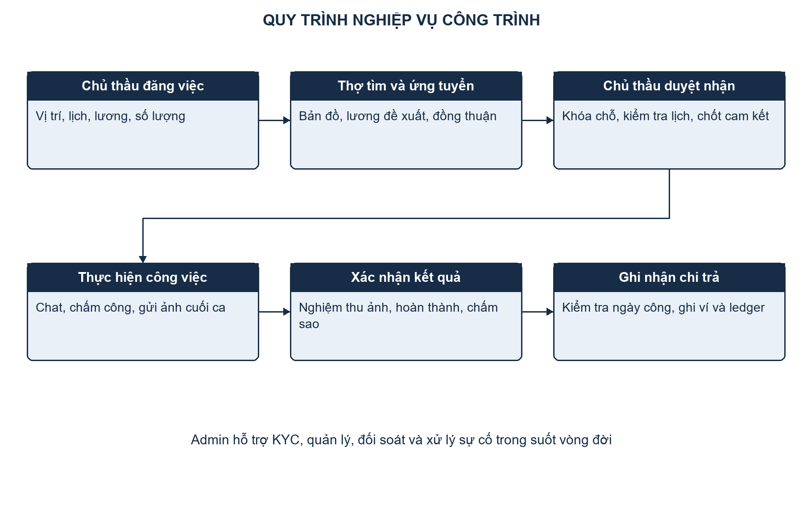

Sau khi thợ gửi đơn, trạng thái PENDING thể hiện đang chờ chủ thầu quyết định. ACCEPTED thể hiện quan hệ đã được nhận và làm căn cứ cho cam kết, liên lạc và các thao tác làm việc. REJECTED kết thúc đơn không được nhận. CANCELLED ghi nhận thợ hủy một việc đã nhận theo điều kiện của dịch vụ; không được diễn giải thành xóa lịch sử.

Lương gốc nằm trên công trình; lương được chốt cho từng thợ nằm trên đơn ứng tuyển. Việc tách hai giá trị cho phép lưu kết quả thương lượng mà không thay đổi điều kiện quảng bá ban đầu của các ứng viên khác. Khi nhận thợ, bản cam kết được chụp thành snapshot và hash; thay thông tin nguồn về sau không được làm thay bằng chứng đã chốt.

Về lịch, khoảng ngày công trình được so với các công việc đã nhận và ngày bận thợ tự khai. Duyệt một tổ đội cần đủ chỗ và đủ điều kiện cho toàn bộ thành viên; nếu một thành viên không hợp lệ, giao dịch không nhận dở dang một phần tổ. Tổ đội của thợ và nhóm thợ quen do chủ thầu tổ chức là hai khái niệm riêng.

Về kết quả công việc, một đơn và một ngày có tối đa một ca. Ca có thể có thời điểm check-in, check-out và báo cáo ảnh. Chủ thầu phê duyệt báo cáo hoặc yêu cầu bổ sung. Điều kiện thanh toán phải khớp toàn bộ ngày đã chốt ca và ảnh đã được duyệt đối với công trình yêu cầu chấm công. Hoàn thành công trình và thanh toán là hai thao tác riêng; hoàn thành không mặc nhiên chuyển tiền. [S3, S4]

## 2.2. Mô hình Use Case

### 2.2.1. Các tác nhân

Bảng 2.1. Các tác nhân

| Tác nhân | Vai trò và quyền | Phạm vi |
| --- | --- | --- |
| Người chưa đăng nhập | Đăng ký vai trò công khai, đăng nhập. | Không có quyền nghiệp vụ sau xác thực. |
| Thợ | Tìm và nhận việc; hồ sơ; lịch; ca làm; ví; sự cố. | Dữ liệu cá nhân và quan hệ công việc của mình. |
| Chủ thầu | Đăng việc; tuyển thợ; nghiệm thu; chấm sao; chi trả. | Công trình do mình sở hữu và các ứng viên liên quan. |
| Quản trị viên | KYC, khóa tài khoản thường, quản lý, đối soát, xử lý sự cố. | Endpoint quản trị có kiểm tra ROLE_ADMIN. |
| Dịch vụ bên ngoài | OSM, thời tiết Open-Meteo, Firebase khi cấu hình. | Cung cấp dữ liệu/dịch vụ hỗ trợ, không quyết định trạng thái nghiệp vụ. |

Thợ, chủ thầu và quản trị viên là tác nhân nghiệp vụ chính. PostgreSQL, repository và service là thành phần bên trong hệ thống, không được đặt thành người dùng trong mô hình Use Case. Dịch vụ bản đồ, thời tiết và thông báo là tác nhân hỗ trợ. Người chưa đăng nhập chỉ sử dụng các chức năng xác thực công khai; quyền nghiệp vụ sau đăng nhập được quyết định theo tài khoản đang hoạt động.

### 2.2.2. Mô hình Use Case

Các sơ đồ dưới đây dùng hình người cho tác nhân, hình ellipse cho ca sử dụng và khung chữ nhật cho biên hệ thống. Đường nối liền thể hiện tác nhân tham gia. Sơ đồ phân theo vai trò để tránh một hình tổng hợp có quá nhiều đường giao nhau. Các điều kiện như đã đăng nhập hoặc quyền sở hữu được ghi trong đặc tả; chúng không được tùy tiện vẽ thành quan hệ include giữa mọi ca sử dụng.

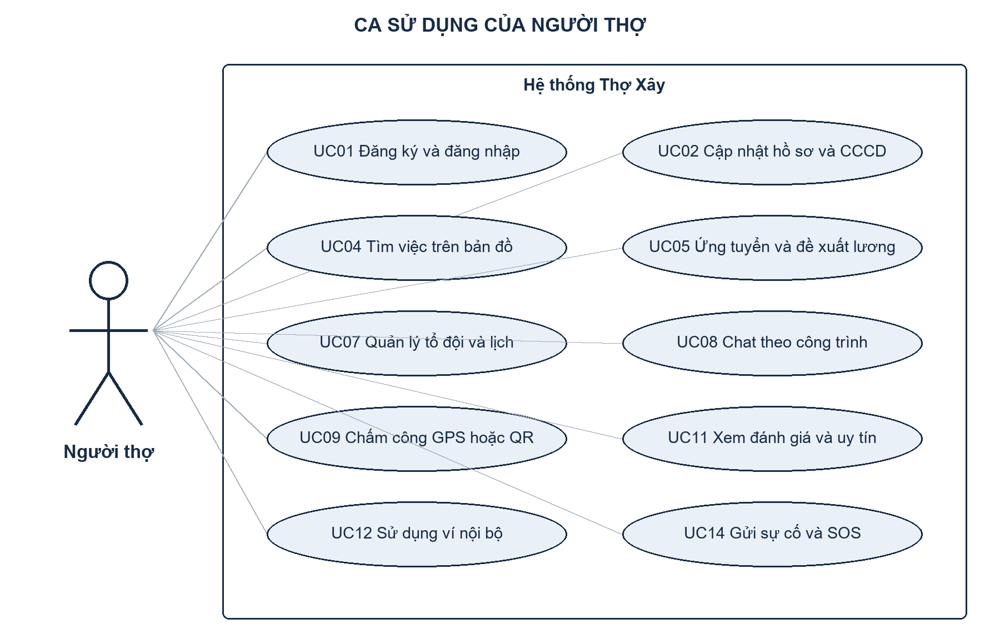

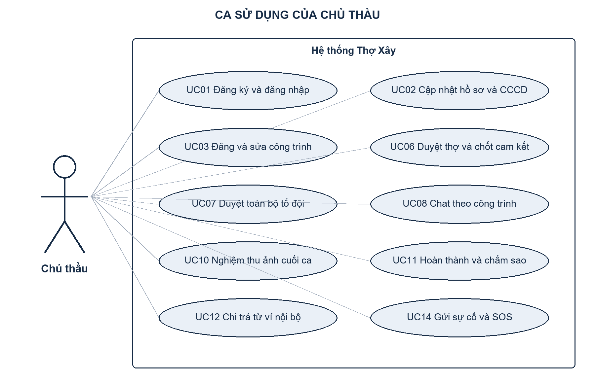

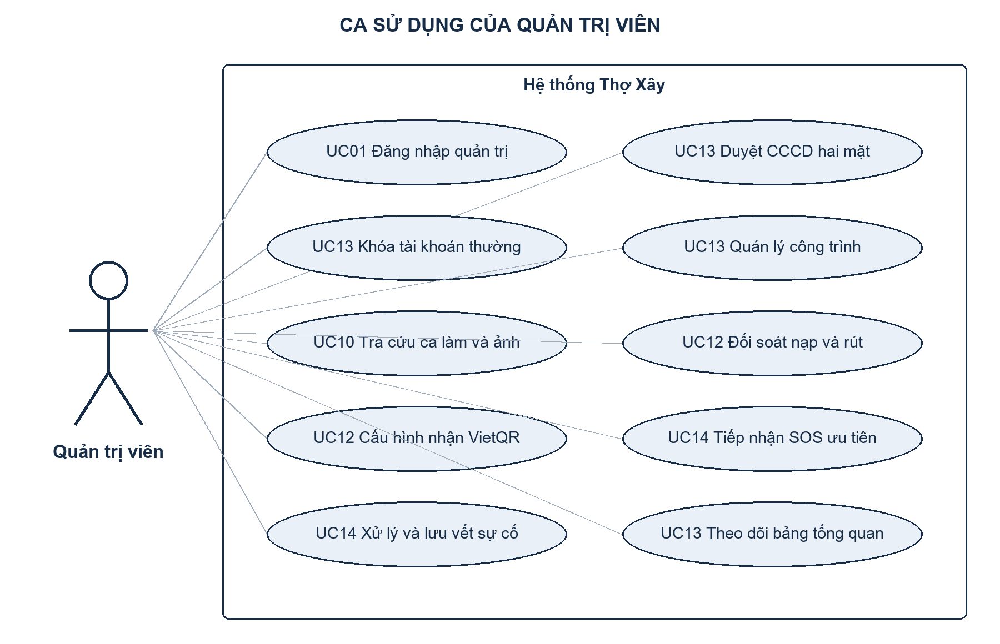

### 2.2.3. Mô tả Use Case

Mỗi đặc tả ghi tác nhân, tiền điều kiện, luồng chính, luồng thay thế và hậu điều kiện. Các mã UC được dùng lại trong bảng truy vết ở Chương 4. Với chức năng cần quyền, việc kiểm tra ở service vẫn bắt buộc dù giao diện đã giới hạn thao tác.

#### UC01 Đăng ký và đăng nhập

Tác nhân: Thợ, chủ thầu; Admin dùng form đăng nhập riêng.

Tiền điều kiện: Người dùng chưa có phiên hợp lệ; đăng ký chỉ chọn vai trò công khai.

Luồng chính:

1. Người dùng nhập thông tin tài khoản hoặc số điện thoại và mật khẩu để đăng nhập.
2. Controller kiểm tra DTO; service kiểm tra vai trò đăng ký, tài khoản và mật khẩu BCrypt.
3. Backend kiểm tra tài khoản hoạt động rồi trả JWT và hồ sơ cho API; Admin nhận session theo form login.
4. Giao diện lưu trạng thái phiên và mở vùng chức năng theo quyền tài khoản.

Luồng thay thế và ngoại lệ: Số điện thoại trùng hoặc DTO sai: từ chối dữ liệu. Sai thông tin đăng nhập: không cấp phiên. Tài khoản khóa: 403 ACCOUNT_LOCKED, kể cả khi dùng JWT cũ. Không cho đăng ký ROLE_ADMIN.

Hậu điều kiện: Tài khoản mới được tạo với mật khẩu băm; hoặc phiên hợp lệ được cấp. Không cấp quyền từ lựa chọn vai trò trên giao diện.

#### UC02 Cập nhật hồ sơ và CCCD

Tác nhân: Thợ hoặc chủ thầu.

Tiền điều kiện: Đã đăng nhập và tài khoản hoạt động.

Luồng chính:

1. Người dùng mở hồ sơ của mình, sửa thông tin hợp lệ hoặc chọn ảnh.
2. Ứng dụng xem trước ảnh; gửi hồ sơ hoặc upload hai mặt CCCD.
3. Service lấy actor hiện tại, kiểm tra dữ liệu và chuẩn hóa ảnh theo giới hạn.
4. Lưu hồ sơ; khi thay CCCD đưa verified về false để chờ quản trị viên xem lại.

Luồng thay thế và ngoại lệ: Thiếu một mặt khi cập nhật CCCD, ảnh hỏng hoặc dữ liệu không hợp lệ: từ chối. Đăng ký có thể chưa bổ sung CCCD. ID người khác không được dùng thay actor của /me.

Hậu điều kiện: Thông tin chính mình được cập nhật; CCCD mới chưa được tự xác thực.

#### UC03 Đăng và sửa công trình

Tác nhân: Chủ thầu.

Tiền điều kiện: Đã đăng nhập ROLE_CONTRACTOR và tài khoản hoạt động.

Luồng chính:

1. Chủ thầu nhập tên việc, loại thợ, lương, số lượng, địa chỉ và chọn tọa độ.
2. Nếu dùng lịch, nhập đủ cặp ngày bắt đầu/kết thúc trong phạm vi cho phép.
3. Backend kiểm tra dữ liệu và gắn contractor từ người đang đăng nhập.
4. Lưu công trình OPEN; với cập nhật hợp lệ, tăng termsVersion và thông báo cho đơn chờ.

Luồng thay thế và ngoại lệ: Thiếu tọa độ hoặc lương/số lượng sai: từ chối. Chỉ sửa công trình OPEN chưa có thợ ACCEPTED. Người không sở hữu không được sửa. Lịch quá hạn, ngược hoặc vượt khoảng cho phép bị chặn.

Hậu điều kiện: Công trình sẵn sàng được tìm thấy khi còn tuyển; thay điều khoản yêu cầu đồng thuận lại.

#### UC04 Tìm việc theo vị trí

Tác nhân: Thợ.

Tiền điều kiện: Đã đăng nhập ROLE_WORKER; trạng thái nhận việc phù hợp.

Luồng chính:

1. Thợ cấp quyền vị trí hoặc chọn vị trí tìm kiếm theo luồng dự phòng.
2. Chọn bán kính, loại thợ và sắp theo khoảng cách hoặc lương.
3. API kiểm tra lat/lng/radius; repository tính Haversine với công trình còn chỗ và chủ thầu hoạt động.
4. Service bỏ việc hết hạn, lọc loại và trả cùng tập kết quả cho danh sách/bản đồ.

Luồng thay thế và ngoại lệ: GPS không khả dụng: dùng lựa chọn vị trí; không có việc: trạng thái rỗng. Thợ Offline nhận danh sách rỗng. IN_PROGRESS còn thiếu thợ vẫn có thể xuất hiện.

Hậu điều kiện: Người dùng thấy thông tin tuyển dụng phù hợp; không tự mở số điện thoại riêng khi chưa được nhận.

#### UC05 Ứng tuyển và đề xuất lương

Tác nhân: Thợ.

Tiền điều kiện: Công trình còn tuyển; chưa có đơn cùng cặp; thợ Online và hoạt động.

Luồng chính:

1. Thợ mở chi tiết, đọc lịch, lương và điều khoản.
2. Nhập lương đề xuất nếu có; đồng thuận đúng termsVersion đang hiển thị.
3. Backend khóa công trình và thợ, kiểm tra trạng thái, số lượng và trùng đơn.
4. Tạo đơn PENDING, lưu đề xuất/đồng thuận và tạo thông báo cho chủ thầu.

Luồng thay thế và ngoại lệ: Đơn đã tồn tại, công trình hết chỗ hoặc điều khoản đổi: trả xung đột. Công trình có lịch yêu cầu đồng thuận; thiếu đồng thuận thì từ chối.

Hậu điều kiện: Có một đơn PENDING; chưa có quyền chat/liên lạc như đơn ACCEPTED.

#### UC06 Duyệt ứng viên và chốt cam kết

Tác nhân: Chủ công trình.

Tiền điều kiện: Đơn PENDING; chủ thầu hợp lệ; công trình chưa kết thúc.

Luồng chính:

1. Chủ thầu xem hồ sơ và chọn nhận hoặc từ chối.
2. Khi nhận, chủ thầu chọn giá gốc/giá đề xuất và đồng thuận phiên bản cam kết.
3. Service khóa công trình rồi thợ; kiểm tra công suất, lịch, trạng thái và đồng thuận của thợ.
4. Chốt lương và snapshot; ghi ACCEPTED hoặc REJECTED; đủ số lượng thì IN_PROGRESS.

Luồng thay thế và ngoại lệ: Hết chỗ, lịch trùng, thợ Offline/khóa, termsVersion cũ: không nhận. Đơn thuộc tổ phải xử lý toàn tổ. Lặp quyết định cũ trả kết quả cũ; đổi quyết định đã chốt bị từ chối.

Hậu điều kiện: Đơn được xử lý nguyên tử; hai bên có thể liên lạc khi ACCEPTED.

#### UC07 Tổ đội và lịch nhận việc

Tác nhân: Thợ/tổ trưởng; chủ thầu khi duyệt.

Tiền điều kiện: Các thành viên là tài khoản thợ thực; quan hệ mời/xác nhận hợp lệ.

Luồng chính:

1. Tổ trưởng tạo tổ và mời thành viên; thành viên xác nhận theo luồng tổ đội.
2. Tổ gửi đợt ứng tuyển vào một công trình phù hợp.
3. Chủ thầu duyệt đợt; backend khóa công trình và thành viên theo thứ tự ID.
4. Kiểm tra đủ chỗ, đồng thuận và lịch cho mọi người rồi nhận nguyên nhóm trong giao dịch.

Luồng thay thế và ngoại lệ: Một thành viên không hợp lệ hoặc không đủ chỗ: rollback cả nhóm. Ngày bận do thợ khai cũng được tính khi xét lịch. Nhóm thợ quen của chủ thầu không thay thế tổ đội ứng tuyển.

Hậu điều kiện: Toàn tổ được nhận hoặc không ai được nhận từ quyết định đó; lịch không bị duyệt trùng.

#### UC08 Trao đổi trong công trình

Tác nhân: Thợ được nhận và chủ công trình.

Tiền điều kiện: Có quan hệ ACCEPTED và quyền truy cập cuộc trò chuyện.

Luồng chính:

1. Người dùng mở hộp thư hoặc chat gắn với công trình và đối tác.
2. API kiểm tra quyền, trả lịch sử và con trỏ đã đọc.
3. Người dùng gửi chữ, ảnh hoặc vị trí sau xác nhận theo giao diện.
4. Backend lưu tin/ảnh; phát sự kiện sau commit; client khử trùng theo ID.

Luồng thay thế và ngoại lệ: Chưa được nhận hoặc truy cập đối tác khác: từ chối. Mạng ngắt: hiển thị trạng thái kết nối và tải lại lịch sử. Không coi việc phát WebSocket là bằng chứng đã lưu trước transaction.

Hậu điều kiện: Tin nằm trong lịch sử đúng quan hệ; ảnh vẫn có kiểm tra quyền; con trỏ đọc không lùi.

#### UC09 Chấm công GPS hoặc QR

Tác nhân: Thợ được nhận.

Tiền điều kiện: Đơn ACCEPTED; ngày và trạng thái công trình cho phép.

Luồng chính:

1. Thợ mở ca, gửi GPS có accuracy hoặc mã QR do chủ thầu phát.
2. Service khóa dữ liệu, kiểm tra đúng thợ và điều kiện thời gian.
3. Với GPS: khoảng cách ≤200 m và accuracy hợp lệ ≤100 m; với QR: hash khớp và còn hạn 300 giây.
4. Lưu check-in theo đơn/ngày; sau đó check-out khi đã có check-in.

Luồng thay thế và ngoại lệ: Ngoài vùng, GPS kém, QR hết hạn hoặc ngày ngoài lịch: từ chối và hướng dẫn gửi lại bằng chứng. Check-out khi chưa check-in không hợp lệ. Lặp thao tác đã ghi không tạo ca thứ hai.

Hậu điều kiện: Có ca theo ngày nghiệp vụ; bằng chứng phương thức và thời điểm được lưu.

#### UC10 Gửi ảnh và nghiệm thu ngày công

Tác nhân: Thợ và chủ công trình; Admin có tra cứu quản trị.

Tiền điều kiện: Có ca đã check-out; ảnh chưa được duyệt chốt.

Luồng chính:

1. Thợ gửi ảnh cuối ca kèm mô tả; client mới hỗ trợ ảnh tổng quan và chi tiết.
2. Backend chuẩn hóa, lưu WorkLog PENDING và version.
3. Chủ thầu tải ảnh theo quyền rồi gửi duyệt hoặc yêu cầu bổ sung kèm version đã xem.
4. Service so version; lưu APPROVED hoặc CHANGES_REQUESTED và thông báo cho thợ.

Luồng thay thế và ngoại lệ: Ảnh/version thay đổi sau lúc xem: trả 409. Chưa check-out hoặc ảnh hỏng: từ chối upload. APPROVED không sửa. Khi cần bổ sung, thợ gửi lại để trở về PENDING.

Hậu điều kiện: Ngày công có kết quả nghiệm thu có dấu vết; chỉ ảnh đã duyệt mới được tính theo điều kiện thanh toán.

#### UC11 Hoàn thành công trình và đánh giá

Tác nhân: Chủ công trình.

Tiền điều kiện: Công trình IN_PROGRESS; có thợ ACCEPTED; actor đúng chủ.

Luồng chính:

1. Chủ thầu chấm 1–5 sao cho toàn bộ thợ được nhận.
2. Service khóa công trình; kiểm tra tập workerId khớp và không trùng.
3. Khóa worker theo thứ tự ID; lưu workerRating và chuyển COMPLETED trong giao dịch.
4. Flush, tính lại trung bình từ công trình COMPLETED, cập nhật uy tín/bậc và thông báo.

Luồng thay thế và ngoại lệ: Thiếu/thừa thợ hoặc sao ngoài khoảng: từ chối. Gửi lại đúng bộ điểm: trả kết quả cũ. Đã hoàn thành với bộ điểm khác: 409, không sửa điểm. Thanh toán là thao tác riêng.

Hậu điều kiện: Điểm và trạng thái nhất quán; đơn PENDING còn lại bị từ chối; không tự phát sinh chuyển tiền.

#### UC12 Ví, đối soát và thanh toán

Tác nhân: Thợ/chủ thầu; Admin duyệt nạp/rút.

Tiền điều kiện: Đã đăng nhập; yêu cầu hợp lệ; có quyền và số dư cho thao tác cần tiền.

Luồng chính:

1. Người dùng tạo nạp/rút hoặc chuyển ký quỹ với khóa yêu cầu client.
2. Backend giữ snapshot đối soát; rút chuyển phần tiền cần giữ sang held.
3. Admin kiểm tra chứng từ rồi duyệt/từ chối; ghi yêu cầu, số dư và ledger cùng giao dịch.
4. Chủ thầu trả công cho đơn đủ điều kiện; service kiểm tra COMPLETED, ngày nghiệm thu, số dư và chống lặp.

Luồng thay thế và ngoại lệ: Số dư thiếu, khóa lặp khác payload, giao dịch đã xử lý khác nội dung: từ chối. Rút bị từ chối hoàn held về main. QR hiển thị không tự cộng tiền. Thanh toán thiếu ca/ảnh hợp lệ bị chặn.

Hậu điều kiện: Sổ ví và số dư nhất quán; mỗi payment không bị ghi lặp; giữ khả năng đối chiếu lịch sử.

#### UC13 Quản trị tài khoản và công trình

Tác nhân: Admin.

Tiền điều kiện: Session quản trị hợp lệ và ROLE_ADMIN.

Luồng chính:

1. Admin xem dashboard và hàng chờ; mở modal CCCD khi cần duyệt.
2. Hai mặt ảnh tải thành công, Admin đối chiếu và gửi đúng hai URL snapshot đã xem.
3. Service kiểm tra ảnh hiện tại rồi xác thực; hoặc khóa tài khoản thường theo quyền.
4. Admin quản lý/xóa công trình theo luồng có khóa và tính lại điểm liên quan khi có đánh giá.

Luồng thay thế và ngoại lệ: Thiếu hai ảnh, ảnh chưa tải hoặc snapshot cũ: không xác thực. Không khóa bất kỳ ROLE_ADMIN nào, kể cả biết URL trực tiếp. Mỗi thao tác vẫn kiểm tra quyền ở backend.

Hậu điều kiện: Trạng thái quản trị được lưu; tài khoản khóa không dùng tiếp JWT; điểm còn lại được tính lại khi xóa công trình.

#### UC14 Gửi và xử lý sự cố hoặc SOS

Tác nhân: Người tham gia công trình; Admin xử lý.

Tiền điều kiện: Người báo là chủ hoặc thuộc quan hệ tham gia mà service cho phép.

Luồng chính:

1. Người dùng chọn công trình, loại sự cố, mô tả và vị trí/ảnh tự nguyện.
2. Backend kiểm tra quyền, chống gửi lặp và lưu snapshot công trình/người báo.
3. Admin xem hàng chờ ưu tiên, ghi nhận xử lý với version và ghi chú.
4. Lưu audit và thông báo phản hồi riêng cho người báo; ảnh chỉ cho người có quyền.

Luồng thay thế và ngoại lệ: Người ngoài công trình hoặc clientRequestId dùng cho nội dung khác: từ chối. Version cũ yêu cầu tải lại. Đóng sự cố cần kết quả xử lý theo validation. SOS không gọi cứu hộ tự động.

Hậu điều kiện: Có hồ sơ sự cố và lịch sử xử lý; dữ liệu tham chiếu quan trọng vẫn được giữ theo snapshot.

## 2.3. Mô hình lớp

Ở mức phân tích, các khái niệm trung tâm là Người dùng, Công trình và Đơn ứng tuyển. Người dùng có vai trò thợ hoặc chủ thầu trong từng ngữ cảnh nghiệp vụ, nhưng mã nguồn dùng cùng entity User; không có ba bảng người dùng tách biệt theo vai trò. Một chủ thầu có thể đăng nhiều công trình; một công trình có nhiều đơn; một thợ có nhiều đơn ở những công trình khác nhau.

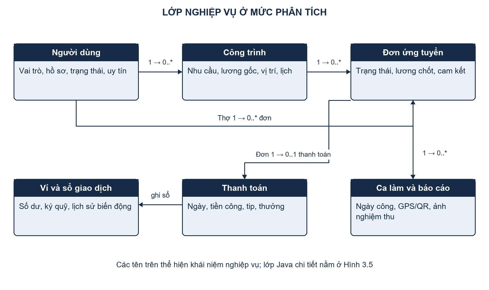

Đơn ứng tuyển là lớp kết hợp có dữ liệu riêng, gồm trạng thái, thời điểm, lương đề xuất, lương chốt, đồng thuận và điểm đánh giá. Vì vậy, quan hệ thợ–công trình không được cài đặt chỉ bằng một danh sách ID. Ca làm tham chiếu đơn để xác định đúng người, đúng công trình và quyền truy cập. Báo cáo ảnh gắn với ca; thanh toán gắn với đơn đã được chấp nhận.

Các phân hệ bổ trợ gồm hồ sơ và ảnh KYC, tổ đội, lịch bận, danh mục thợ quen, ví và sổ giao dịch, chat, thông báo, sự cố và uy tín. Bản phân tích giữ các khái niệm chính để dễ hiểu; tên lớp Java, thuộc tính và lớp dịch vụ được trình bày ở mục 3.2. Không phải mọi hình chữ nhật trong mô hình phân tích đều tương ứng với một bảng mới.

## 2.4. Mô hình trạng thái

Trạng thái công trình và trạng thái đơn có vòng đời riêng. OPEN thể hiện công trình đang mở; khi nhận đủ số lượng thì chuyển IN_PROGRESS; chủ thầu hoàn thành đúng điều kiện để chuyển COMPLETED. CANCELLED là giá trị có trong enum công trình, nhưng báo cáo không khẳng định có một API hủy công trình công khai khi mã hiện tại chưa cung cấp luồng đó. Xóa công trình bởi Admin là thao tác quản trị, không đồng nhất với chuyển trạng thái CANCELLED.

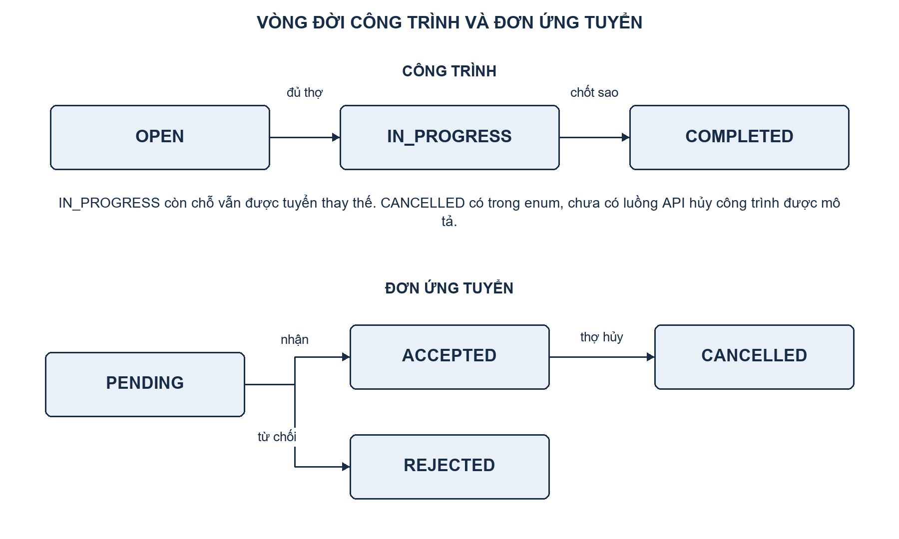

Khi một thợ hủy đơn ACCEPTED ở công trình IN_PROGRESS, công trình vẫn có thể giữ IN_PROGRESS và xuất hiện lại trong tìm việc nếu còn chỗ. Đơn đã hủy giữ nguyên dấu vết, lý do và mức trừ uy tín; UNIQUE(job_id, worker_id) vẫn ngăn tạo lại một đơn thứ hai cho cùng cặp.

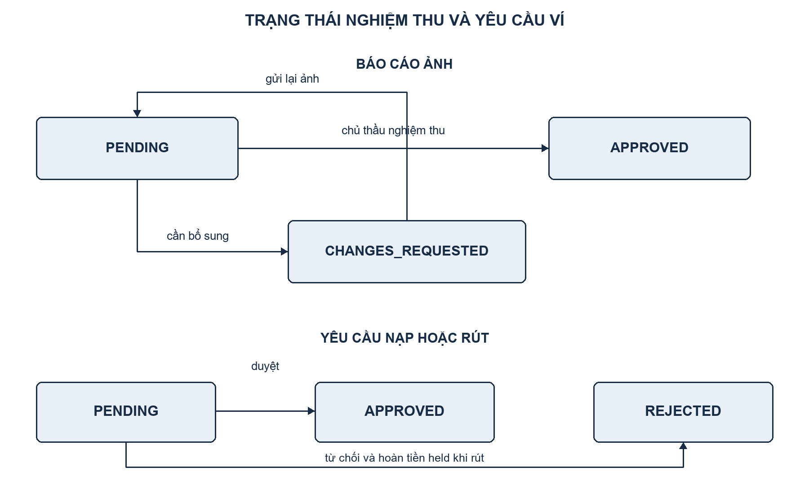

Báo cáo ảnh bắt đầu PENDING; chủ thầu chuyển APPROVED hoặc CHANGES_REQUESTED. Khi được yêu cầu bổ sung, thợ gửi lại ảnh và báo cáo trở về PENDING. Báo cáo APPROVED không được thay thế. Yêu cầu ví đi từ PENDING sang APPROVED hoặc REJECTED; thao tác từ chối rút phải hoàn lại phần tiền đang giữ. Dữ liệu version và khóa giao dịch được dùng để tránh ghi đè hoặc xử lý cùng yêu cầu hai lần. [S4, S5]

# CHƯƠNG 3: THIẾT KẾ HỆ THỐNG

## 3.1. Biểu đồ tuần tự

Biểu đồ tuần tự trình bày thứ tự tương tác giữa giao diện, controller, service và tầng lưu trữ. Thời gian đi từ trên xuống; mũi tên nét liền là lời gọi, nét đứt là kết quả. Các hình chỉ thể hiện những bước quyết định đến nghiệp vụ; kiểm tra DTO và xử lý ngoại lệ được mô tả bằng nội dung kèm theo.

### Đăng nhập và cấp JWT

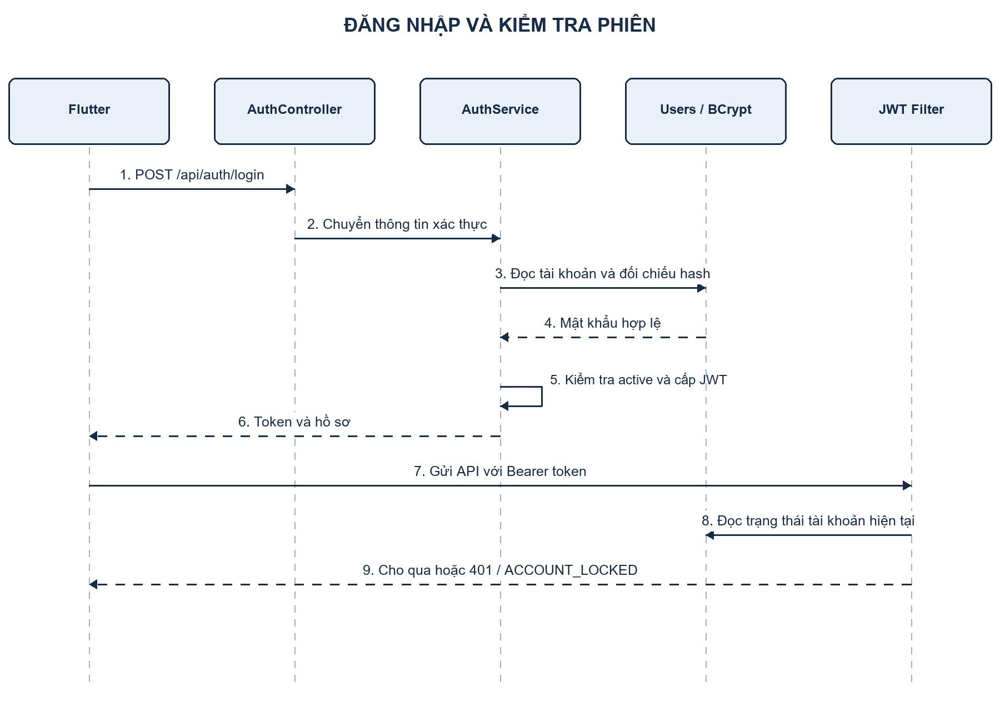

Flutter gửi số điện thoại và mật khẩu tới API xác thực. Backend đối chiếu mật khẩu BCrypt, kiểm tra trạng thái tài khoản rồi cấp JWT. Ở yêu cầu tiếp theo, bộ lọc xác minh token và đọc trạng thái tài khoản hiện tại. Do đó, khóa tài khoản có hiệu lực với cả token cũ. Khi phiên không hợp lệ, ứng dụng xử lý lỗi và đưa người dùng về luồng đăng nhập. Đăng nhập trang Admin sử dụng form và session riêng, không thay thế bằng việc tự đính JWT vào HTML.

### Ứng tuyển và duyệt nhận thợ

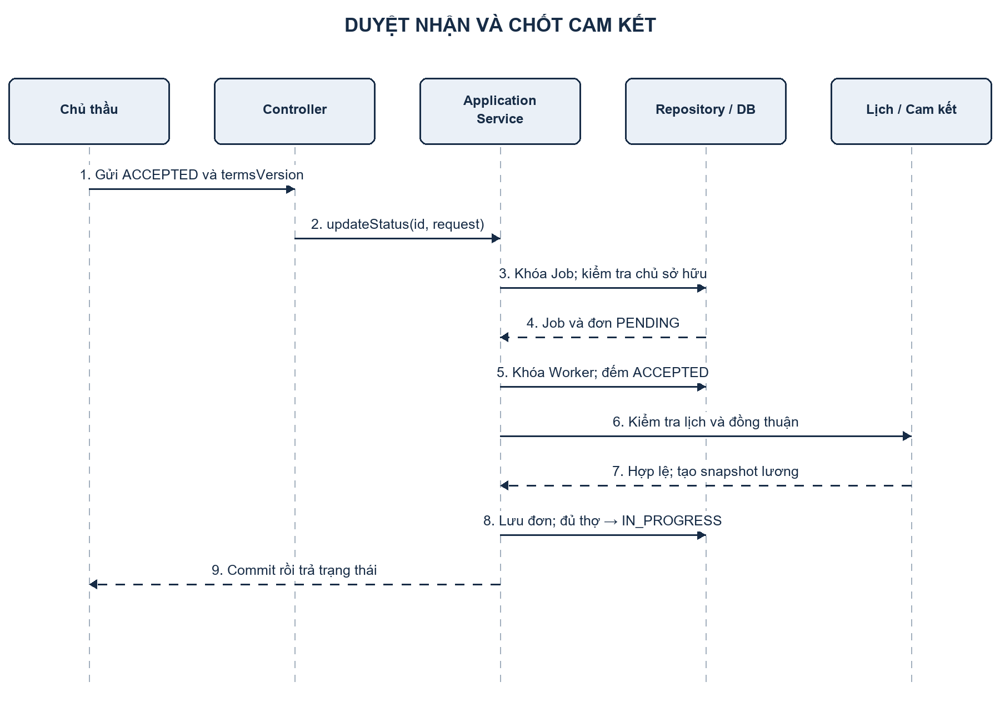

Sau khi có đơn PENDING, chủ thầu gửi quyết định cùng dữ liệu đồng thuận. ApplicationService khóa công trình, kiểm tra chủ sở hữu, đọc đơn rồi khóa thợ. Service kiểm tra vai trò hiện tại, trạng thái hoạt động, nhận việc, lịch và termsVersion. Nếu còn chỗ, hệ thống lưu lương chốt, snapshot cam kết và trạng thái ACCEPTED; khi đủ số lượng, công trình thành IN_PROGRESS. Giao dịch kết thúc rồi kết quả được trả cho giao diện.

Khóa công trình bảo đảm hai yêu cầu cạnh tranh cùng nhìn một số lượng đã nhận theo thứ tự tuần tự. Nếu kiểm tra chỗ trống trước khi khóa rồi ghi sau, cả hai yêu cầu có thể cùng nhận chỗ cuối. Với tổ đội, khóa các worker theo thứ tự ID giúp giảm nguy cơ deadlock và giữ nguyên tính nguyên tử cho cả nhóm. Yêu cầu có phiên bản điều khoản cũ bị từ chối để người dùng đọc lại.

### Hoàn thành và cập nhật đánh giá

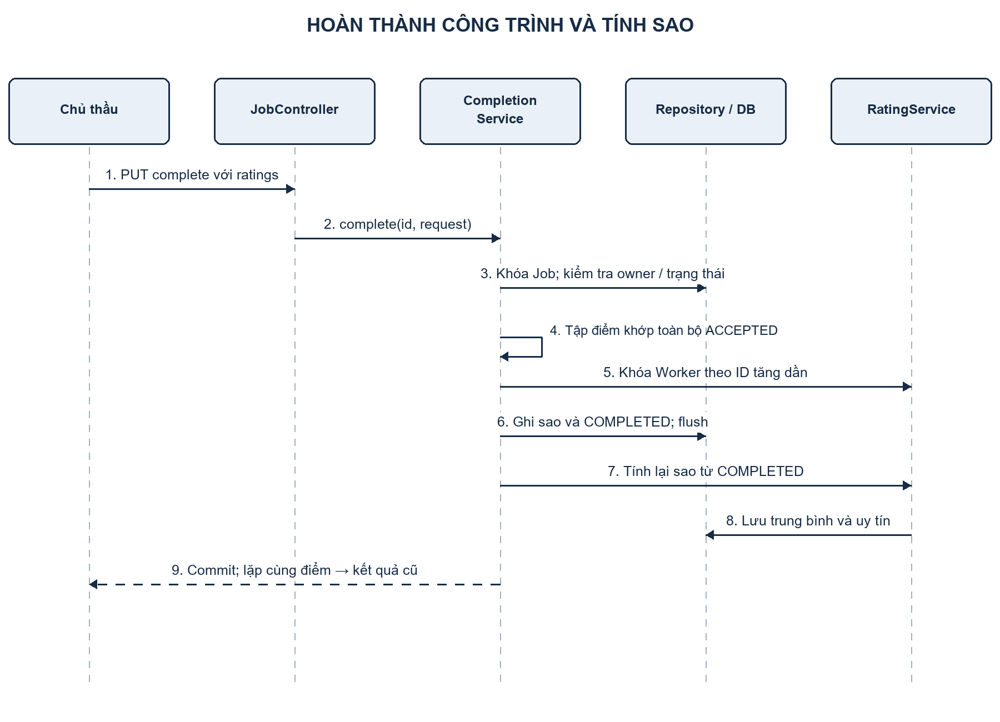

JobCompletionService khóa công trình và kiểm tra đúng chủ thầu. Tập workerId trong ratings phải bằng đúng tập thợ ACCEPTED, không trùng và không thiếu. Service khóa các thợ theo thứ tự ID, lưu điểm, chuyển công trình COMPLETED rồi tính lại trung bình từ các công trình đã hoàn thành. Các đơn PENDING còn lại được chuyển REJECTED. Gửi lại đúng bộ điểm đã lưu trả kết quả hiện tại; gửi bộ điểm khác bị từ chối với xung đột. Thanh toán được thực hiện qua dịch vụ ví riêng sau bước này.

### Chấm công và nghiệm thu

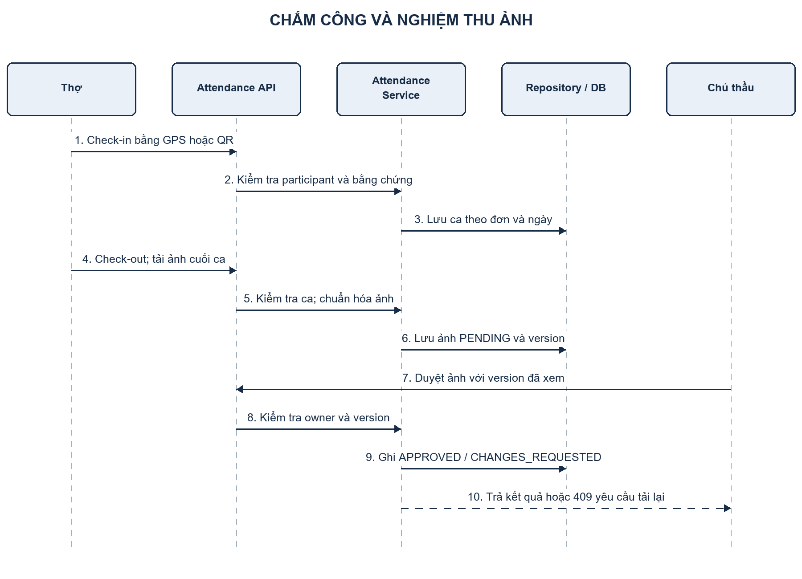

Thợ thuộc đơn ACCEPTED gửi bằng chứng GPS hoặc QR. Với GPS, backend tính khoảng cách tới công trình và kiểm tra độ chính xác; với QR, backend kiểm tra hash và thời hạn mã. Check-out yêu cầu đã check-in trong ngày nghiệp vụ. Sau check-out, thợ tải ảnh và chủ thầu nghiệm thu đúng version vừa xem. Khi version thay đổi, hệ thống yêu cầu tải lại trước khi duyệt. Ảnh chỉ trả qua endpoint có kiểm tra quan hệ tham gia, không phải URL công khai không kiểm soát.

## 3.2. Mô hình lớp chi tiết

### 3.2.1. Mô hình lớp

Thiết kế backend theo cấu trúc controller–service–repository. Controller nhận DTO và kiểm tra Jakarta Validation; service xác định người thao tác, quyền sở hữu, điều kiện trạng thái và ranh giới giao dịch; repository truy vấn dữ liệu và cung cấp thao tác khóa. Entity ánh xạ các bảng, còn DTO kiểm soát dữ liệu được trao đổi qua API.

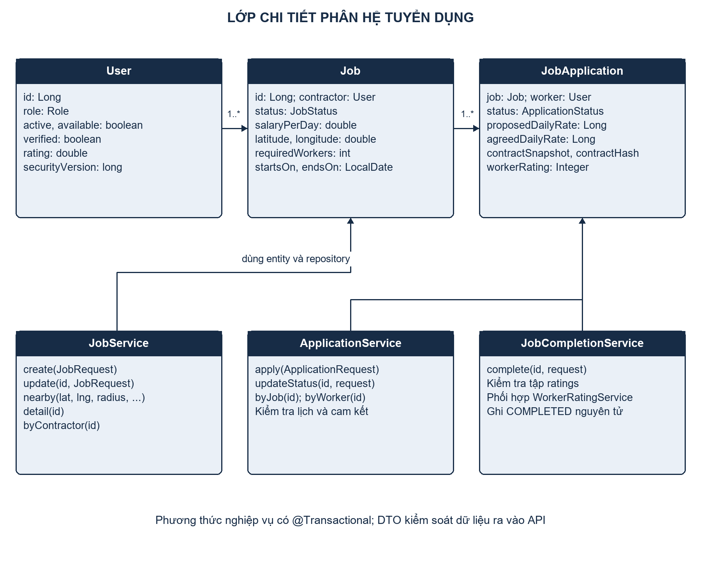

User chứa trạng thái hoạt động, xác thực, hồ sơ, điểm và vai trò. Job thuộc một contractor và chứa yêu cầu tuyển dụng, lịch, tọa độ, trạng thái và termsVersion. JobApplication tham chiếu Job và worker, đồng thời lưu lương, đồng thuận, snapshot cam kết và workerRating. Các lớp dịch vụ phối hợp các đối tượng này theo từng ca sử dụng thay vì đưa toàn bộ nghiệp vụ vào controller.

Flutter tổ chức dữ liệu trong models, gọi backend qua services, hiển thị trong screens và tái sử dụng UI trong widgets. ApiService tập trung URL, header xác thực, đọc lỗi và gửi multipart; LocationService quản lý truy cập vị trí. Các controller phía client không được coi là nguồn quyết định quyền truy cập cuối cùng.

### 3.2.2. Mô tả các lớp

Bảng 3.1. Mô tả các lớp

| Lớp hoặc nhóm lớp | Trách nhiệm chính | Vị trí package |
| --- | --- | --- |
| User / Job / JobApplication | Entity cốt lõi; tham chiếu qua khóa ngoại; enum vai trò và trạng thái. | entity |
| AuthService / JwtAuthenticationFilter | Xác thực; cấp/kiểm tra JWT; tài khoản hoạt động và phiên bảo mật. | service, security |
| CurrentUser | Lấy actor; require(role), requireOwner(id, role); dùng trong service. | security |
| JobService / JobRepository | Tạo/sửa/xem việc; tìm gần Haversine; findLockedById khóa công trình. | service, repository |
| ApplicationService | apply, updateStatus, byJob, byWorker; điều phối lịch/cam kết/công suất. | service |
| JobCompletionService / WorkerRatingService | complete; khóa thợ theo thứ tự; recompute trung bình sao. | service |
| CommitmentService / WorkerCalendarService | Chốt lương và snapshot; kiểm tra đồng thuận, ngày bận và giao lịch. | scheduling |
| CrewService / ContractorTeamService | Ứng tuyển và duyệt nguyên tổ; nhóm thợ quen do chủ thầu sở hữu. | crew, favorites |
| AttendanceService / AttendanceRecord / WorkLog | Ca theo ngày; proof GPS/QR; upload; review(version); requirePayable. | attendance |
| WalletService / JobPaymentService | Số dư, nạp/rút, ký quỹ, ledger và thanh toán từ công trình. | wallet |
| KycService / ImageSanitizer | Chuẩn hóa ảnh; lưu KYC; tải ảnh theo quyền; hồ sơ cần duyệt lại. | kyc, media |
| MessageService / ChatWebSocketHandler | Lưu lịch sử, gửi nội dung, kiểm tra người tham gia, phát sự kiện chat. | service, chat |
| IncidentService / IncidentAudit | Tạo sự cố, kiểm tra người báo, version xử lý, lịch sử và bằng chứng. | incident |
| AdminService | Duyệt snapshot CCCD, chặn khóa Admin, quản lý/xóa công trình. | admin |
| NotificationService / NotificationDispatcher | Lưu thông báo; điều phối push khi cấu hình; xử lý sau commit. | service, notification |
| ApiService / LocationService | REST, token, lỗi, multipart; truy cập vị trí phía Flutter. | mobile_app/lib/services |
| Screens / Widgets / Models | Màn hình vai trò; thành phần tái dùng; dữ liệu trao đổi và trạng thái UI. | mobile_app/lib |

Ranh giới giao dịch đặt tại phương thức service cần cập nhật nhiều bảng. Duyệt thợ dùng cùng một transaction cho số lượng, trạng thái và cam kết; hoàn thành dùng cùng transaction cho điểm, trạng thái và tính lại trung bình; thanh toán dùng cùng transaction cho số dư, bản ghi payment và ledger. Không tách các bước này thành những yêu cầu client độc lập vì lỗi giữa chừng có thể để dữ liệu không nhất quán.

## 3.3. Biểu đồ thành phần

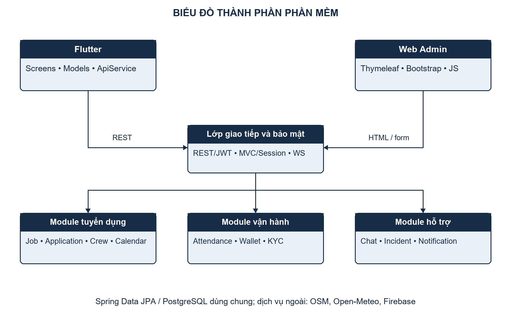

Ứng dụng Flutter và Web Admin là hai kênh truy cập của cùng backend. Flutter giao tiếp qua REST có JWT và WebSocket cho chat; Admin được render bằng Thymeleaf, dùng form login, session và CSRF. Backend là một ứng dụng nguyên khối có các module nghiệp vụ, không phải tập các microservice triển khai độc lập.

Tầng bảo mật áp dụng các filter chain theo vùng URL và tiếp tục kiểm tra quyền ở service/controller. Tầng nghiệp vụ gồm xác thực–hồ sơ, tuyển dụng–cam kết–lịch, tổ đội, ca làm–nghiệm thu, ví–đối soát, chat–thông báo, uy tín và sự cố. Các module dùng chung PostgreSQL và transaction của Spring khi cần.

OpenStreetMap cung cấp bản đồ nền; Open-Meteo cung cấp thời tiết tham khảo; Firebase hỗ trợ thông báo đẩy khi được cấu hình. Dữ liệu nghiệp vụ cốt lõi vẫn được lưu trong database. Nếu thời tiết hoặc push không khả dụng, hệ thống cần giữ được khả năng đọc công trình và thông báo đã lưu, thay vì coi dịch vụ phụ trợ là bằng chứng một giao dịch đã thành công.

## 3.4. Biểu đồ triển khai

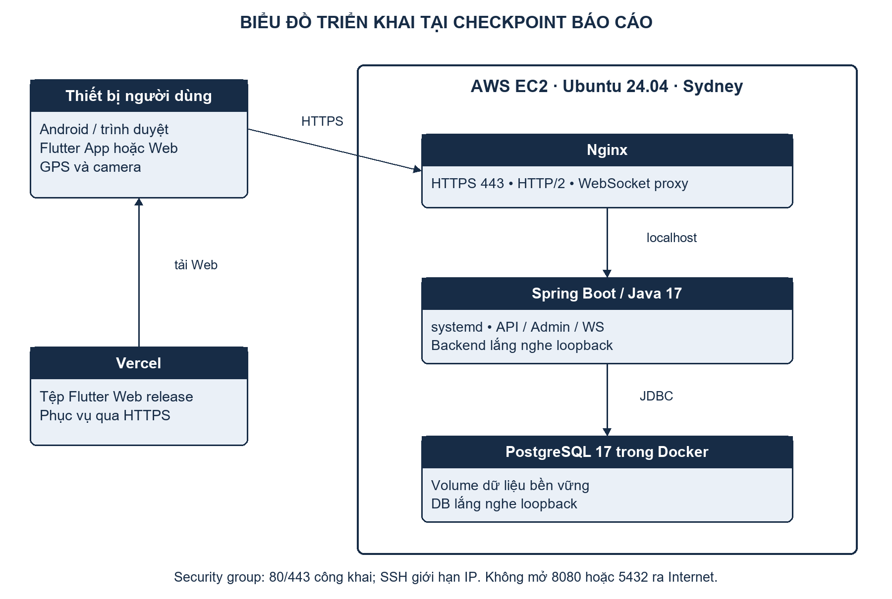

Theo cấu hình triển khai trong kho mã ngày 26/11/2026, Flutter Web được phục vụ tại Vercel; API và trang Admin chạy trên EC2 Ubuntu 24.04 tại vùng Sydney. Máy triển khai được ghi nhận là t4g.small ARM64, 2 vCPU, 2 GiB RAM và ổ gp3 30 GB. Java 17 chạy ứng dụng Spring Boot bằng systemd; Nginx tiếp nhận HTTPS/HTTP/2 và chuyển tiếp đến backend. PostgreSQL 17 chạy trong Docker với volume bền vững. [S7]

Các cổng Java và database chỉ lắng nghe loopback theo bộ cấu hình AWS. Security group mở 80/443 cho truy cập Web và giới hạn SSH theo IP quản trị. Tệp môi trường chứa thông tin database và khóa JWT được giữ ngoài Git. Artifact được build trước khi đưa lên VPS nhằm tránh tiêu tốn tài nguyên máy vận hành.

Backend trước đây được chạy trên Render; cấu hình hiện tại đã chuyển sang AWS ngày 25/11/2026. Sơ đồ dùng AWS để phản ánh bản triển khai được ghi nhận mới nhất. Số 70 bảng trong biên bản chuyển dữ liệu là số bảng vật lý của bản sao vận hành; không đồng nhất với 34 bảng nghiệp vụ thuộc mô hình ứng dụng được kiểm kê ở mục 3.5.

Địa chỉ Web và API trong kho có thể thay đổi theo cấu hình triển khai. Báo cáo mô tả kiến trúc tại checkpoint mã nguồn, không coi việc có URL là bằng chứng đã đo được uptime. Khi EC2 dùng IPv4 chưa cố định, thao tác stop/start có thể yêu cầu cập nhật hostname và chứng chỉ; dự phòng lâu dài cần tên miền ổn định và quy trình phục hồi đã diễn tập.

## 3.5. Thiết kế cơ sở dữ liệu

### Phạm vi dữ liệu và quan hệ chính

Thiết kế sử dụng PostgreSQL. Mô hình được lập từ catalog V23 có sẵn trong PROJECT_INVENTORY.json, sau đó đối chiếu các migration V24–V27 và entity hiện tại. Kết quả gồm 34 bảng nghiệp vụ, 273 cột. flyway_schema_history là bảng kỹ thuật theo dõi nâng cấp và không tính trong số bảng nghiệp vụ. Đây là kiểm kê theo mã nguồn và catalog lưu trong kho, không phải phép truy vấn mới vào database vận hành. [S6]

Ba bảng cốt lõi users, jobs và job_applications thể hiện tài khoản, nhu cầu tuyển dụng và quan hệ ứng tuyển. Các bảng còn lại mở rộng hồ sơ, chấm công, lịch, tổ đội, ví, chat, thông báo và hỗ trợ quản trị. Khóa ngoại duy trì quan hệ; UNIQUE bảo vệ các cặp nghiệp vụ như công trình–thợ và đơn–ngày; CHECK giới hạn các trạng thái hoặc giá trị cần thiết.

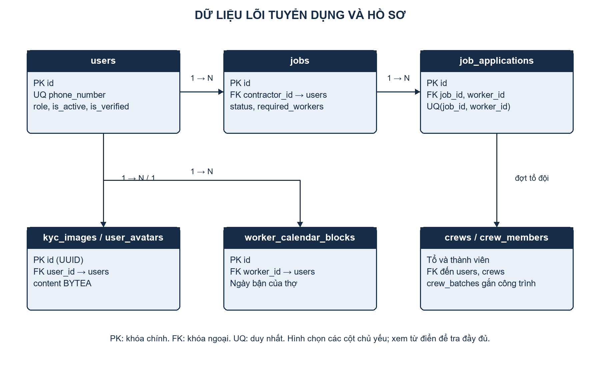

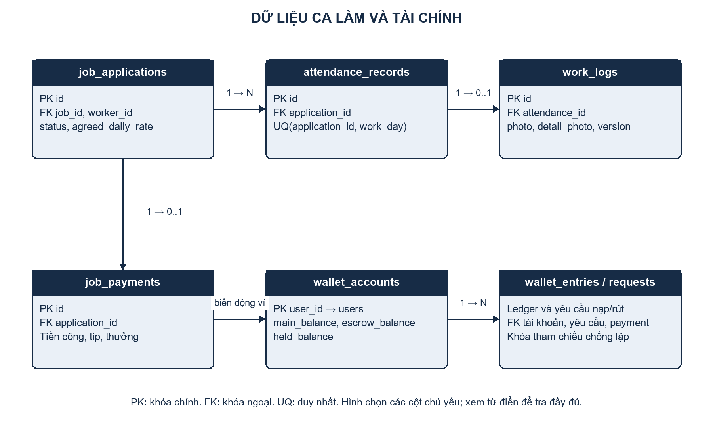

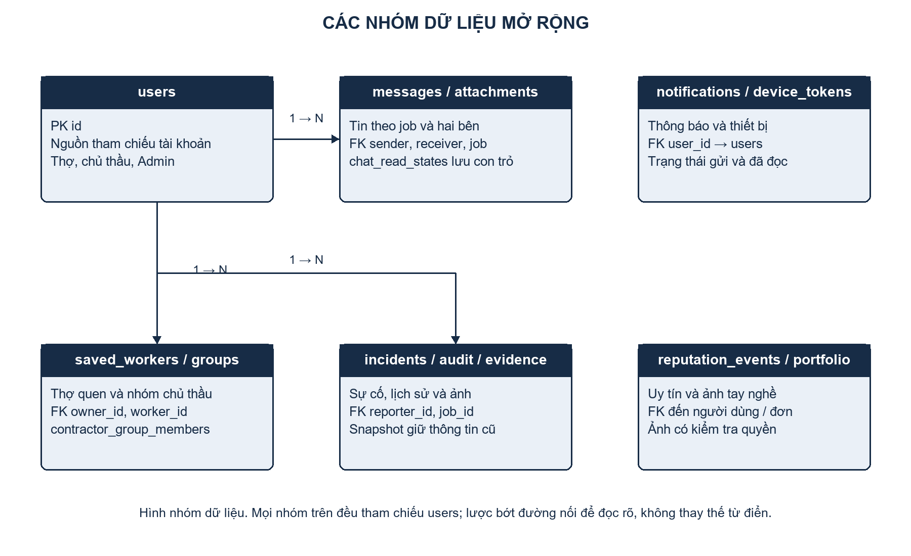

Các hình ERD chọn trường định danh và quan hệ tiêu biểu để đọc được ở khổ in; từ điển bên dưới liệt kê đầy đủ cột của 34 bảng. Một đường quan hệ thể hiện tham chiếu dữ liệu; các tùy chọn ON DELETE, NULL và ràng buộc cụ thể được giữ trong schema/migration thay vì suy ra từ vị trí của các khối trên hình.

### Từ điển dữ liệu

Trong các bảng dưới đây, “Có” ở cột bắt buộc nghĩa là NOT NULL; “Không” nghĩa là cho phép NULL. Kiểu varchar được rút gọn từ character varying, timestamptz là timestamp with time zone. Giá trị mặc định được nêu khi có trong catalog hoặc migration. Nội dung BYTEA là dữ liệu ảnh đã chuẩn hóa, không phải đường dẫn ảnh công khai.

#### Bảng 01 attendance_records

Một ca/ngày theo đơn, check-in/out và chứng cứ GPS/QR.

Bảng 3.2. Từ điển attendance_records

| Thuộc tính | Kiểu dữ liệu | Bắt buộc và mặc định | Ý nghĩa |
| --- | --- | --- | --- |
| id | bigint | Có; mặc định tự tăng | Khóa định danh bản ghi. |
| application_id | bigint | Có | Đơn ứng tuyển liên quan. |
| work_day | date | Có | Ngày công theo giờ Việt Nam. |
| checked_in_at | timestamptz | Có | Thời điểm checked in. |
| checked_out_at | timestamptz | Không | Thời điểm checked out. |
| checkin_method | varchar(10) | Có | Phương thức check-in GPS hoặc QR. |
| checkout_method | varchar(10) | Không | Phương thức check-out GPS hoặc QR. |
| checkin_latitude | double precision | Không | Vĩ độ thiết bị tại check-in bằng GPS. |
| checkin_longitude | double precision | Không | Kinh độ thiết bị tại check-in bằng GPS. |
| checkin_accuracy | double precision | Không | Độ chính xác GPS tại check-in, đơn vị mét. |
| checkout_latitude | double precision | Không | Vĩ độ thiết bị tại check-out bằng GPS. |
| checkout_longitude | double precision | Không | Kinh độ thiết bị tại check-out bằng GPS. |
| checkout_accuracy | double precision | Không | Độ chính xác GPS tại check-out, đơn vị mét. |

Ràng buộc chính: CHECK (((checked_out_at IS NULL) OR (checked_out_at >= checked_in_at))); CHECK (((checkin_method)::text = ANY ((ARRAY['GPS'::character varying, 'QR'::character varying])::text[]))); CHECK (((checkout_method)::text = ANY ((ARRAY['GPS'::character varying, 'QR'::character varying])::text[]))); FOREIGN KEY (application_id) REFERENCES job_applications(id) ON DELETE CASCADE; PRIMARY KEY (id); UNIQUE (application_id, work_day).

#### Bảng 02 attendance_shift_codes

Hash mã ca làm đang còn hiệu lực cho một công trình.

Bảng 3.3. Từ điển attendance_shift_codes

| Thuộc tính | Kiểu dữ liệu | Bắt buộc và mặc định | Ý nghĩa |
| --- | --- | --- | --- |
| job_id | bigint | Có | Công trình liên quan. |
| token_hash | varchar(64) | Có | Hash định danh token thiết bị/ca làm. |
| expires_at | timestamptz | Có | Hết hạn QR ca làm. |

Ràng buộc chính: FOREIGN KEY (job_id) REFERENCES jobs(id) ON DELETE CASCADE; PRIMARY KEY (job_id).

#### Bảng 03 chat_read_states

Con trỏ tin đã đọc tăng đơn điệu theo người/công trình/đối tác.

Bảng 3.4. Từ điển chat_read_states

| Thuộc tính | Kiểu dữ liệu | Bắt buộc và mặc định | Ý nghĩa |
| --- | --- | --- | --- |
| id | bigint | Có; mặc định tự tăng | Khóa định danh bản ghi. |
| user_id | bigint | Có | Tài khoản sở hữu hoặc nhận dữ liệu. |
| job_id | bigint | Có | Công trình liên quan. |
| peer_id | bigint | Có | Đối tác trong cuộc hội thoại. |
| last_read_message_id | bigint | Có; mặc định 0 | Con trỏ message đã đọc gần nhất, không giảm. |

Ràng buộc chính: CHECK ((user_id <> peer_id)); CHECK ((last_read_message_id >= 0)); FOREIGN KEY (job_id) REFERENCES jobs(id) ON DELETE CASCADE; FOREIGN KEY (peer_id) REFERENCES users(id) ON DELETE CASCADE; FOREIGN KEY (user_id) REFERENCES users(id) ON DELETE CASCADE; PRIMARY KEY (id); UNIQUE (user_id, job_id, peer_id).

#### Bảng 04 contractor_group_members

Gắn thợ đã lưu vào nhóm của chủ thầu; không phải thành viên tổ đội ứng tuyển.

Bảng 3.5. Từ điển contractor_group_members

| Thuộc tính | Kiểu dữ liệu | Bắt buộc và mặc định | Ý nghĩa |
| --- | --- | --- | --- |
| id | bigint | Có; mặc định tự tăng | Khóa định danh bản ghi. |
| group_id | bigint | Có | Nhóm thợ quen chứa thành viên. |
| saved_worker_id | bigint | Có | Bản ghi thợ quen của chủ thầu. |

Ràng buộc chính: PRIMARY KEY (id); UNIQUE (group_id, saved_worker_id); FOREIGN KEY (group_id) REFERENCES contractor_groups(id) ON DELETE CASCADE; FOREIGN KEY (saved_worker_id) REFERENCES saved_workers(id) ON DELETE CASCADE.

#### Bảng 05 contractor_groups

Nhóm thợ quen riêng do chủ thầu tổ chức, tên duy nhất trong phạm vi chủ sở hữu.

Bảng 3.6. Từ điển contractor_groups

| Thuộc tính | Kiểu dữ liệu | Bắt buộc và mặc định | Ý nghĩa |
| --- | --- | --- | --- |
| id | bigint | Có; mặc định tự tăng | Khóa định danh bản ghi. |
| owner_id | bigint | Có | Chủ sở hữu dữ liệu. |
| name | varchar(80) | Có | Tên hiển thị. |

Ràng buộc chính: PRIMARY KEY (id); UNIQUE (owner_id, name); FOREIGN KEY (owner_id) REFERENCES users(id) ON DELETE CASCADE; CHECK (length(trim(name)) BETWEEN 1 AND 80).

#### Bảng 06 crew_batches

Một đợt ứng tuyển nguyên tổ vào công trình.

Bảng 3.7. Từ điển crew_batches

| Thuộc tính | Kiểu dữ liệu | Bắt buộc và mặc định | Ý nghĩa |
| --- | --- | --- | --- |
| id | bigint | Có; mặc định tự tăng | Khóa định danh bản ghi. |
| crew_id | bigint | Có | Định danh tham chiếu crew. |
| job_id | bigint | Có | Công trình liên quan. |
| status | varchar(20) | Có; mặc định 'PENDING' | Trạng thái nghiệp vụ theo CHECK ở dưới bảng. |
| created_at | timestamptz | Có; mặc định CURRENT_TIMESTAMP | Thời điểm tạo. |

Ràng buộc chính: CHECK (((status)::text = ANY ((ARRAY['PENDING'::character varying, 'ACCEPTED'::character varying, 'REJECTED'::character varying])::text[]))); FOREIGN KEY (crew_id) REFERENCES crews(id); FOREIGN KEY (job_id) REFERENCES jobs(id) ON DELETE CASCADE; PRIMARY KEY (id); UNIQUE (crew_id, job_id).

#### Bảng 07 crew_members

Lời mời và trạng thái xác nhận của các tài khoản thợ thực.

Bảng 3.8. Từ điển crew_members

| Thuộc tính | Kiểu dữ liệu | Bắt buộc và mặc định | Ý nghĩa |
| --- | --- | --- | --- |
| id | bigint | Có; mặc định tự tăng | Khóa định danh bản ghi. |
| crew_id | bigint | Có | Định danh tham chiếu crew. |
| worker_id | bigint | Có | Tài khoản thợ liên quan. |
| status | varchar(20) | Có; mặc định 'INVITED' | Trạng thái nghiệp vụ theo CHECK ở dưới bảng. |
| confirmed_at | timestamptz | Không | Thời điểm xác nhận tham gia. |

Ràng buộc chính: CHECK (((status)::text = ANY ((ARRAY['INVITED'::character varying, 'CONFIRMED'::character varying, 'DECLINED'::character varying])::text[]))); FOREIGN KEY (crew_id) REFERENCES crews(id) ON DELETE CASCADE; FOREIGN KEY (worker_id) REFERENCES users(id) ON DELETE CASCADE; PRIMARY KEY (id); UNIQUE (crew_id, worker_id).

#### Bảng 08 crews

Tổ đội do một thợ làm tổ trưởng.

Bảng 3.9. Từ điển crews

| Thuộc tính | Kiểu dữ liệu | Bắt buộc và mặc định | Ý nghĩa |
| --- | --- | --- | --- |
| id | bigint | Có; mặc định tự tăng | Khóa định danh bản ghi. |
| leader_id | bigint | Có | Thợ làm tổ trưởng. |
| name | varchar(100) | Có | Tên hiển thị. |
| created_at | timestamptz | Có; mặc định CURRENT_TIMESTAMP | Thời điểm tạo. |

Ràng buộc chính: FOREIGN KEY (leader_id) REFERENCES users(id); PRIMARY KEY (id).

#### Bảng 09 device_tokens

FCM token thiết bị, hash để định danh và last-seen.

Bảng 3.10. Từ điển device_tokens

| Thuộc tính | Kiểu dữ liệu | Bắt buộc và mặc định | Ý nghĩa |
| --- | --- | --- | --- |
| id | bigint | Có; mặc định tự tăng | Khóa định danh bản ghi. |
| user_id | bigint | Có | Tài khoản sở hữu hoặc nhận dữ liệu. |
| token_hash | varchar(64) | Có | Hash định danh token thiết bị/ca làm. |
| token | varchar(4096) | Có | FCM token, không phải JWT. |
| last_seen_at | timestamptz | Có; mặc định CURRENT_TIMESTAMP | Thời điểm thiết bị cập nhật token. |

Ràng buộc chính: FOREIGN KEY (user_id) REFERENCES users(id) ON DELETE CASCADE; PRIMARY KEY (id); UNIQUE (token_hash).

#### Bảng 10 incident_audit

Lịch sử trạng thái xử lý sự cố và ghi chú của Admin.

Bảng 3.11. Từ điển incident_audit

| Thuộc tính | Kiểu dữ liệu | Bắt buộc và mặc định | Ý nghĩa |
| --- | --- | --- | --- |
| id | bigint | Có; mặc định tự tăng | Khóa định danh bản ghi. |
| incident_id | bigint | Có | Báo cáo sự cố liên quan. |
| actor_id | bigint | Không | Người thao tác. |
| status | varchar(30) | Có | Trạng thái nghiệp vụ theo CHECK ở dưới bảng. |
| note | varchar(1000) | Có | Ghi chú nghiệp vụ. |
| created_at | timestamptz | Có | Thời điểm tạo. |

Ràng buộc chính: FOREIGN KEY (actor_id) REFERENCES users(id) ON DELETE SET NULL; FOREIGN KEY (incident_id) REFERENCES incidents(id) ON DELETE CASCADE; PRIMARY KEY (id).

#### Bảng 11 incident_evidence

Một ảnh JPEG bằng chứng đã chuẩn hóa trên mỗi sự cố; chỉ người báo hoặc Admin đọc.

Bảng 3.12. Từ điển incident_evidence

| Thuộc tính | Kiểu dữ liệu | Bắt buộc và mặc định | Ý nghĩa |
| --- | --- | --- | --- |
| incident_id | bigint | Có | Báo cáo sự cố liên quan. |
| content | bytea | Có | Nội dung ảnh đã chuẩn hóa dạng nhị phân. |
| created_at | timestamptz | Có; mặc định CURRENT_TIMESTAMP | Thời điểm tạo. |

Ràng buộc chính: CHECK ((octet_length(content) <= 2097152)); FOREIGN KEY (incident_id) REFERENCES incidents(id) ON DELETE CASCADE; PRIMARY KEY (incident_id).

#### Bảng 12 incidents

Báo cáo riêng tư với snapshot công trình/người báo và độ ưu tiên.

Bảng 3.13. Từ điển incidents

| Thuộc tính | Kiểu dữ liệu | Bắt buộc và mặc định | Ý nghĩa |
| --- | --- | --- | --- |
| id | bigint | Có; mặc định tự tăng | Khóa định danh bản ghi. |
| job_id | bigint | Không | Công trình liên quan. |
| original_job_id | bigint | Có | ID gốc được giữ ngay cả khi công trình bị xóa. |
| job_title | varchar(200) | Có | Snapshot tên công trình. |
| job_address | varchar(255) | Có | Snapshot địa chỉ. |
| job_latitude | double precision | Có | Snapshot vĩ độ công trình. |
| job_longitude | double precision | Có | Snapshot kinh độ công trình. |
| reporter_id | bigint | Không | Tài khoản người báo, có thể SET NULL khi xóa. |
| reporter_name | varchar(100) | Có | Snapshot tên người báo. |
| reporter_phone | varchar(15) | Có | Snapshot số liên lạc người báo. |
| client_request_id | varchar(80) | Có | Khóa idempotency từ client. |
| type | varchar(30) | Có | Loại sự kiện hoặc báo cáo. |
| status | varchar(30) | Có; mặc định 'NEW' | Trạng thái nghiệp vụ theo CHECK ở dưới bảng. |
| description | varchar(2000) | Có | Nội dung mô tả. |
| reported_latitude | double precision | Không | Vĩ độ do người báo tự nguyện gửi. |
| reported_longitude | double precision | Không | Kinh độ do người báo tự nguyện gửi. |
| admin_note | varchar(1000) | Có; mặc định '' | Phản hồi/kết quả xử lý từ Admin. |
| created_at | timestamptz | Có | Thời điểm tạo. |
| updated_at | timestamptz | Không | Thời điểm cập nhật. |
| version | bigint | Có; mặc định 0 | Phiên bản optimistic locking. |

Ràng buộc chính: CHECK ((((reported_latitude IS NULL) AND (reported_longitude IS NULL)) OR ((reported_latitude IS NOT NULL) AND (reported_longitude IS NOT NULL) AND ((reported_latitude >= ('-90'::integer)::double precision) AND (reported_latitude <= (90)::double precision)) AND ((reported_longitude >= ('-180'::integer)::double precision) AND (reported_longitude <= (180)::double precision))))); CHECK (((status)::text = ANY ((ARRAY['NEW'::character varying, 'IN_REVIEW'::character varying, 'RESOLVED'::character varying])::text[]))); CHECK (((type)::text = ANY ((ARRAY['SOS'::character varying, 'SAFETY'::character varying, 'PAYMENT_DISPUTE'::character varying, 'OTHER'::character varying])::text[]))); FOREIGN KEY (job_id) REFERENCES jobs(id) ON DELETE SET NULL; FOREIGN KEY (reporter_id) REFERENCES users(id) ON DELETE SET NULL; PRIMARY KEY (id); UNIQUE (reporter_id, client_request_id).

#### Bảng 13 job_applications

Đơn ứng tuyển cá nhân, thương lượng, đồng thuận, cam kết chốt, sao và hủy việc.

Bảng 3.14. Từ điển job_applications

| Thuộc tính | Kiểu dữ liệu | Bắt buộc và mặc định | Ý nghĩa |
| --- | --- | --- | --- |
| id | bigint | Có; mặc định tự tăng | Khóa định danh bản ghi. |
| job_id | bigint | Có | Công trình liên quan. |
| worker_id | bigint | Có | Tài khoản thợ liên quan. |
| status | varchar(30) | Có; mặc định 'PENDING' | Trạng thái nghiệp vụ theo CHECK ở dưới bảng. |
| cancellation_reason | varchar(500) | Không | Lý do hủy việc. |
| cancelled_at | timestamptz | Không | Thời điểm hủy. |
| cancellation_penalty | integer | Có; mặc định 0 | Điểm phạt khi hủy. |
| worker_rating | integer | Không | Điểm sao 1–5, chỉ đơn ACCEPTED; chốt khi COMPLETED. |
| reviewed_at | timestamptz | Không | Thời điểm đánh giá hoặc nghiệm thu. |
| applied_at | timestamp | Có; mặc định CURRENT_TIMESTAMP | Thời điểm ứng tuyển. |
| proposed_daily_rate | bigint | Không | Lương thợ đề xuất, VND/ngày. |
| wage_note | varchar(500) | Không | Ghi chú thương lượng. |
| agreed_daily_rate | bigint | Không | Lương được hai bên chốt. |
| consent_version | integer | Không | Phiên bản điều khoản thợ đã đồng ý. |
| accepted_terms_at | timestamptz | Không | Thời điểm thợ xác nhận. |
| contract_snapshot | text | Không | Văn bản cam kết bất biến sau duyệt. |
| contract_hash | varchar(64) | Không | SHA256 của snapshot cam kết. |
| contractor_confirmed_at | timestamptz | Không | Thời điểm chủ thầu xác nhận. |
| crew_batch_id | bigint | Không | Đợt ứng tuyển tổ đội, nếu có. |

Ràng buộc chính: CHECK ((((proposed_daily_rate IS NULL) OR ((proposed_daily_rate >= 1) AND (proposed_daily_rate <= 1000000000))) AND ((agreed_daily_rate IS NULL) OR ((agreed_daily_rate >= 1) AND (agreed_daily_rate <= 1000000000))))); CHECK (((worker_rating IS NULL) OR (((worker_rating >= 1) AND (worker_rating <= 5)) AND ((status)::text = 'ACCEPTED'::text)))); CHECK (((status)::text = ANY ((ARRAY['PENDING'::character varying, 'ACCEPTED'::character varying, 'REJECTED'::character varying, 'CANCELLED'::character varying])::text[]))); FOREIGN KEY (crew_batch_id) REFERENCES crew_batches(id) ON DELETE SET NULL; FOREIGN KEY (job_id) REFERENCES jobs(id) ON DELETE CASCADE; FOREIGN KEY (worker_id) REFERENCES users(id); PRIMARY KEY (id); UNIQUE (job_id, worker_id).

#### Bảng 14 job_payments

Thanh toán công trình một lần cho mỗi đơn, công/tip/thưởng đã chốt.

Bảng 3.15. Từ điển job_payments

| Thuộc tính | Kiểu dữ liệu | Bắt buộc và mặc định | Ý nghĩa |
| --- | --- | --- | --- |
| id | bigint | Có; mặc định tự tăng | Khóa định danh bản ghi. |
| application_id | bigint | Không | Đơn ứng tuyển liên quan. |
| job_id | bigint | Không | Công trình liên quan. |
| contractor_id | bigint | Có | Chủ thầu liên quan. |
| worker_id | bigint | Có | Tài khoản thợ liên quan. |
| job_title | varchar(200) | Có | Snapshot tên công trình. |
| work_days | integer | Có | Ngày công được thanh toán. |
| daily_rate | bigint | Có | Lương ngày công đã chốt. |
| base | bigint | Có | Tiền công bằng ngày công nhân đơn giá. |
| tip | bigint | Có | Tiền tip đã xác nhận. |
| bonus | bigint | Có | Thưởng đã xác nhận. |
| total | bigint | Có | Tổng công, tip và thưởng. |
| created_at | timestamptz | Có; mặc định CURRENT_TIMESTAMP | Thời điểm tạo. |

Ràng buộc chính: CHECK (((work_days >= 1) AND (work_days <= 366))); CHECK ((bonus >= 0)); CHECK (((base = (work_days * daily_rate)) AND (total = ((base + tip) + bonus)))); CHECK ((daily_rate > 0)); CHECK ((tip >= 0)); FOREIGN KEY (application_id) REFERENCES job_applications(id) ON DELETE SET NULL; FOREIGN KEY (contractor_id) REFERENCES users(id) ON DELETE CASCADE; FOREIGN KEY (job_id) REFERENCES jobs(id) ON DELETE SET NULL; FOREIGN KEY (worker_id) REFERENCES users(id) ON DELETE CASCADE; PRIMARY KEY (id); UNIQUE (application_id).

#### Bảng 15 jobs

Công trình, chủ thầu, mức lương, tọa độ, lịch và yêu cầu chấm công.

Bảng 3.16. Từ điển jobs

| Thuộc tính | Kiểu dữ liệu | Bắt buộc và mặc định | Ý nghĩa |
| --- | --- | --- | --- |
| id | bigint | Có; mặc định tự tăng | Khóa định danh bản ghi. |
| contractor_id | bigint | Có | Chủ thầu liên quan. |
| title | varchar(200) | Có | Tiêu đề hiển thị. |
| description | text | Không | Nội dung mô tả. |
| job_type | varchar(50) | Có | Thợ chính hoặc Phụ hồ. |
| salary_per_day | double precision | Có | Lương tuyển dụng gốc, VND/ngày. |
| address | varchar(255) | Có | Địa chỉ công trình. |
| latitude | double precision | Có | Vĩ độ theo WGS84. |
| longitude | double precision | Có | Kinh độ theo WGS84. |
| required_workers | integer | Có | Số thợ cần tuyển. |
| status | varchar(30) | Có; mặc định 'OPEN' | Trạng thái nghiệp vụ theo CHECK ở dưới bảng. |
| created_at | timestamp | Có; mặc định CURRENT_TIMESTAMP | Thời điểm tạo. |
| starts_on | date | Không | Ngày bắt đầu lịch công trình. |
| ends_on | date | Không | Ngày kết thúc, bao gồm ngày này. |
| terms_version | integer | Có; mặc định 1 | Phiên bản điều khoản công trình. |
| attendance_required | boolean | Có; mặc định false | Yêu cầu ngày công phải qua chấm công/nghiệm thu trước khi trả. |

Ràng buộc chính: CHECK ((((starts_on IS NULL) AND (ends_on IS NULL)) OR ((starts_on IS NOT NULL) AND (ends_on IS NOT NULL) AND (ends_on >= starts_on) AND ((ends_on - starts_on) <= 365)))); CHECK (((job_type)::text = ANY ((ARRAY['Thợ chính'::character varying, 'Phụ hồ'::character varying])::text[]))); CHECK (((latitude >= ('-90'::integer)::double precision) AND (latitude <= (90)::double precision))); CHECK (((longitude >= ('-180'::integer)::double precision) AND (longitude <= (180)::double precision))); CHECK ((required_workers > 0)); CHECK ((salary_per_day > (0)::double precision)); CHECK (((status)::text = ANY ((ARRAY['OPEN'::character varying, 'IN_PROGRESS'::character varying, 'COMPLETED'::character varying, 'CANCELLED'::character varying])::text[]))); FOREIGN KEY (contractor_id) REFERENCES users(id); PRIMARY KEY (id).

#### Bảng 16 kyc_images

Ảnh CCCD riêng tư đã được chuẩn hóa, truy cập có kiểm tra quyền.

Bảng 3.17. Từ điển kyc_images

| Thuộc tính | Kiểu dữ liệu | Bắt buộc và mặc định | Ý nghĩa |
| --- | --- | --- | --- |
| id | uuid | Có | Khóa định danh bản ghi. |
| user_id | bigint | Có | Tài khoản sở hữu hoặc nhận dữ liệu. |
| content | bytea | Có | Nội dung ảnh đã chuẩn hóa dạng nhị phân. |

Ràng buộc chính: FOREIGN KEY (user_id) REFERENCES users(id) ON DELETE CASCADE; PRIMARY KEY (id).

#### Bảng 17 message_attachments

Nội dung ảnh tin nhắn, cùng giao dịch với message và xóa cascade.

Bảng 3.18. Từ điển message_attachments

| Thuộc tính | Kiểu dữ liệu | Bắt buộc và mặc định | Ý nghĩa |
| --- | --- | --- | --- |
| message_id | bigint | Có | Tin nhắn sở hữu ảnh. |
| content | bytea | Có | Nội dung ảnh đã chuẩn hóa dạng nhị phân. |

Ràng buộc chính: CHECK ((octet_length(content) <= 2097152)); FOREIGN KEY (message_id) REFERENCES messages(id) ON DELETE CASCADE; PRIMARY KEY (message_id).

#### Bảng 18 messages

Tin chữ/ảnh/GPS giữa hai người gắn với công trình.

Bảng 3.19. Từ điển messages

| Thuộc tính | Kiểu dữ liệu | Bắt buộc và mặc định | Ý nghĩa |
| --- | --- | --- | --- |
| id | bigint | Có; mặc định tự tăng | Khóa định danh bản ghi. |
| sender_id | bigint | Có | Người gửi. |
| recipient_id | bigint | Có | Người nhận. |
| job_id | bigint | Có | Công trình liên quan. |
| content | varchar(2000) | Có | Nội dung tin nhắn; loại tin được phân biệt qua kind. |
| client_message_id | varchar(64) | Có | Khóa idempotency tin nhắn theo người gửi. |
| created_at | timestamptz | Có; mặc định CURRENT_TIMESTAMP | Thời điểm tạo. |
| kind | varchar(16) | Có; mặc định 'TEXT' | Loại TEXT, IMAGE hoặc LOCATION theo ràng buộc database. |
| latitude | double precision | Không | Vĩ độ theo WGS84. |
| longitude | double precision | Không | Kinh độ theo WGS84. |
| image_hash | varchar(64) | Không | SHA256 ảnh tin nhắn chuẩn hóa. |

Ràng buộc chính: CHECK (((((kind)::text = 'TEXT'::text) AND (latitude IS NULL) AND (longitude IS NULL) AND (image_hash IS NULL)) OR (((kind)::text = 'IMAGE'::text) AND (latitude IS NULL) AND (longitude IS NULL) AND (image_hash IS NOT NULL) AND (length((image_hash)::text) = 64)) OR (((kind)::text = 'LOCATION'::text) AND (latitude IS NOT NULL) AND (longitude IS NOT NULL) AND ((latitude >= ('-90'::integer)::double precision) AND (latitude <= (90)::double precision)) AND ((longitude >= ('-180'::integer)::double precision) AND (longitude <= (180)::double precision)) AND (image_hash IS NULL)))); CHECK ((sender_id <> recipient_id)); CHECK ((length(TRIM(BOTH FROM content)) > 0)); FOREIGN KEY (job_id) REFERENCES jobs(id) ON DELETE CASCADE; FOREIGN KEY (recipient_id) REFERENCES users(id); FOREIGN KEY (sender_id) REFERENCES users(id); PRIMARY KEY (id); UNIQUE (sender_id, client_message_id).

#### Bảng 19 notifications

Lịch sử thông báo và outbox thử gửi FCM.

Bảng 3.20. Từ điển notifications

| Thuộc tính | Kiểu dữ liệu | Bắt buộc và mặc định | Ý nghĩa |
| --- | --- | --- | --- |
| id | bigint | Có; mặc định tự tăng | Khóa định danh bản ghi. |
| recipient_id | bigint | Có | Người nhận. |
| job_id | bigint | Không | Công trình liên quan. |
| event_key | varchar(200) | Có | Khóa sự kiện duy nhất chống thông báo lặp. |
| type | varchar(40) | Có | Loại sự kiện thông báo. |
| title | varchar(120) | Có | Tiêu đề hiển thị. |
| body | varchar(500) | Có | Nội dung thông báo gửi cho người nhận. |
| created_at | timestamptz | Có; mặc định CURRENT_TIMESTAMP | Thời điểm tạo. |
| read_at | timestamptz | Không | Thời điểm thông báo được đọc. |
| push_status | varchar(20) | Có; mặc định 'DISABLED' | Trạng thái outbox FCM. |
| push_attempts | integer | Có; mặc định 0 | Số lần thử gửi push. |
| next_attempt_at | timestamptz | Có; mặc định CURRENT_TIMESTAMP | Thời điểm đủ điều kiện thử lại. |

Ràng buộc chính: FOREIGN KEY (job_id) REFERENCES jobs(id) ON DELETE SET NULL; FOREIGN KEY (recipient_id) REFERENCES users(id) ON DELETE CASCADE; PRIMARY KEY (id); UNIQUE (event_key).

#### Bảng 20 portfolio_photos

Ảnh tay nghề upload riêng tư, tối đa 12 ảnh mỗi chủ hồ sơ.

Bảng 3.21. Từ điển portfolio_photos

| Thuộc tính | Kiểu dữ liệu | Bắt buộc và mặc định | Ý nghĩa |
| --- | --- | --- | --- |
| id | uuid | Có | Khóa định danh bản ghi. |
| owner_id | bigint | Có | Chủ sở hữu dữ liệu. |
| caption | varchar(160) | Có; mặc định '' | Chú thích ảnh. |
| content | bytea | Có | Nội dung ảnh đã chuẩn hóa dạng nhị phân. |
| created_at | timestamptz | Có; mặc định CURRENT_TIMESTAMP | Thời điểm tạo. |

Ràng buộc chính: CHECK ((octet_length(content) <= 2097152)); FOREIGN KEY (owner_id) REFERENCES users(id) ON DELETE CASCADE; PRIMARY KEY (id).

#### Bảng 21 receiving_bank_audit

Lịch sử cấu hình nhận tiền và người thực hiện.

Bảng 3.22. Từ điển receiving_bank_audit

| Thuộc tính | Kiểu dữ liệu | Bắt buộc và mặc định | Ý nghĩa |
| --- | --- | --- | --- |
| id | bigint | Có; mặc định tự tăng | Khóa định danh bản ghi. |
| actor_id | bigint | Không | Người thao tác. |
| enabled | boolean | Có | Bật/tắt tạo yêu cầu QR mới. |
| bank_bin | varchar(6) | Không | BIN ngân hàng nhận tiền. |
| bank_name | varchar(100) | Không | Tên ngân hàng tại thời điểm lưu. |
| account_no | varchar(19) | Không | Số tài khoản nhận tiền. |
| account_name | varchar(100) | Không | Tên chủ tài khoản. |
| revision | bigint | Có | Phiên bản cấu hình được audit. |
| changed_at | timestamptz | Có | Thời điểm thay cấu hình. |

Ràng buộc chính: FOREIGN KEY (actor_id) REFERENCES users(id) ON DELETE SET NULL; PRIMARY KEY (id).

#### Bảng 22 receiving_bank_settings

Cấu hình ngân hàng nhận tiền duy nhất, mặc định không bật QR.

Bảng 3.23. Từ điển receiving_bank_settings

| Thuộc tính | Kiểu dữ liệu | Bắt buộc và mặc định | Ý nghĩa |
| --- | --- | --- | --- |
| id | bigint | Có | Khóa định danh bản ghi. |
| enabled | boolean | Có; mặc định false | Bật/tắt tạo yêu cầu QR mới. |
| bank_bin | varchar(6) | Không | BIN ngân hàng nhận tiền. |
| bank_name | varchar(100) | Không | Tên ngân hàng tại thời điểm lưu. |
| account_no | varchar(19) | Không | Số tài khoản nhận tiền. |
| account_name | varchar(100) | Không | Tên chủ tài khoản. |
| version | bigint | Có; mặc định 0 | Phiên bản optimistic locking. |

Ràng buộc chính: CHECK (((NOT enabled) OR ((bank_bin IS NOT NULL) AND (bank_name IS NOT NULL) AND (account_no IS NOT NULL) AND (account_name IS NOT NULL)))); CHECK ((id = 1)); PRIMARY KEY (id).

#### Bảng 23 reputation_events

Sự kiện hoàn thành/hủy việc và điểm uy tín sau thay đổi.

Bảng 3.24. Từ điển reputation_events

| Thuộc tính | Kiểu dữ liệu | Bắt buộc và mặc định | Ý nghĩa |
| --- | --- | --- | --- |
| id | bigint | Có; mặc định tự tăng | Khóa định danh bản ghi. |
| user_id | bigint | Có | Tài khoản sở hữu hoặc nhận dữ liệu. |
| job_id | bigint | Không | Công trình liên quan. |
| application_id | bigint | Không | Đơn ứng tuyển liên quan. |
| job_title | varchar(200) | Có | Snapshot tên công trình. |
| type | varchar(30) | Có | Loại sự kiện thay đổi uy tín. |
| delta | integer | Có | Thay đổi điểm uy tín. |
| score_after | integer | Có | Điểm uy tín sau sự kiện. |
| created_at | timestamptz | Có; mặc định CURRENT_TIMESTAMP | Thời điểm tạo. |

Ràng buộc chính: FOREIGN KEY (application_id) REFERENCES job_applications(id) ON DELETE SET NULL; FOREIGN KEY (job_id) REFERENCES jobs(id) ON DELETE SET NULL; FOREIGN KEY (user_id) REFERENCES users(id) ON DELETE CASCADE; PRIMARY KEY (id); UNIQUE (application_id, type).

#### Bảng 24 saved_jobs

Công trình yêu thích riêng của thợ.

Bảng 3.25. Từ điển saved_jobs

| Thuộc tính | Kiểu dữ liệu | Bắt buộc và mặc định | Ý nghĩa |
| --- | --- | --- | --- |
| id | bigint | Có; mặc định tự tăng | Khóa định danh bản ghi. |
| owner_id | bigint | Có | Chủ sở hữu dữ liệu. |
| job_id | bigint | Có | Công trình liên quan. |
| created_at | timestamptz | Có; mặc định CURRENT_TIMESTAMP | Thời điểm tạo. |

Ràng buộc chính: FOREIGN KEY (job_id) REFERENCES jobs(id) ON DELETE CASCADE; FOREIGN KEY (owner_id) REFERENCES users(id) ON DELETE CASCADE; PRIMARY KEY (id); UNIQUE (owner_id, job_id).

#### Bảng 25 saved_workers

Thợ quen riêng của chủ thầu.

Bảng 3.26. Từ điển saved_workers

| Thuộc tính | Kiểu dữ liệu | Bắt buộc và mặc định | Ý nghĩa |
| --- | --- | --- | --- |
| id | bigint | Có; mặc định tự tăng | Khóa định danh bản ghi. |
| owner_id | bigint | Có | Chủ sở hữu dữ liệu. |
| worker_id | bigint | Có | Tài khoản thợ liên quan. |
| created_at | timestamptz | Có; mặc định CURRENT_TIMESTAMP | Thời điểm tạo. |

Ràng buộc chính: CHECK ((owner_id <> worker_id)); FOREIGN KEY (owner_id) REFERENCES users(id) ON DELETE CASCADE; FOREIGN KEY (worker_id) REFERENCES users(id) ON DELETE CASCADE; PRIMARY KEY (id); UNIQUE (owner_id, worker_id).

#### Bảng 26 user_avatars

Ảnh đại diện đã chuẩn hóa, tối đa một bản ghi cho mỗi tài khoản.

Bảng 3.27. Từ điển user_avatars

| Thuộc tính | Kiểu dữ liệu | Bắt buộc và mặc định | Ý nghĩa |
| --- | --- | --- | --- |
| id | uuid | Có | Khóa định danh bản ghi. |
| user_id | bigint | Có | Tài khoản sở hữu hoặc nhận dữ liệu. |
| content | bytea | Có | Nội dung ảnh đã chuẩn hóa dạng nhị phân. |

Ràng buộc chính: PRIMARY KEY (id); UNIQUE (user_id); FOREIGN KEY (user_id) REFERENCES users(id) ON DELETE CASCADE.

#### Bảng 27 user_project_images

URL ảnh dự án legacy có thứ tự, giữ tương thích dữ liệu cũ.

Bảng 3.28. Từ điển user_project_images

| Thuộc tính | Kiểu dữ liệu | Bắt buộc và mặc định | Ý nghĩa |
| --- | --- | --- | --- |
| user_id | bigint | Có | Tài khoản sở hữu hoặc nhận dữ liệu. |
| sort_order | integer | Có | Thứ tự trong collection. |
| image_url | varchar(500) | Có | URL ảnh dự án legacy. |

Ràng buộc chính: FOREIGN KEY (user_id) REFERENCES users(id) ON DELETE CASCADE; PRIMARY KEY (user_id, sort_order).

#### Bảng 28 user_skills

Danh sách kỹ năng có thứ tự của tài khoản.

Bảng 3.29. Từ điển user_skills

| Thuộc tính | Kiểu dữ liệu | Bắt buộc và mặc định | Ý nghĩa |
| --- | --- | --- | --- |
| user_id | bigint | Có | Tài khoản sở hữu hoặc nhận dữ liệu. |
| sort_order | integer | Có | Thứ tự trong collection. |
| skill | varchar(50) | Có | Tên kỹ năng. |

Ràng buộc chính: FOREIGN KEY (user_id) REFERENCES users(id) ON DELETE CASCADE; PRIMARY KEY (user_id, sort_order).

#### Bảng 29 users

Tài khoản, vai trò, trạng thái, hồ sơ, KYC và thông số uy tín.

Bảng 3.30. Từ điển users

| Thuộc tính | Kiểu dữ liệu | Bắt buộc và mặc định | Ý nghĩa |
| --- | --- | --- | --- |
| id | bigint | Có; mặc định tự tăng | Khóa định danh bản ghi. |
| is_available | boolean | Có; mặc định true | Cờ thợ sẵn sàng nhận việc. |
| phone_number | varchar(15) | Có | Số điện thoại dùng đăng nhập, duy nhất. |
| password | varchar(255) | Có | Mật khẩu băm BCrypt, không trả cho client. |
| full_name | varchar(100) | Có | Họ tên hiển thị. |
| date_of_birth | date | Không | Ngày sinh. |
| experience_years | integer | Có; mặc định 0 | Số năm kinh nghiệm. |
| experience_summary | varchar(2000) | Không | Mô tả kinh nghiệm. |
| role | varchar(30) | Có | ROLE_WORKER, ROLE_CONTRACTOR hoặc ROLE_ADMIN. |
| is_verified | boolean | Có; mặc định false | KYC được Admin duyệt, yêu cầu đủ hai ảnh. |
| cccd_image | varchar(500) | Không | Liên kết ảnh CCCD legacy. |
| cccd_front_image | varchar(500) | Không | Tham chiếu ảnh CCCD mặt trước. |
| cccd_back_image | varchar(500) | Không | Tham chiếu ảnh CCCD mặt sau. |
| rating | double precision | Có; mặc định 5.0 | Trung bình sao từ công trình COMPLETED; mặc định 5.0 nếu chưa có sao. |
| reputation_score | integer | Có; mặc định 100 | Điểm uy tín từ 0 đến 100. |
| completed_jobs | integer | Có; mặc định 0 | Số công trình hoàn thành được ghi nhận. |
| cancelled_jobs | integer | Có; mặc định 0 | Số lần hủy việc đã nhận. |
| worker_tier | varchar(12) | Có; mặc định 'BRONZE' | Bậc BRONZE, SILVER, GOLD hoặc DIAMOND; V26 bổ sung BRONZE. |
| is_active | boolean | Có; mặc định true | Cờ hoạt động; false chặn cả JWT cũ. |
| created_at | timestamp | Có; mặc định CURRENT_TIMESTAMP | Thời điểm tạo. |
| security_version | bigint | Có; mặc định 0 | Phiên bản bảo mật dùng kiểm tra hiệu lực phiên. |
| job_push_enabled | boolean | Có; mặc định true | Tùy chọn thông báo đẩy về việc làm. |
| chat_push_enabled | boolean | Có; mặc định true | Tùy chọn thông báo đẩy trò chuyện. |
| avatar_version | uuid | Không | Mã phiên bản avatar phục vụ URL và cập nhật ảnh. |

Ràng buộc chính: CHECK (((NOT is_verified) OR ((((COALESCE(cccd_front_image, ''::character varying))::text ~~ 'https://_%'::text) OR ((COALESCE(cccd_front_image, ''::character varying))::text ~~ '/admin/kyc/images/%'::text)) AND (((COALESCE(cccd_back_image, ''::character varying))::text ~~ 'https://_%'::text) OR ((COALESCE(cccd_back_image, ''::character varying))::text ~~ '/admin/kyc/images/%'::text))))); CHECK (((rating >= (0)::double precision) AND (rating <= (5)::double precision))); CHECK (((reputation_score >= 0) AND (reputation_score <= 100))); CHECK (((role)::text = ANY ((ARRAY['ROLE_WORKER'::character varying, 'ROLE_CONTRACTOR'::character varying, 'ROLE_ADMIN'::character varying])::text[]))); PRIMARY KEY (id); UNIQUE (phone_number).

#### Bảng 30 wallet_accounts

Số dư chính, ký quỹ và tiền giữ chỗ rút của từng tài khoản.

Bảng 3.31. Từ điển wallet_accounts

| Thuộc tính | Kiểu dữ liệu | Bắt buộc và mặc định | Ý nghĩa |
| --- | --- | --- | --- |
| user_id | bigint | Có | Tài khoản sở hữu hoặc nhận dữ liệu. |
| main_balance | bigint | Có; mặc định 0 | Số dư khả dụng. |
| escrow_balance | bigint | Có; mặc định 0 | Tiền ký quỹ. |
| held_balance | bigint | Có; mặc định 0 | Tiền đang giữ chỗ rút. |

Ràng buộc chính: CHECK (((main_balance >= 0) AND (escrow_balance >= 0) AND (held_balance >= 0) AND (((main_balance + escrow_balance) + held_balance) <= '1000000000000'::bigint))); FOREIGN KEY (user_id) REFERENCES users(id) ON DELETE CASCADE; PRIMARY KEY (user_id).

#### Bảng 31 wallet_entries

Sổ giao dịch với delta từng ngăn tiền, số dư sau và khóa tham chiếu chống lặp.

Bảng 3.32. Từ điển wallet_entries

| Thuộc tính | Kiểu dữ liệu | Bắt buộc và mặc định | Ý nghĩa |
| --- | --- | --- | --- |
| id | bigint | Có; mặc định tự tăng | Khóa định danh bản ghi. |
| user_id | bigint | Có | Tài khoản sở hữu hoặc nhận dữ liệu. |
| request_id | bigint | Không | Yêu cầu nạp/rút liên quan. |
| payment_id | bigint | Không | Thanh toán công trình liên quan. |
| kind | varchar(30) | Có | Loại biến động tiền của sổ ví. |
| amount | bigint | Có | Số tiền nguyên VND. |
| main_delta | bigint | Có | Mức tăng hoặc giảm số dư chính. |
| escrow_delta | bigint | Có | Mức tăng hoặc giảm tiền ký quỹ. |
| held_delta | bigint | Có | Mức tăng hoặc giảm tiền đang giữ để rút. |
| main_after | bigint | Có | Số số dư chính sau giao dịch. |
| escrow_after | bigint | Có | Số tiền ký quỹ sau giao dịch. |
| held_after | bigint | Có | Số tiền đang giữ để rút sau giao dịch. |
| reference | varchar(150) | Có | Khóa tham chiếu chống ghi sổ trùng. |
| description | varchar(250) | Có | Nội dung mô tả. |
| created_at | timestamptz | Có; mặc định CURRENT_TIMESTAMP | Thời điểm tạo. |

Ràng buộc chính: CHECK ((amount > 0)); CHECK ((escrow_after >= 0)); CHECK ((held_after >= 0)); CHECK ((main_after >= 0)); FOREIGN KEY (payment_id) REFERENCES job_payments(id) ON DELETE SET NULL; FOREIGN KEY (request_id) REFERENCES wallet_requests(id) ON DELETE SET NULL; FOREIGN KEY (user_id) REFERENCES users(id) ON DELETE CASCADE; PRIMARY KEY (id); UNIQUE (reference).

#### Bảng 32 wallet_requests

Yêu cầu nạp/rút, trạng thái Admin và snapshot VietQR.

Bảng 3.33. Từ điển wallet_requests

| Thuộc tính | Kiểu dữ liệu | Bắt buộc và mặc định | Ý nghĩa |
| --- | --- | --- | --- |
| id | bigint | Có; mặc định tự tăng | Khóa định danh bản ghi. |
| user_id | bigint | Có | Tài khoản sở hữu hoặc nhận dữ liệu. |
| kind | varchar(15) | Có | TOP_UP (nạp) hoặc WITHDRAW (rút). |
| status | varchar(15) | Có; mặc định 'PENDING' | Trạng thái nghiệp vụ theo CHECK ở dưới bảng. |
| amount | bigint | Có | Số tiền nguyên VND. |
| client_request_id | varchar(80) | Có | Khóa idempotency từ client. |
| transfer_reference | varchar(200) | Không | Nội dung chuyển khoản. |
| bank_name | varchar(100) | Không | Tên ngân hàng tại thời điểm lưu. |
| bank_account | varchar(34) | Không | Số tài khoản của yêu cầu. |
| account_name | varchar(100) | Không | Tên chủ tài khoản. |
| external_reference | varchar(100) | Không | Mã đối soát thực tế duy nhất do Admin ghi. |
| note | varchar(300) | Không | Ghi chú nghiệp vụ. |
| processed_by | bigint | Không | Admin xử lý yêu cầu. |
| created_at | timestamptz | Có; mặc định CURRENT_TIMESTAMP | Thời điểm tạo. |
| processed_at | timestamptz | Không | Thời điểm Admin chốt yêu cầu. |
| receiving_bank_bin | varchar(6) | Không | Snapshot BIN khi tạo yêu cầu. |
| deposit_reference | varchar(25) | Không | Nội dung đối soát VietQR duy nhất. |
| qr_payload | text | Không | Chuỗi TLV QRIBFTTA có CRC16. |

Ràng buộc chính: CHECK (((amount >= 1000) AND (amount <= 100000000))); CHECK (((kind)::text = ANY ((ARRAY['TOP_UP'::character varying, 'WITHDRAW'::character varying])::text[]))); CHECK (((status)::text = ANY ((ARRAY['PENDING'::character varying, 'APPROVED'::character varying, 'REJECTED'::character varying])::text[]))); FOREIGN KEY (processed_by) REFERENCES users(id) ON DELETE SET NULL; FOREIGN KEY (user_id) REFERENCES users(id) ON DELETE CASCADE; PRIMARY KEY (id); UNIQUE (external_reference); UNIQUE (user_id, client_request_id).

#### Bảng 33 work_logs

Ảnh báo cáo cuối ca, phản hồi nghiệm thu và version chống ghi đè.

Bảng 3.34. Từ điển work_logs

| Thuộc tính | Kiểu dữ liệu | Bắt buộc và mặc định | Ý nghĩa |
| --- | --- | --- | --- |
| id | bigint | Có; mặc định tự tăng | Khóa định danh bản ghi. |
| attendance_id | bigint | Có | Định danh tham chiếu attendance. |
| caption | varchar(1000) | Có; mặc định '' | Chú thích ảnh. |
| photo | bytea | Có | Byte ảnh tổng quan công việc chuẩn hóa JPEG. |
| status | varchar(30) | Có; mặc định 'PENDING' | Trạng thái nghiệp vụ theo CHECK ở dưới bảng. |
| feedback | varchar(500) | Có; mặc định '' | Phản hồi nghiệm thu. |
| created_at | timestamptz | Có; mặc định CURRENT_TIMESTAMP | Thời điểm tạo. |
| reviewed_at | timestamptz | Không | Thời điểm đánh giá hoặc nghiệm thu. |
| version | bigint | Có; mặc định 0 | Phiên bản optimistic locking. |
| detail_photo | bytea | Không | Ảnh chi tiết JPEG, tối đa 2MB; NULL cho báo cáo cũ. |

Ràng buộc chính: CHECK (((detail_photo IS NULL) OR (octet_length(detail_photo) <= 2097152))); CHECK ((octet_length(photo) <= 2097152)); CHECK (((status)::text = ANY ((ARRAY['PENDING'::character varying, 'APPROVED'::character varying, 'CHANGES_REQUESTED'::character varying])::text[]))); FOREIGN KEY (attendance_id) REFERENCES attendance_records(id) ON DELETE CASCADE; PRIMARY KEY (id); UNIQUE (attendance_id).

#### Bảng 34 worker_calendar_blocks

Ngày bận do thợ tự khai, khóa duy nhất theo thợ/ngày.

Bảng 3.35. Từ điển worker_calendar_blocks

| Thuộc tính | Kiểu dữ liệu | Bắt buộc và mặc định | Ý nghĩa |
| --- | --- | --- | --- |
| id | bigint | Có; mặc định tự tăng | Khóa định danh bản ghi. |
| worker_id | bigint | Có | Tài khoản thợ liên quan. |
| work_day | date | Có | Ngày công theo giờ Việt Nam. |
| note | varchar(200) | Có; mặc định '' | Ghi chú nghiệp vụ. |

Ràng buộc chính: FOREIGN KEY (worker_id) REFERENCES users(id) ON DELETE CASCADE; PRIMARY KEY (id); UNIQUE (worker_id, work_day).

### Toàn vẹn và truy vấn dữ liệu

Ràng buộc UNIQUE(job_id, worker_id) ngăn trùng ứng tuyển. Điểm worker_rating chỉ hợp lệ trong khoảng 1–5 và gắn với đơn ACCEPTED. Hồ sơ xác thực phải có đủ hai mặt CCCD hợp lệ; callback entity và ràng buộc database phối hợp bảo vệ trạng thái đó. Tài khoản không có đủ ảnh, kể cả Admin seed, không được tự coi là đã xác thực.

Truy vấn tìm việc dùng Haversine với bán kính Trái Đất 6.371 km. Hiệu vĩ độ và kinh độ được chuyển sang radian; khoảng cách được tính từ hai cặp tọa độ rồi so với radius. Kết quả mặc định theo khoảng cách; SALARY_DESC sắp lương giảm dần và có tiêu chí phụ ổn định. Bản hiện tại lấy cả OPEN và IN_PROGRESS còn thiếu thợ, bỏ công trình của chủ thầu bị khóa và lọc lịch hết hạn ở service. Việc tính khoảng cách không chứng minh vị trí thiết bị không bị giả lập.

Ví dùng số nguyên cho số tiền trong các entity tài chính để tránh sai số dấu phẩy động; trường salary_per_day của công trình còn dùng double theo thiết kế ban đầu. Các khóa tham chiếu và khóa yêu cầu từ client được dùng chống ghi lặp. Nhật ký ví cần đủ delta từng ngăn và số dư sau thao tác để giải thích các thay đổi tiền.

Flyway quản lý migration trong src/main/resources/db/migration. Các migration cũ bổ sung sao và CCCD hai mặt có bản script trong migrations để nâng cấp cơ sở dữ liệu đã tồn tại; cần áp dụng theo đúng hướng dẫn và lịch sử Flyway của từng môi trường. Không chạy lại schema seed lên database đang có dữ liệu người dùng. V24 bổ sung bảo mật và tùy chọn thông báo, V25 thêm avatar, V26 bổ sung bậc BRONZE và V27 thêm nhóm thợ quen của chủ thầu.

## 3.6. Thiết kế giao diện

Giao diện hiện tại dùng nền sáng, logo biểu tượng Thợ Xây trên thanh tiêu đề và thanh điều hướng năm mục. Màu nhấn của thợ là vàng hổ phách #D97706; chủ thầu dùng xanh dương #1D4ED8. Trang chủ có lời chào, thống kê, tìm kiếm và bản đồ; khu vực ví hoặc hồ sơ có thể dùng bề mặt tối để phân cấp thông tin. Giao diện có các chế độ sáng, tối và Outdoor.

Các hình dưới đây là 20 ảnh chụp mới ngày 26/11/2026 từ phiên bản ứng dụng build bằng mã nguồn hiện tại, chạy tại localhost với database DEMO riêng. Bộ ảnh dùng logo biểu tượng mới, màu vai trò và bố cục điều hướng hiện tại. Manifest trong docs/giao_dien_hien_tai_20261126 ghi nguồn, thời điểm, kích thước và SHA-256 của từng ảnh. Ảnh giao diện cũ ngày 04/11/2026 đã được thay khỏi bản báo cáo này.

Số tiền, danh tính và lịch sử trong ảnh phục vụ minh họa. GPS ở ảnh radar được mô phỏng để kiểm tra hiển thị, không được dùng làm kết quả nghiệm thu định vị ngoài thực địa. Bản đồ giữ attribution OpenStreetMap. Mỗi cặp hình có mô tả hành vi và điều kiện nghiệp vụ tương ứng.

### Đăng nhập và Tìm việc của Thợ

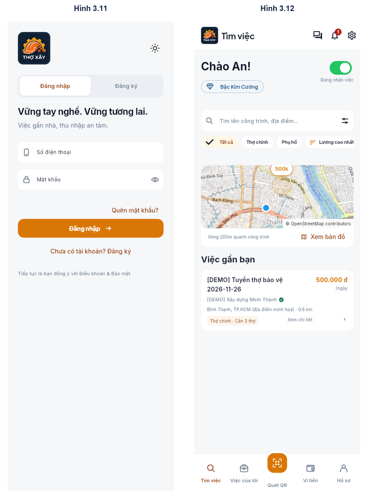

Hình 3.11. Màn hình đăng nhập mới hiển thị logo biểu tượng, hai mục Đăng nhập/Đăng ký, số điện thoại, mật khẩu và liên kết hỗ trợ. Vai trò sau đăng nhập do tài khoản và server xác định; các thẻ chọn vai trò cũ không còn xuất hiện ở màn hình này.

Hình 3.12. Trang tìm việc mới dùng thanh tiêu đề có logo, lời chào và công tắc nhận việc, bộ lọc, bản đồ OSM, thẻ công trình và thanh điều hướng năm mục với QR ở giữa.

### Chi tiết công trình và Việc và chấm công

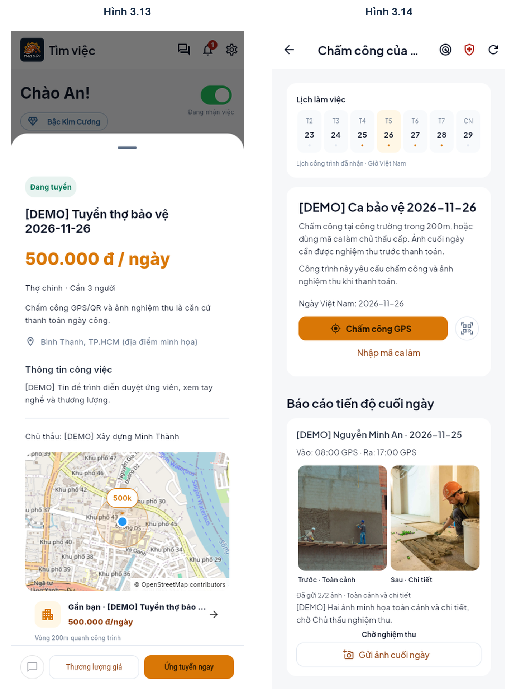

Hình 3.13. Khung chi tiết có vị trí, chỉ đường, mức lương và thương lượng. Thanh ứng tuyển cố định ở đáy; cam kết và quyết định giá vẫn qua kiểm tra server.

Hình 3.14. Lịch tuần, GPS hoặc QR, hai ảnh tổng quan và chi tiết cuối ca, SOS. Quy tắc triển khai giữ GPS 200m, accuracy tối đa 100m và QR hết hạn sau 5 phút.

### Ví của Thợ và Nạp ví VietQR

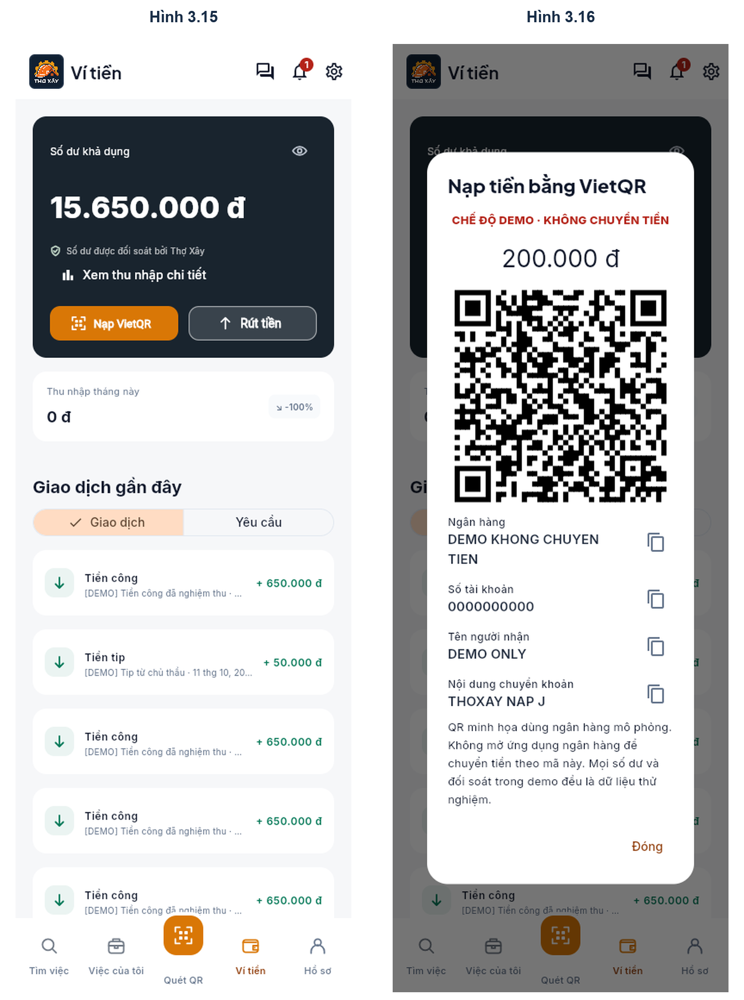

Hình 3.15. Ví hiện tại hiển thị số dư khả dụng, nút ẩn/hiện, Nạp VietQR, Rút tiền, thu nhập tháng và danh sách giao dịch. Thu nhập chi tiết và các ngăn tiền được quản lý theo dữ liệu ví của tài khoản.

Hình 3.16. Chọn nhanh mệnh giá và xem QR do server sinh. Nội dung đối soát phải duy nhất theo yêu cầu, không thay bằng chuỗi tĩnh của bản vẽ; chế độ demo ghi rõ không chuyển tiền thật.

### Hồ sơ của Thợ và Trò chuyện của Thợ

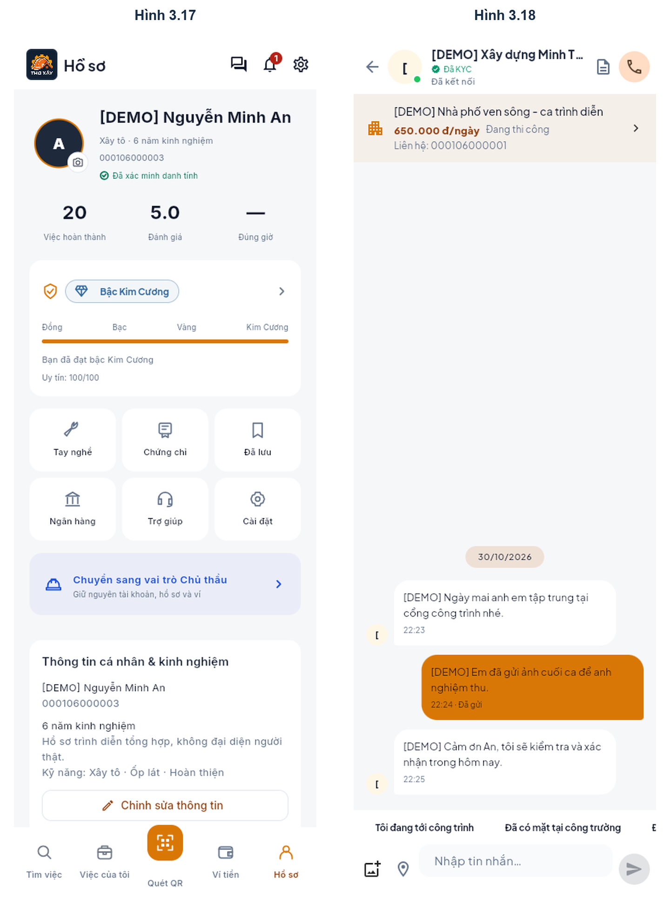

Hình 3.17. Hồ sơ mới hiển thị avatar, số việc hoàn thành, sao, chỉ số đúng giờ khi có dữ liệu, bậc nghề và các tiện ích. Chức năng tay nghề, ngân hàng, trợ giúp và cài đặt được truy cập từ các ô riêng.

Hình 3.18. Bong bóng phân biệt hai phía và thẻ cam kết ghim đầu cuộc trò chuyện. Chỉ cặp đã ACCEPTED có quyền trao đổi; không giả lập trạng thái đã xem từng tin.

### Bảng xếp hạng và Trang chủ Chủ thầu

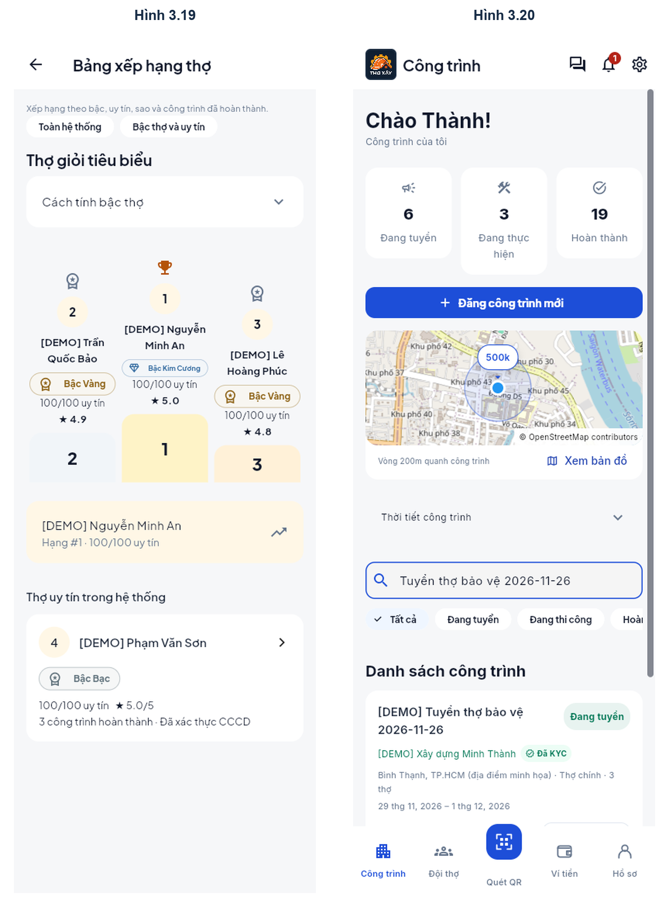

Hình 3.19. Bảng xếp hạng hiện tại dùng dữ liệu API và bộ bậc Đồng, Bạc, Vàng, Kim Cương; podium được tách khỏi bậc nghề của từng thợ.

Hình 3.20. Trang chủ Chủ thầu mới có logo biểu tượng, lời chào, ba ô thống kê, nút Đăng công trình mới màu xanh dương, bản đồ và thanh điều hướng Công trình, Đội thợ, Quét QR, Ví tiền, Hồ sơ.

### Tạo công trình và Duyệt ứng viên

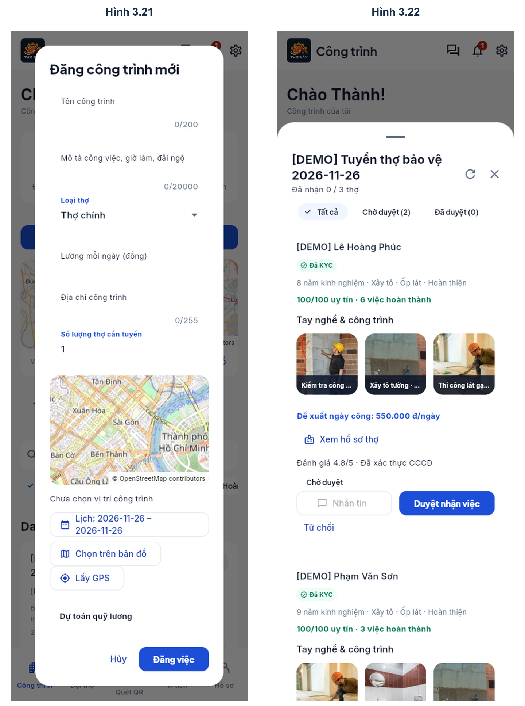

Hình 3.21. Nhập loại thợ, lương, số lượng, lịch và chọn ghim. Hiển thị dự toán quỹ lương; thao tác đăng việc hiện chưa tự khóa ngân sách theo công trình.

Hình 3.22. Lọc trạng thái, xem kinh nghiệm, uy tín, ảnh tay nghề và lương đề xuất. Duyệt nhận vẫn khóa giao dịch để kiểm tra số lượng, lịch và cam kết.

### Nghiệm thu công việc và Ví và chi trả của Chủ thầu

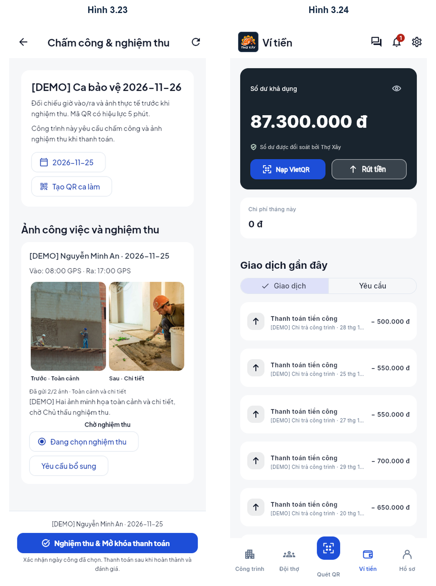

Hình 3.23. Đối chiếu GPS và hai ảnh riêng tư. Chốt sao và hoàn thành trước khi mở thanh toán; công trình có yêu cầu ca và ảnh phải được nghiệm thu theo quy tắc server.

Hình 3.24. Số dư, tài khoản ký quỹ và chi trả tuần từ ledger đang tải. Ký quỹ tài khoản không được trình bày như ngân sách đã khóa cho một công trình riêng.

### Hồ sơ và thợ quen và Trò chuyện của Chủ thầu

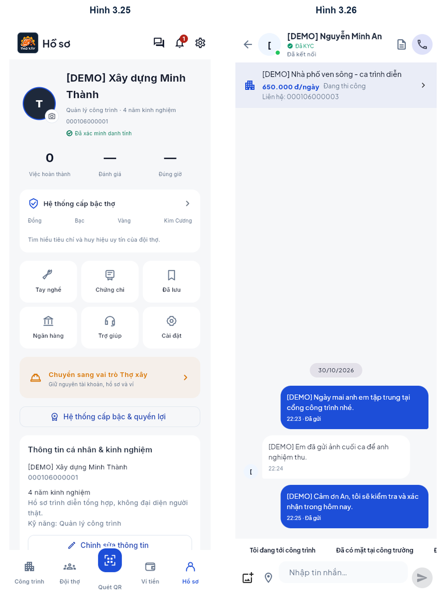

Hình 3.25. Hồ sơ chủ thầu hiện tại dùng logo mới và màu xanh dương, avatar, trạng thái xác minh, các tiện ích và thông tin kinh nghiệm. Quản lý thợ quen và nhóm được truy cập qua mục Đội thợ trong thanh điều hướng.

Hình 3.26. Giao diện chat của chủ thầu dùng màu xanh dương theo vai trò. Lịch sử, tin chưa đọc và quyền tham gia do API và WebSocket hiện tại kiểm soát.

### Phiếu cam kết điện tử và Radar và QR toàn màn hình

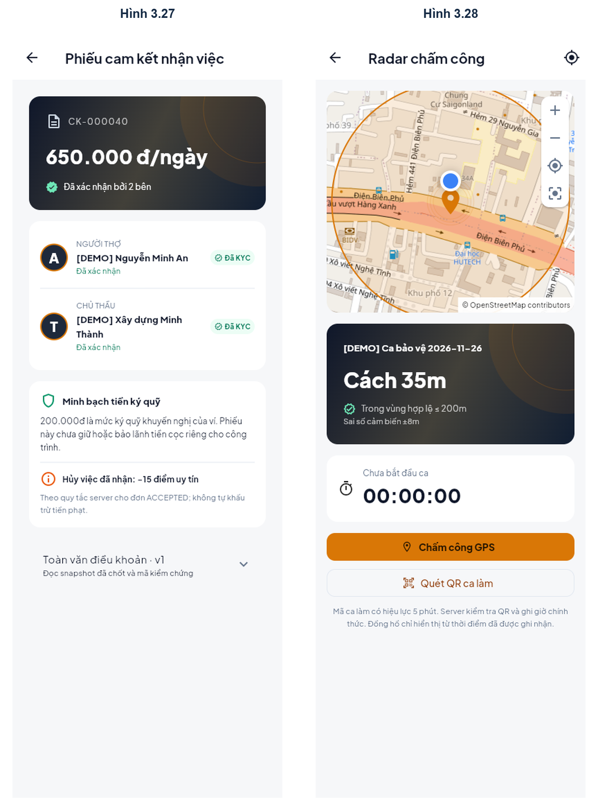

Hình 3.27. Hiển thị mã, mức lương chốt, hai bên và KYC thật, timestamp đồng thuận và snapshot SHA256. Chỉ hiện hai bên xác nhận khi đủ trạng thái FINAL và cả hai timestamp; 200.000đ là khuyến nghị ký quỹ tài khoản, không bảo đảm tiền cọc riêng công trình.

Hình 3.28. Bản đồ OSM, geofence 200m, khoảng cách Haversine, độ chính xác GPS, mở camera QR ca làm 5 phút và đồng hồ theo ca thực; chưa chấm công thì thời gian bằng không.

### Thông báo và xử lý sự cố

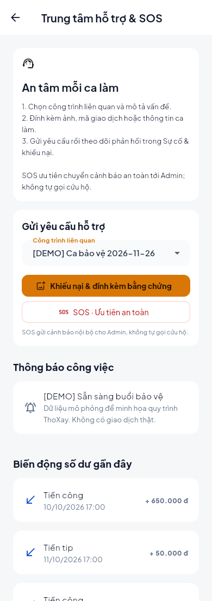

Hiển thị biến động ví và thông báo thật, chọn công trình, gửi SOS hoặc khiếu nại kèm một ảnh bằng chứng riêng tư. SOS ưu tiên cho Admin, không tự gọi cứu hộ.

### Control Center quản trị

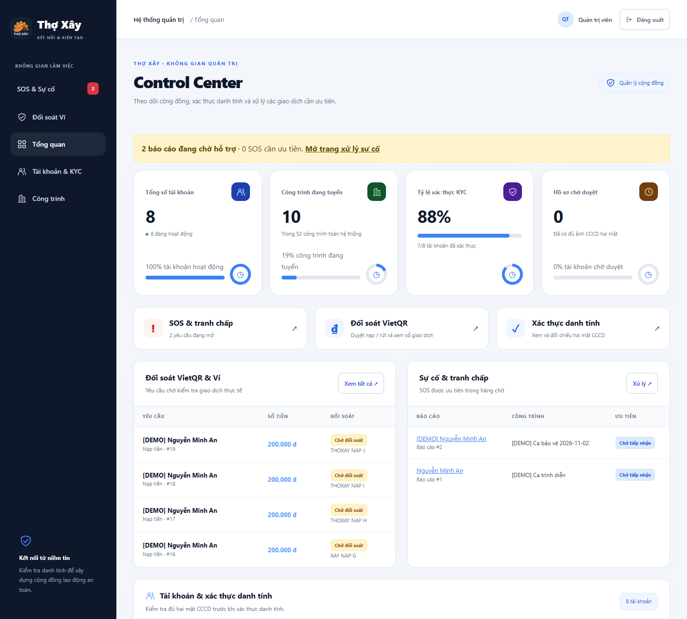

Sidebar Navy, bốn KPI thực với vòng tỷ lệ, hàng đợi KYC hai mặt, đối soát ví và sự cố ưu tiên. Giữ CSRF, ACL ảnh và chống duyệt nhầm snapshot.

Thiết kế phản hồi cần có trạng thái đang tải, dữ liệu rỗng, lỗi kết nối, thành công và xung đột. Khi backend trả 409 vì điều khoản hoặc ảnh đã đổi, giao diện yêu cầu tải lại dữ liệu liên quan; khi phiên hết hiệu lực hoặc tài khoản bị khóa, ứng dụng không tiếp tục hiển thị thao tác như thể phiên vẫn hợp lệ. Những thao tác có ảnh cần xem trước và thông báo tải lên; thao tác ví cần xác nhận số tiền và nội dung đối soát.

# CHƯƠNG 4: CÀI ĐẶT

## 4.1. Giới thiệu tổng quan về công cụ, kỹ thuật, công nghệ sử dụng

Bảng 4.1. Giới thiệu tổng quan về công cụ, kỹ thuật, công nghệ sử dụng

| Công cụ hoặc công nghệ | Phiên bản đối chiếu | Mục đích |
| --- | --- | --- |
| Java / Maven Wrapper | Target Java 17; pom.xml và wrapper của kho | Biên dịch, quản lý phụ thuộc, kiểm thử và đóng gói JAR. |
| Spring Boot | 3.5.16 trong pom.xml | REST/MVC, cấu hình ứng dụng và server nhúng. |
| Spring Data JPA / Hibernate | Do Spring Boot quản lý | ORM, repository và khóa dữ liệu. |
| Spring Security / JJWT | JJWT 0.12.6; Security do Boot quản lý | BCrypt, JWT, session, CSRF và kiểm tra quyền. |
| PostgreSQL / Flyway | PostgreSQL 17 trong cấu hình AWS; migration tới V27 | Lưu dữ liệu quan hệ và quản lý nâng cấp. |
| Thymeleaf / Bootstrap | Bootstrap 5; Thymeleaf theo phụ thuộc Boot | Render trang quản trị và thành phần UI Web. |
| Flutter / Dart | Flutter ghim 3.47.8; Dart constraint ≥3.13.0 <4.0.0 | Giao diện chung cho các nền tảng được cấu hình. |
| http / shared_preferences | Theo pubspec và pubspec.lock | Gọi HTTP và lưu tùy chọn/trạng thái cục bộ. |
| geolocator / flutter_map / latlong2 | Theo pubspec.lock | GPS, bản đồ và tọa độ. |
| image_picker / mobile_scanner / qr_flutter | Theo pubspec.lock | Ảnh, quét QR và hiển thị QR. |
| WebSocket / Firebase Admin | web_socket_channel; firebase-admin 9.11.0 | Sự kiện chat và thông báo đẩy khi cấu hình. |
| Git / GitHub Actions | Cấu hình workflow trong kho | Lịch sử mã, kiểm tra và artifact triển khai. |
| Vercel / EC2 / Nginx / Docker | Ubuntu 24.04; cấu hình deploy/aws | Phục vụ Flutter Web, API/Admin và PostgreSQL. |

### Tổ chức mã nguồn

Backend nằm ở thư mục gốc, mã Java trong src/main/java/vn/thoxay; template Admin trong src/main/resources/templates; cấu hình và migration trong src/main/resources. Mobile nằm trong mobile_app với các thư mục models, services, screens, widgets và theme. Kiểm thử backend nằm trong src/test; kiểm thử Flutter trong mobile_app/test. Cấu hình triển khai AWS nằm trong deploy/aws, workflow nằm trong .github/workflows.

Mã nguồn không đặt mật khẩu database, khóa JWT và tệp Firebase riêng vào báo cáo. .env.example mô tả tên biến cần cấu hình; .local chứa cấu hình và artifact cục bộ đã được loại khỏi Git. Báo cáo và tài liệu bảo vệ được tạo thủ công theo yêu cầu; không đưa việc sinh tài liệu vào build, test hoặc Git hook của ứng dụng.

### Kỹ thuật bảo mật và xử lý đồng thời

Mật khẩu được băm BCrypt. API sử dụng JWT và session stateless; Web Admin sử dụng session cùng cơ chế CSRF. Service kiểm tra vai trò và chủ sở hữu ngay trước hành vi nghiệp vụ. security_version hỗ trợ thu hồi hiệu lực phiên theo thay đổi bảo mật; trạng thái active được kiểm tra để chặn tài khoản bị khóa dùng token cũ.

Khóa PESSIMISTIC_WRITE được dùng cho công trình trong các thao tác cạnh tranh. Nhiều worker được khóa theo thứ tự ID khi duyệt nhóm hoặc tính lại điểm. Dịch vụ ví khóa dữ liệu liên quan, kiểm tra số dư và ghi sổ cùng giao dịch. Các snapshot và trường version được dùng tại nơi việc thay dữ liệu giữa lúc xem và xác nhận có thể dẫn đến quyết định sai.

Ảnh nhạy cảm được kiểm tra, chuẩn hóa và lưu trong các bảng riêng. Khi tải ảnh, endpoint kiểm tra quyền theo người dùng hoặc quan hệ công việc. Admin chỉ tải CCCD khi mở modal, cần tải thành công hai mặt mới cho xác thực, gửi kèm hai URL đã xem và xóa src khi đóng. Cơ chế này giảm tình huống xác thực dựa vào ảnh cũ; nó không thay thế quy trình eKYC chuyên nghiệp.

### Chạy và kiểm tra ứng dụng

Môi trường phát triển cần Java 17 trở lên, Flutter theo phiên bản ghim và PostgreSQL. Maven Wrapper dùng để biên dịch và kiểm thử backend. Script start-local.ps1 hỗ trợ khởi động local theo README; thông tin kết nối database và JWT được truyền qua biến môi trường hoặc cấu hình cục bộ. Flutter nhận API_BASE_URL ở thời điểm build/run, không thêm /api vào cuối origin vì các endpoint đã có tiền tố này.

Các lệnh kiểm tra ứng dụng gồm .\mvnw.cmd verify, flutter analyze, flutter test và flutter build web --release. Kiểm thử bản đồ dùng TileProvider giả trong bộ nhớ để tránh phụ thuộc tải tile mạng. Kiểm thử tích hợp PostgreSQL cần điều kiện môi trường riêng; việc bị skip phải được ghi rõ thay vì tính như đã chạy thành công. Trong tác vụ biên soạn này không thay đổi ứng dụng nên không chạy lại bộ build/test để tạo số liệu mới.

## 4.2. Các chức năng đã cài đặt được

### Kết quả theo nhóm chức năng

Bảng 4.2. Kết quả theo nhóm chức năng

| Yêu cầu | Use Case | Mã nguồn tiêu biểu | Kết quả và minh họa |
| --- | --- | --- | --- |
| F01–F02 | UC01–UC02 | AuthService, AccountSettingsService, UserProfileController, KycService, UserAvatarService | Đăng ký/đăng nhập/hồ sơ; Hình 3.11 và 3.17. |
| F03–F04 | UC03–UC04 | JobService, JobRepository; worker_home_screen, contractor_home_screen | Đăng việc, bản đồ, tìm gần; Hình 3.12, 3.20, 3.21. |
| F05–F07 | UC05–UC07 | ApplicationService, CommitmentService, CrewService, WorkerCalendarService | Ứng tuyển, duyệt, cam kết, lịch; Hình 3.13, 3.22, 3.27. |
| F08 | UC08 | MessageService, ChatInboxService, NotificationService | Chat chữ/ảnh/GPS, hộp thư; Hình 3.18, 3.26. |
| F09–F10 | UC09–UC10 | AttendanceService; WorkLog; AttendanceController | GPS/QR, ảnh và nghiệm thu; Hình 3.14, 3.23, 3.28. |
| F11 | UC11 | JobCompletionService, WorkerRatingService, ReputationService, WorkerTier | Hoàn thành, sao, uy tín và bậc; Hình 3.17, 3.19. |
| F12 | UC12 | WalletService, JobPaymentService, BankSettingsService | Ví, ký quỹ, VietQR, chi trả; Hình 3.15, 3.16, 3.24. |
| F13 | UC13 | AdminService; admin controllers và templates | KYC, khóa tài khoản, quản lý; Hình 3.30. |
| F14 | UC14 | IncidentService, IncidentEvidence, IncidentAudit | Sự cố/SOS và phản hồi; Hình 3.29. |

### Một số quy tắc cài đặt đáng chú ý

Quy tắc duyệt nhận có thể quan sát trong ApplicationService: service khóa công trình, kiểm tra quyền chủ thầu, khóa worker, kiểm tra lịch và cam kết rồi mới cập nhật trạng thái. Công trình có trạng thái IN_PROGRESS vẫn có thể nhận người thay thế khi số ACCEPTED chưa đủ. Đây là khác biệt cần giữ so với mô tả ban đầu chỉ tìm công trình OPEN.

Quy tắc đánh giá được cài trong JobCompletionService và WorkerRatingService. Bộ điểm phải khớp tập thợ đã nhận; điểm cũ không bị thay đổi bởi một lần gửi lại khác nội dung. Khi Admin xóa công trình có đánh giá, trung bình của các thợ liên quan được tính lại từ dữ liệu còn lại. Điểm sao trung bình và điểm uy tín là hai đại lượng khác nhau; bậc thợ kết hợp nhiều điều kiện.

Theo WorkerTier hiện tại, BRONZE là bậc khởi đầu; SILVER yêu cầu uy tín ít nhất 60, ít nhất một công trình hoàn thành và sao ít nhất 3,0; GOLD yêu cầu 80 điểm, năm công trình và 4,0 sao; DIAMOND yêu cầu 95 điểm, 20 công trình, 4,7 sao và KYC. Các điều kiện là logic sản phẩm trong mã nguồn, không phải chứng chỉ nghề nghiệp được cấp bởi cơ quan bên ngoài.

Chấm công GPS yêu cầu trong 200 m quanh công trình và accuracy không quá 100 m, hoặc dùng mã QR ca làm còn hiệu lực 300 giây. Mỗi đơn/ngày có một bản ghi; ca qua đêm chưa được hỗ trợ như một ca liên tục. Báo cáo ảnh APPROVED không được sửa. Thanh toán kiểm tra số ngày khớp toàn bộ ca đã check-out và ảnh được nghiệm thu đối với công trình áp dụng chấm công.

Ví chia ba ngăn main, escrow và held. Chuyển vào ký quỹ chỉ di chuyển giữa các ngăn, không tạo thu nhập. Mốc 200.000 đồng là cảnh báo ký quỹ trong ứng dụng, chưa phải khoản bảo đảm cho từng công trình và chưa có cơ chế tự phạt tiền khi hủy. Yêu cầu nạp được Admin duyệt sau đối soát; hiển thị QR không tự chứng minh đã nhận tiền.

### Đối chiếu kiểm thử và giới hạn bằng chứng

Bảng 4.3. Đối chiếu kiểm thử và giới hạn bằng chứng

| Bằng chứng | Thời điểm được ghi nhận | Kết quả và cách hiểu |
| --- | --- | --- |
| Maven verify trong biên bản cập nhật | 25/11/2026 | 159 bài được báo cáo: 156 đạt, 3 bỏ qua; không có thất bại/lỗi. Ba bài tích hợp PostgreSQL chưa chạy. |
| flutter test trong biên bản cập nhật | 26/11/2026 | 281 đạt, 2 chưa đạt tại server_warmup_test.dart; không tuyên bố toàn bộ Flutter test thành công. |
| 20 PNG giao diện mới và manifest | 26/11/2026 UTC | Ảnh chạy localhost DEMO; có file, hash và viewport. Không phải ảnh thiết bị thật tại ngày soạn. |
| Chuyển triển khai AWS theo README | 25–26/11/2026 | Có cấu hình EC2/Nginx/PostgreSQL và biên bản chuyển dữ liệu; phiên này không đo lại dịch vụ online. |
| Kiểm tra bản báo cáo này | Trong tác vụ biên soạn | Kiểm tra cấu trúc, hình nhúng, từ điển dữ liệu, tham chiếu và kết xuất trang. Không tính là test ứng dụng. |

Những kết quả trên được dẫn lại từ biên bản cập nhật trong kho; tác vụ soạn báo cáo không thực thi lại các bộ test ứng dụng. Số bài pass không phải tỷ lệ bao phủ mã nguồn và không chứng minh sản phẩm đã được nghiệm thu ở mọi thiết bị. Các ảnh demo chứng minh màn hình và dữ liệu minh họa tại lần chụp; trạng thái hạ tầng hiện tại được đối chiếu từ cấu hình triển khai, không phải từ một phép đo uptime trong phiên này.

Các nhóm kiểm thử hiện diện trong kho bao gồm đăng nhập, khóa tài khoản, quyền truy cập, tuyển dụng, lịch–cam kết, đánh giá, ví–đối soát, chấm công, chat, hồ sơ, bản đồ, ảnh và trạng thái kết nối. Những kiểm thử cần ưu tiên chạy trước khi bàn giao bản cài đặt tiếp theo là các trường hợp server warmup chưa đạt được ghi trong biên bản, tích hợp PostgreSQL, cạnh tranh chỗ tuyển cuối và ghi lặp thanh toán trên môi trường tương ứng.

## 4.3. Kết luận

Hệ thống đã có mã nguồn cho các nhóm nghiệp vụ chính từ đăng ký, đăng việc, tìm việc và ứng tuyển đến cam kết, ca làm, nghiệm thu, đánh giá và sổ ví. Thiết kế Flutter–Spring Boot–PostgreSQL cho phép dùng chung một backend cho ứng dụng và trang quản trị. Các ràng buộc quyền sở hữu, khóa giao dịch, snapshot và idempotency giải quyết những tình huống sai lệch dữ liệu quan trọng của bài toán.

Kết quả cài đặt cần được đánh giá trong phạm vi bằng chứng hiện có. Một số dịch vụ còn phụ thuộc cấu hình thực tế như Firebase và ngân hàng; kiểm thử thiết bị, tải lớn, khôi phục dữ liệu và các ca nghiệp vụ mở rộng chưa đủ để tuyên bố sản phẩm sẵn sàng vận hành thương mại. Chương này xác nhận phần đã có trong mã và ghi rõ các giới hạn thay vì xem toàn bộ hạng mục là đã nghiệm thu.

# KẾT LUẬN VÀ HƯỚNG PHÁT TRIỂN

## Những kết quả đã đạt được của đề tài

Đề tài đã hình thành một mô hình dữ liệu thống nhất cho người dùng, công trình và đơn ứng tuyển, cùng các phân hệ hỗ trợ vòng đời làm việc. Ứng dụng Flutter có các màn hình cho thợ và chủ thầu; Web Admin cung cấp công cụ quản lý hồ sơ, công trình, đối soát ví và sự cố. Backend áp dụng phân quyền, kiểm tra trạng thái và giao dịch để bảo vệ các quyết định nghiệp vụ.

Những kết quả kỹ thuật có thể đối chiếu trực tiếp gồm tìm việc theo khoảng cách Haversine; duyệt nhận có kiểm tra công suất và lịch; đóng băng lương và cam kết; hồ sơ CCCD hai mặt có kiểm tra snapshot; chấm công GPS/QR; nghiệm thu ảnh theo version; tính sao từ công trình hoàn thành; và sổ ví có cơ chế chống ghi lặp. Mô hình 34 bảng nghiệp vụ được mô tả bằng ERD và từ điển đầy đủ, liên kết với các Use Case và màn hình trong báo cáo.

Đề tài cũng xây dựng được nền tảng kiểm chứng qua kiểm thử tự động, cấu hình chạy local và bộ triển khai AWS. Giá trị của kết quả nằm ở khả năng mở mã để giải thích hành vi và tái hiện các điều kiện, không ở các số liệu hiệu quả kinh doanh chưa được đo.

## Hạn chế

- Chưa có khảo sát người dùng đủ mẫu và thử nghiệm thực địa dài hạn để lượng hóa hiệu quả kết nối hoặc giảm tranh chấp.
- GPS có thể bị giả lập; accuracy và geofence chỉ kiểm tra dữ liệu vị trí được gửi, chưa tạo bằng chứng hiện diện tuyệt đối. Ca qua đêm chưa được hỗ trợ đầy đủ.
- KYC hiện cần quản trị viên xem xét; chưa có kiểm tra giấy tờ và liveness từ nhà cung cấp eKYC. Cam kết trong ứng dụng chưa có quy trình ký số được chứng thực.
- Ví và VietQR còn cần đối soát thủ công; chưa có kết nối ngân hàng tự động được nghiệm thu. SOS là hàng chờ hỗ trợ nội bộ.
- Thông báo FCM phụ thuộc cấu hình Firebase và thiết bị. Bản Web và ảnh demo chưa thay thế kiểm thử camera/GPS/push trên Android và iOS thực.
- Biên bản kiểm thử gần nhất còn ghi hai trường hợp Flutter chưa đạt và ba bài tích hợp PostgreSQL bỏ qua; chưa có bằng chứng tải lớn, đánh giá xâm nhập hoặc diễn tập phục hồi toàn hệ thống.
- Backend và database cùng VPS tạo một điểm lỗi chung; tên miền theo IP cần được ổn định cho triển khai lâu dài. Quy trình lưu giữ, xóa và phân quyền vận hành dữ liệu nhạy cảm cần hoàn thiện trước khi mở rộng sử dụng.

## Hướng phát triển

Ưu tiên ngắn hạn là xử lý các kiểm thử chưa đạt, chạy các bài PostgreSQL còn bỏ qua trong môi trường thích hợp và nghiệm thu luồng end-to-end trên thiết bị thật. Cần kiểm tra có hệ thống các tình huống mất mạng, gửi lại yêu cầu, thay ảnh khi đang duyệt và cạnh tranh nhiều yêu cầu cùng lúc. Song song, bổ sung theo dõi lỗi, cảnh báo, sao lưu ngoài VPS và diễn tập phục hồi.

Ở giai đoạn tiếp theo, hệ thống có thể hỗ trợ ca qua đêm, quy tắc thời gian linh hoạt hơn và chính sách xử lý tranh chấp rõ ràng. Tích hợp eKYC, xác thực thiết bị hoặc chữ ký điện tử cần được thiết kế như dự án riêng, có tiêu chí nghiệm thu và quản lý dữ liệu phù hợp. Đối soát ngân hàng tự động cần webhook đáng tin cậy, kiểm tra chữ ký, chống lặp và quy trình xử lý sai lệch trước khi thay thế quyết định thủ công.

Khi lượng dữ liệu tăng, có thể đánh giá PostGIS và chỉ mục không gian cho tìm việc, chuyển ảnh sang kho đối tượng có URL có thời hạn, phân trang nhất quán và tối ưu truy vấn dựa trên số đo. Việc tách database khỏi VPS hoặc mở rộng thành nhiều thành phần chỉ nên thực hiện khi có nhu cầu và số liệu vận hành, đồng thời giữ nguyên các đảm bảo transaction hiện tại.

Về trải nghiệm, cần thử nghiệm với thợ và chủ thầu trong các điều kiện ánh sáng, đường truyền và kỹ năng sử dụng điện thoại khác nhau; cải thiện khả năng đọc, hướng dẫn lỗi và thao tác bằng một tay. Các cải tiến nên được đánh giá bằng tỷ lệ hoàn tất tác vụ và phản hồi người dùng được thu thập có phương pháp.

# TÀI LIỆU THAM KHẢO VÀ NGUỒN ĐỐI CHIẾU

[S1] AGENTS.md. Yêu cầu, kiến trúc và quy tắc nghiệp vụ của đồ án Thợ Xây. Đối chiếu trong kho mã ngày 26/11/2026.

[S2] README.md; pom.xml; .flutter-version; mobile_app/pubspec.yaml và pubspec.lock. Phạm vi sản phẩm, phiên bản, cách chạy và triển khai.

[S3] src/main/java/vn/thoxay/entity; repository/JobRepository.java; service/JobService.java; ApplicationService.java; ApplicationCancellationService.java; scheduling và crew. Mô hình tuyển dụng, lịch và cam kết.

[S4] service/JobCompletionService.java; WorkerRatingService.java; ReputationService.java; entity/WorkerTier.java; attendance/AttendanceService.java. Hoàn thành, sao, bậc, chấm công và nghiệm thu.

[S5] wallet; security; admin; kyc; media; chat và incident trong src/main/java/vn/thoxay. Ví, quyền, KYC, ảnh, trao đổi và xử lý sự cố.

[S6] docs/PROJECT_INVENTORY.json; schema.sql; src/main/resources/db/migration/V24__account_settings.sql, V25__user_avatars.sql, V26__bronze_worker_tier.sql, V27__contractor_team_groups.sql; các entity hiện tại. Nguồn từ điển dữ liệu gồm catalog V23 và thay đổi đến V27.

[S7] deploy/aws/README.md; nginx.conf.template và các script, cấu hình triển khai trong deploy/aws; README.md. Nguồn sơ đồ triển khai tại checkpoint. Không truy cập bí mật trong tệp môi trường.

[S8] docs/giao_dien_hien_tai_20261126/manifest.json và 20 PNG đi kèm. Ảnh được chụp mới ngày 26/11/2026 từ localhost DEMO bằng bản build mã nguồn hiện tại; GPS phục vụ minh họa được mô phỏng trong trình duyệt.

[S9] docs/CAP_NHAT_BAO_CAO_2026_11_26.md; TESTING.md; src/test và mobile_app/test. Nguồn kết quả kiểm thử lịch sử và phạm vi kiểm tra. Phiên biên soạn không chạy lại bộ test ứng dụng.

[S10] Các sơ đồ mới trong docs/bao_cao_hinh do người biên soạn dựng từ mã nguồn cho báo cáo này. Sơ đồ là mô hình diễn giải ở mức được chú thích, không phải ảnh tự sinh trực tiếp từ database production.
