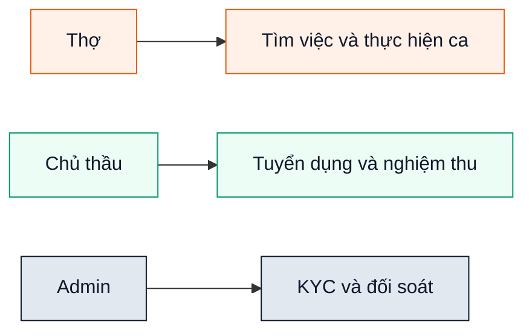
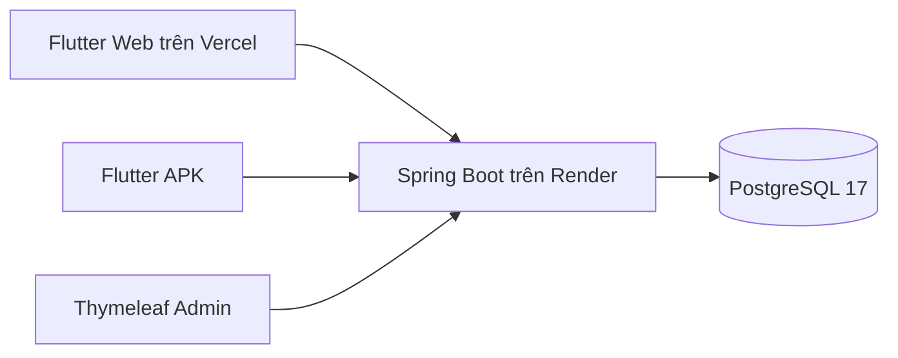
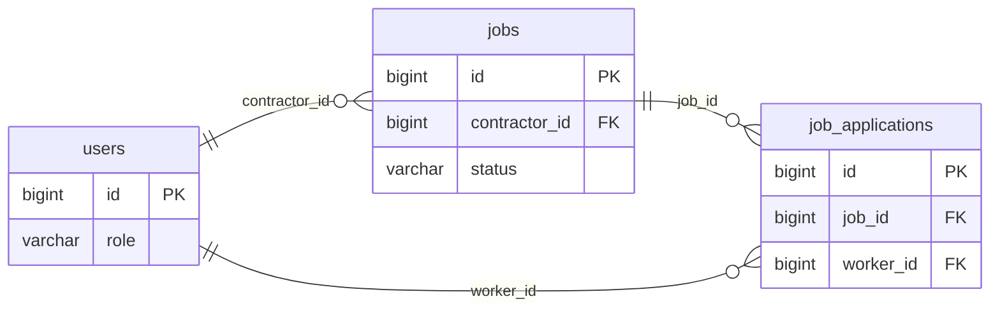

# Sơ đồ rút gọn cho trình chiếu

Các hình này chỉ rút gọn phạm vi trình bày; báo cáo chính giữ đủ 30 bảng và toàn bộ chức năng.

<!-- diagram:slide-use-case -->

<!-- diagram:slide-architecture -->

<!-- diagram:slide-erd -->

